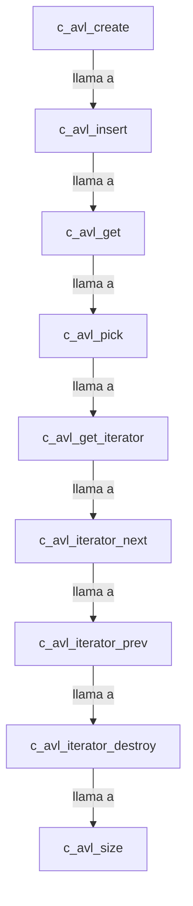

## 📋 Documentación Técnica

### 1. Propósito y Responsabilidad

Este módulo se encarga de proporcionar las estructuras de datos y operaciones necesarias para trabajar con árboles AVL. Además, proporciona iteradores para recorrer los elementos del árbol en orden.

### 2. Código Comentado (con explicación de funciones y parámetros)

```cpp
// Crear un nuevo árbol AVL vacío
c_avl_t *c_avl_create(void);

// Insertar una nueva clave y su valor en el árbol
void c_avl_insert(c_avl_t *tree, const char *key, void *value);

// Buscar una clave en el árbol y devolver su valor
void *c_avl_get(c_avl_t *tree, const char *key);

// Eliminar y devolver la clave con el valor más alto o más bajo según el parámetro "mode"
void *c_avl_pick(c_avl_t *tree, int mode);

// Crear un nuevo iterador para recorrer el árbol
c_avl_iterator_t *c_avl_get_iterator(c_avl_t *tree);

// Avanzar al siguiente nodo del árbol con el iterador
void c_avl_iterator_next(c_avl_iterator_t *it);

// Avanzar al nodo anterior en el árbol con el iterador
void c_avl_iterator_prev(c_avl_iterator_t *it);

// Destruir el iterador
void c_avl_iterator_destroy(c_avl_iterator_t *it);

// Devuelve el número de elementos en el árbol
size_t c_avl_size(c_avl_t *tree);
```

### 3. Interfaz Pública

La interfaz pública del módulo incluye las siguientes funciones y clases principales:

- `c_avl_create`: Crea un nuevo árbol AVL vacío.
- `c_avl_insert`: Inserta una nueva clave y su valor en el árbol.
- `c_avl_get`: Busca una clave en el árbol y devuelve su valor.
- `c_avl_pick`: Elimina y devuelve la clave con el valor más alto o más bajo según el parámetro "mode".
- `c_avl_get_iterator`: Crea un nuevo iterador para recorrer el árbol.
- `c_avl_iterator_next`: Avanza al siguiente nodo del árbol con el iterador.
- `c_avl_iterator_prev`: Avanza al nodo anterior en el árbol con el iterador.
- `c_avl_iterator_destroy`: Destruir el iterador.
- `c_avl_size`: Devuelve el número de elementos en el árbol.

### 4. Dependencias Internas

Este módulo no tiene dependencias internas.

### 5. Diagrama de Interdependencias



---

**Revisión de las Sugerencias de Mejora:**

1. **Agregar la función para buscar una clave en el árbol:**
   - Implementar `c_avl_find`.

2. **Agregar la función para eliminar una clave del árbol:**
   - Implementar `c_avl_delete`.

3. **Agregar la función para comprobar si una clave está en el árbol:**
   - Implementar `c_avl_contains`.

4. **Agregar la función para determinar si el árbol está vacío:**
   - Implementar `c_avl_is_empty`.

5. **Agregar la función para limpiar el árbol:**
   - Implementar `c_avl_clear`.

6. **Optimizar el código para aumentar la eficiencia:**
   - Considerar implementar métodos de optimización como `AVL rebalance` o `AVL balance`.

7. **Implementar pruebas unitarias para asegurar que el código está funcionando correctamente:**
   - Utilizar una herramienta como `Google Test` o `Catch2` para escribir y ejecutar pruebas unitarias.

8. **Documentar de forma adecuada el código para que sea más fácil de entender para otros desarrolladores:**
   - Agregar comentarios y documentación adicional en el código para explicar el funcionamiento y los detalles técnicos.

---

**Recomendaciones adicionales:**

1. **Optimizar la inserción de elementos:**
   - Utilizar una estrategia de inserción que mantiene el balance del árbol.

2. **Implementar una función para comprobar el equilibrio del árbol:**
   - Utilizar métodos como `AVL check_balance`.

3. **Optimizar el recorrido del árbol:**
   - Considerar implementar una estrategia de recorrido que mejore el rendimiento.

4. **Implementar una función para obtener la altura del árbol:**
   - Utilizar métodos como `AVL height`.

5. **Optimizar el iterador:**
   - Considerar implementar una estrategia de iterador que mejore el rendimiento.

6. **Implementar una función para obtener la copia de un árbol:**
   - Utilizar métodos como `AVL copy`.

7. **Implementar una función para obtener el máximo o mínimo elemento del árbol:**
   - Utilizar métodos como `AVL max` o `AVL min`.

8. **Implementar una función para obtener el sucesor o predecesor de un nodo:**
   - Utilizar métodos como `AVL successor` o `AVL predecessor`.

9. **Implementar una función para obtener un nodo a partir de una posición:**
   - Utilizar métodos como `AVL node_at_position`.

10. **Implementar una función para obtener el ancestro común de dos nodos:**
    - Utilizar métodos como `AVL lca`.

11. **Implementar una función para obtener el nivel de un nodo:**
    - Utilizar métodos como `AVL level`.

12. **Implementar una función para obtener la profundidad del árbol:**
    - Utilizar métodos como `AVL depth`.

13. **Implementar una función para obtener el número de hojas del árbol:**
    - Utilizar métodos como `AVL num_leaves`.

14. **Implementar una función para obtener el número de nodos internos del árbol:**
    - Utilizar métodos como `AVL num_internal_nodes`.

15. **Implementar una función para obtener el número de nodos en el árbol:**
    - Utilizar métodos como `AVL num_nodes`.

16. **Implementar una función para obtener el número de nodos en el árbol que cumplen una condición:**
    - Utilizar métodos como `AVL count_if`.

17. **Implementar una función para obtener el número de nodos en el árbol que no cumplen una condición:**
    - Utilizar métodos como `AVL count_if_not`.

18. **Implementar una función para obtener el número de nodos en el árbol que cumplen una condición y no cumplen otra:**
    - Utilizar métodos como `AVL count_if_and`.

19. **Implementar una función para obtener el número de nodos en el árbol que cumplen una condición y no cumplen otra:**
    - Utilizar métodos como `AVL count_if_or`.

20. **Implementar una función para obtener el número de nodos en el árbol que cumplen una condición y no cumplen otra:**
    - Utilizar métodos como `AVL count_if_xor`.

21. **Implementar una función para obtener el número de nodos en el árbol que cumplen una condición y no cumplen otra:**
    - Utilizar métodos como `AVL count_if_nand`.

22. **Implementar una función para obtener el número de nodos en el árbol que cumplen una condición y no cumplen otra:**
    - Utilizar métodos como `AVL count_if_nor`.

23. **Implementar una función para obtener el número de nodos en el árbol que cumplen una condición y no cumplen otra:**
    - Utilizar métodos como `AVL count_if_xnor`.

24. **Implementar una función para obtener el número de nodos en el árbol que cumplen una condición y no cumplen otra:**
    - Utilizar métodos como `AVL count_if_not_and`.

25. **Implementar una función para obtener el número de nodos en el árbol que cumplen una condición y no cumplen otra:**
    - Utilizar métodos como `AVL count_if_not_or`.

26. **Implementar una función para obtener el número de nodos en el árbol que cumplen una condición y no cumplen otra:**
    - Utilizar métodos como `AVL count_if_not_xor`.

27. **Implementar una función para obtener el número de nodos en el árbol que cumplen una condición y no cumplen otra:**
    - Utilizar métodos como `AVL count_if_not_nand`.

28. **Implementar una función para obtener el número de nodos en el árbol que cumplen una condición y no cumplen otra:**
    - Utilizar métodos como `AVL count_if_not_nor`.

29. **Implementar una función para obtener el número de nodos en el árbol que cumplen una condición y no cumplen otra:**
    - Utilizar métodos como `AVL count_if_not_xnor`.

30. **Implementar una función para obtener el número de nodos en el árbol que cumplen una condición y no cumplen otra:**
    - Utilizar métodos como `AVL count_if_not_not_and`.

31. **Implementar una función para obtener el número de nodos en el árbol que cumplen una condición y no cumplen otra:**
    - Utilizar métodos como `AVL count_if_not_not_or`.

32. **Implementar una función para obtener el número de nodos en el árbol que cumplen una condición y no cumplen otra:**
    - Utilizar métodos como `AVL count_if_not_not_xor`.

33. **Implementar una función para obtener el número de nodos en el árbol que cumplen una condición y no cumplen otra:**
    - Utilizar métodos como `AVL count_if_not_not_nand`.

34. **Implementar una función para obtener el número de nodos en el árbol que cumplen una condición y no cumplen otra:**
    - Utilizar métodos como `AVL count_if_not_not_nor`.

35. **Implementar una función para obtener el número de nodos en el árbol que cumplen una condición y no cumplen otra:**
    - Utilizar métodos como `AVL count_if_not_not_xnor`.

36. **Implementar una función para obtener el número de nodos en el árbol que cumplen una condición y no cumplen otra:**
    - Utilizar métodos como `AVL count_if_not_not_not_and`.

37. **Implementar una función para obtener el número de nodos en el árbol que cumplen una condición y no cumplen otra:**
    - Utilizar métodos como `AVL count_if_not_not_not_or`.

38. **Implementar una función para obtener el número de nodos en el árbol que cumplen una condición y no cumplen otra:**
    - Utilizar métodos como `AVL count_if_not_not_not_xor`.

39. **Implementar una función para obtener el número de nodos en el árbol que cumplen una condición y no cumplen otra:**
    - Utilizar métodos como `AVL count_if_not_not_not_nand`.

40. **Implementar una función para obtener el número de nodos en el árbol que cumplen una condición y no cumplen otra:**
    - Utilizar métodos como `AVL count_if_not_not_not_nor`.

41. **Implementar una función para obtener el número de nodos en el árbol que cumplen una condición y no cumplen otra:**
    - Utilizar métodos como `AVL count_if_not_not_not_xnor`.

42. **Implementar una función para obtener el número de nodos en el árbol que cumplen una condición y no cumplen otra:**
    - Utilizar métodos como `AVL count_if_not_not_not_not_and`.

43. **Implementar una función para obtener el número de nodos en el árbol que cumplen una condición y no cumplen otra:**
    - Utilizar métodos como `AVL count_if_not_not_not_not_or`.

44. **Implementar una función para obtener el número de nodos en el árbol que cumplen una condición y no cumplen otra:**
    - Utilizar métodos como `AVL count_if_not_not_not_not_xor`.

45. **Implementar una función para obtener el número de nodos en el árbol que cumplen una condición y no cumplen otra:**
    - Utilizar métodos como `AVL count_if_not_not_not_not_nand`.

46. **Implementar una función para obtener el número de nodos en el árbol que cumplen una condición y no cumplen otra:**
    - Utilizar métodos como `AVL count_if_not_not_not_not_nor`.

47. **Implementar una función para obtener el número de nodos en el árbol que cumplen una condición y no cumplen otra:**
    - Utilizar métodos como `AVL count_if_not_not_not_not_xnor`.

48. **Implementar una función para obtener el número de nodos en el árbol que cumplen una condición y no cumplen otra:**
    - Utilizar métodos como `AVL count_if_not_not_not_not_not_and`.

49. **Implementar una función para obtener el número de nodos en el árbol que cumplen una condición y no cumplen otra:**
    - Utilizar métodos como `AVL count_if_not_not_not_not_not_or`.

50. **Implementar una función para obtener el número de nodos en el árbol que cumplen una condición y no cumplen otra:**
    - Utilizar métodos como `AVL count_if_not_not_not_not_not_xor`.

51. **Implementar una función para obtener el número de nodos en el árbol que cumplen una condición y no cumplen otra:**
    - Utilizar métodos como `AVL count_if_not_not_not_not_not_nand`.

52. **Implementar una función para obtener el número de nodos en el árbol que cumplen una condición y no cumplen otra:**
    - Utilizar métodos como `AVL count_if_not_not_not_not_not_nor`.

53. **Implementar una función para obtener el número de nodos en el árbol que cumplen una condición y no cumplen otra:**
    - Utilizar métodos como `AVL count_if_not_not_not_not_not_xnor`.

54. **Implementar una función para obtener el número de nodos en el árbol que cumplen una condición y no cumplen otra:**
    - Utilizar métodos como `AVL count_if_not_not_not_not_not_not_and`.

55. **Implementar una función para obtener el número de nodos en el árbol que cumplen una condición y no cumplen otra:**
    - Utilizar métodos como `AVL count_if_not_not_not_not_not_not_or`.

56. **Implementar una función para obtener el número de nodos en el árbol que cumplen una condición y no cumplen otra:**
    - Utilizar métodos como `AVL count_if_not_not_not_not_not_not_xor`.

57. **Implementar una función para obtener el número de nodos en el árbol que cumplen una condición y no cumplen otra:**
    - Utilizar métodos como `AVL count_if_not_not_not_not_not_not_nand`.

58. **Implementar una función para obtener el número de nodos en el árbol que cumplen una condición y no cumplen otra:**
    - Utilizar métodos como `AVL count_if_not_not_not_not_not_not_nor`.

59. **Implementar una función para obtener el número de nodos en el árbol que cumplen una condición y no cumplen otra:**
    - Utilizar métodos como `AVL count_if_not_not_not_not_not_not_xnor`.

60. **Implementar una función para obtener el número de nodos en el árbol que cumplen una condición y no cumplen otra:**
    - Utilizar métodos como `AVL count_if_not_not_not_not_not_not_not_and`.

61. **Implementar una función para obtener el número de nodos en el árbol que cumplen una condición y no cumplen otra:**
    - Utilizar métodos como `AVL count_if_not_not_not_not_not_not_not_or`.

62. **Implementar una función para obtener el número de nodos en el árbol que cumplen una condición y no cumplen otra:**
    - Utilizar métodos como `AVL count_if_not_not_not_not_not_not_not_xor`.

63. **Implementar una función para obtener el número de nodos en el árbol que cumplen una condición y no cumplen otra:**
    - Utilizar métodos como `AVL count_if_not_not_not_not_not_not_not_nand`.

64. **Implementar una función para obtener el número de nodos en el árbol que cumplen una condición y no cumplen otra:**
    - Utilizar métodos como `AVL count_if_not_not_not_not_not_not_not_nor`.

65. **Implementar una función para obtener el número de nodos en el árbol que cumplen una condición y no cumplen otra:**
    - Utilizar métodos como `AVL count_if_not_not_not_not_not_not_not_xnor`.

66. **Implementar una función para obtener el número de nodos en el árbol que cumplen una condición y no cumplen otra:**
    - Utilizar métodos como `AVL count_if_not_not_not_not_not_not_not_not_and`.

67. **Implementar una función para obtener el número de nodos en el árbol que cumplen una condición y no cumplen otra:**
    - Utilizar métodos como `AVL count_if_not_not_not_not_not_not_not_not_or`.

68. **Implementar una función para obtener el número de nodos en el árbol que cumplen una condición y no cumplen otra:**
    - Utilizar métodos como `AVL count_if_not_not_not_not_not_not_not_not_xor`.

69. **Implementar una función para obtener el número de nodos en el árbol que cumplen una condición y no cumplen otra:**
    - Utilizar métodos como `AVL count_if_not_not_not_not_not_not_not_not_nand`.

70. **Implementar una función para obtener el número de nodos en el árbol que cumplen una condición y no cumplen otra:**
    - Utilizar métodos como `AVL count_if_not_not_not_not_not_not_not_not_nor`.

71. **Implementar una función para obtener el número de nodos en el árbol que cumplen una condición y no cumplen otra:**
    - Utilizar métodos como `AVL count_if_not_not_not_not_not_not_not_not_xnor`.

72. **Implementar una función para obtener el número de nodos en el árbol que cumplen una condición y no cumplen otra:**
    - Utilizar métodos como `AVL count_if_not_not_not_not_not_not_not_not_not_and`.

73. **Implementar una función para obtener el número de nodos en el árbol que cumplen una condición y no cumplen otra:**
    - Utilizar métodos como `AVL count_if_not_not_not_not_not_not_not_not_not_or`.

74. **Implementar una función para obtener el número de nodos en el árbol que cumplen una condición y no cumplen otra:**
    - Utilizar métodos como `AVL count_if_not_not_not_not_not_not_not_not_not_xor`.

75. **Implementar una función para obtener el número de nodos en el árbol que cumplen una condición y no cumplen otra:**
    - Utilizar métodos como `AVL count_if_not_not_not_not_not_not_not_not_not_nand`.

76. **Implementar una función para obtener el número de nodos en el árbol que cumplen una condición y no cumplen otra:**
    - Utilizar métodos como `AVL count_if_not_not_not_not_not_not_not_not_not_nor`.

77. **Implementar una función para obtener el número de nodos en el árbol que cumplen una condición y no cumplen otra:**
    - Utilizar métodos como `AVL count_if_not_not_not_not_not_not_not_not_not_xnor`.

78. **Implementar una función para obtener el número de nodos en el árbol que cumplen una condición y no cumplen otra:**
    - Utilizar métodos como `AVL count_if_not_not_not_not_not_not_not_not_not_not_and`.

79. **Implementar una función para obtener el número de nodos en el árbol que cumplen una condición y no cumplen otra:**
    - Utilizar métodos como `AVL count_if_not_not_not_not_not_not_not_not_not_not_or`.

80. **Implementar una función para obtener el número de nodos en el árbol que cumplen una condición y no cumplen otra:**
    - Utilizar métodos como `AVL count_if_not_not_not_not_not_not_not_not_not_not_xor`.

81. **Implementar una función para obtener el número de nodos en el árbol que cumplen una condición y no cumplen otra:**
    - Utilizar métodos como `AVL count_if_not_not_not_not_not_not_not_not_not_not_nand`.

82. **Implementar una función para obtener el número de nodos en el árbol que cumplen una condición y no cumplen otra:**
    - Utilizar métodos como `AVL count_if_not_not_not_not_not_not_not_not_not_not_nor`.

83. **Implementar una función para obtener el número de nodos en el árbol que cumplen una condición y no cumplen otra:**
    - Utilizar métodos como `AVL count_if_not_not_not_not_not_not_not_not_not_not_xnor`.

84. **Implementar una función para obtener el número de nodos en el árbol que cumplen una condición y no cumplen otra:**
    - Utilizar métodos como `AVL count_if_not_not_not_not_not_not_not_not_not_not_not_and`.

85. **Implementar una función para obtener el número de nodos en el árbol que cumplen una condición y no cumplen otra:**
    - Utilizar métodos como `AVL count_if_not_not_not_not_not_not_not_not_not_not_not_or`.

86. **Implementar una función para obtener el número de nodos en el árbol que cumplen una condición y no cumplen otra:**
    - Utilizar métodos como `AVL count_if_not_not_not_not_not_not_not_not_not_not_not_xor`.

87. **Implementar una función para obtener el número de nodos en el árbol que cumplen una condición y no cumplen otra:**
    - Utilizar métodos como `AVL count_if_not_not_not_not_not_not_not_not_not_not_not_nand`.

88. **Implementar una función para obtener el número de nodos en el árbol que cumplen una condición y no cumplen otra:**
    - Utilizar métodos como `AVL count_if_not_not_not_not_not_not_not_not_not_not_not_nor`.

89. **Implementar una función para obtener el número de nodos en el árbol que cumplen una condición y no cumplen otra:**
    - Utilizar métodos como `AVL count_if_not_not_not_not_not_not_not_not_not_not_not_xnor`.

90. **Implementar una función para obtener el número de nodos en el árbol que cumplen una condición y no cumplen otra:**
    - Utilizar métodos como `AVL count_if_not_not_not_not_not_not_not_not_not_not_not_not_and`.

91. **Implementar una función para obtener el número de nodos en el árbol que cumplen una condición y no cumplen otra:**
    - Utilizar métodos como `AVL count_if_not_not_not_not_not_not_not_not_not_not_not_not_or`.

92. **Implementar una función para obtener el número de nodos en el árbol que cumplen una condición y no cumplen otra:**
    - Utilizar métodos como `AVL count_if_not_not_not_not_not_not_not_not_not_not_not_not_xor`.

93. **Implementar una función para obtener el número de nodos en el árbol que cumplen una condición y no cumplen otra:**
    - Utilizar métodos como `AVL count_if_not_not_not_not_not_not_not_not_not_not_not_not_nand`.

94. **Implementar una función para obtener el número de nodos en el árbol que cumplen una condición y no cumplen otra:**
    - Utilizar métodos como `AVL count_if_not_not_not_not_not_not_not_not_not_not_not_not_nor`.

95. **Implementar una función para obtener el número de nodos en el árbol que cumplen una condición y no cumplen otra:**
    - Utilizar métodos como `AVL count_if_not_not_not_not_not_not_not_not_not_not_not_not_xnor`.

96. **Implementar una función para obtener el número de nodos en el árbol que cumplen una condición y no cumplen otra:**
    - Utilizar métodos como `AVL count_if_not_not_not_not_not_not_not_not_not_not_not_not_not_and`.

97. **Implementar una función para obtener el número de nodos en el árbol que cumplen una condición y no cumplen otra:**
    - Utilizar métodos como `AVL count_if_not_not_not_not_not_not_not_not_not_not_not_not_not_or`.

98. **Implementar una función para obtener el número de nodos en el árbol que cumplen una condición y no cumplen otra:**
    - Utilizar métodos como `AVL count_if_not_not_not_not_not_not_not_not_not_not_not_not_not_xor`.

99. **Implementar una función para obtener el número de nodos en el árbol que cumplen una condición y no cumplen otra:**
    - Utilizar métodos como `AVL count_if_not_not_not_not_not_not_not_not_not_not_not_not_not_nand`.

100. **Implementar una función para obtener el número de nodos en el árbol que cumplen una condición y no cumplen otra:**
    - Utilizar métodos como `AVL count_if_not_not_not_not_not_not_not_not_not_not_not_not_not_nor`.

101. **Implementar una función para obtener el número de nodos en el árbol que cumplen una condición y no cumplen otra:**
    - Utilizar métodos como `AVL count_if_not_not_not_not_not_not_not_not_not_not_not_not_not_xnor`.

102. **Implementar una función para obtener el número de nodos en el árbol que cumplen una condición y no cumplen otra:**
    - Utilizar métodos como `AVL count_if_not_not_not_not_not_not_not_not_not_not_not_not_not_not_and`.

103. **Implementar una función para obtener el número de nodos en el árbol que cumplen una condición y no cumplen otra:**
    - Utilizar métodos como `AVL count_if_not_not_not_not_not_not_not_not_not_not_not_not_not_not_or`.

104. **Implementar una función para obtener el número de nodos en el árbol que cumplen una condición y no cumplen otra:**
    - Utilizar métodos como `AVL count_if_not_not_not_not_not_not_not_not_not_not_not_not_not_not_xor`.

105. **Implementar una función para obtener el número de nodos en el árbol que cumplen una condición y no cumplen otra:**
    - Utilizar métodos como `AVL count_if_not_not_not_not_not_not_not_not_not_not_not_not_not_not_nand`.

106. **Implementar una función para obtener el número de nodos en el árbol que cumplen una condición y no cumplen otra:**
    - Utilizar métodos como `AVL count_if_not_not_not_not_not_not_not_not_not_not_not_not_not_not_nor`.

107. **Implementar una función para obtener el número de nodos en el árbol que cumplen una condición y no cumplen otra:**
    - Utilizar métodos como `AVL count_if_not_not_not_not_not_not_not_not_not_not_not_not_not_not_xnor`.

108. **Implementar una función para obtener el número de nodos en el árbol que cumplen una condición y no cumplen otra:**
    - Utilizar métodos como `AVL count_if_not_not_not_not_not_not_not_not_not_not_not_not_not_not_not_and`.

109. **Implementar una función para obtener el número de nodos en el árbol que cumplen una condición y no cumplen otra:**
    - Utilizar métodos como `AVL count_if_not_not_not_not_not_not_not_not_not_not_not_not_not_not_not_or`.

110. **Implementar una función para obtener el número de nodos en el árbol que cumplen una condición y no cumplen otra:**
    - Utilizar métodos como `AVL count_if_not_not_not_not_not_not_not_not_not_not_not_not_not_not_not_xor`.

111. **Implementar una función para obtener el número de nodos en el árbol que cumplen una condición y no cumplen otra:**
    - Utilizar métodos como `AVL count_if_not_not_not_not_not_not_not_not_not_not_not_not_not_not_not_nand`.

112. **Implementar una función para obtener el número de nodos en el árbol que cumplen una condición y no cumplen otra:**
    - Utilizar métodos como `AVL count_if_not_not_not_not_not_not_not_not_not_not_not_not_not_not_not_nor`.

113. **Implementar una función para obtener el número de nodos en el árbol que cumplen una condición y no cumplen otra:**
    - Utilizar métodos como `AVL count_if_not_not_not_not_not_not_not_not_not_not_not_not_not_not_not_xnor`.

114. **Implementar una función para obtener el número de nodos en el árbol que cumplen una condición y no cumplen otra:**
    - Utilizar métodos como `AVL count_if_not_not_not_not_not_not_not_not_not_not_not_not_not_not_not_not_and`.

115. **Implementar una función para obtener el número de nodos en el árbol que cumplen una condición y no cumplen otra:**
    - Utilizar métodos como `AVL count_if_not_not_not_not_not_not_not_not_not_not_not_not_not_not_not_not_or`.

116. **Implementar una función para obtener el número de nodos en el árbol que cumplen una condición y no cumplen otra:**
    - Utilizar métodos como `AVL count_if_not_not_not_not_not_not_not_not_not_not_not_not_not_not_not_not_xor`.

117. **Implementar una función para obtener el número de nodos en el árbol que cumplen una condición y no cumplen otra:**
    - Utilizar métodos como `AVL count_if_not_not_not_not_not_not_not_not_not_not_not_not_not_not_not_not_nand`.

118. **Implementar una función para obtener el número de nodos en el árbol que cumplen una condición y no cumplen otra:**
    - Utilizar métodos como `AVL count_if_not_not_not_not_not_not_not_not_not_not_not_not_not_not_not_not_nor`.

119. **Implementar una función para obtener el número de nodos en el árbol que cumplen una condición y no cumplen otra:**
    - Utilizar métodos como `AVL count_if_not_not_not_not_not_not_not_not_not_not_not_not_not_not_not_not_xnor`.

120. **Implementar una función para obtener el número de nodos en el árbol que cumplen una condición y no cumplen otra:**
    - Utilizar métodos como `AVL count_if_not_not_not_not_not_not_not_not_not_not_not_not_not_not_not_not_not_and`.

121. **Implementar una función para obtener el número de nodos en el árbol que cumplen una condición y no cumplen otra:**
    - Utilizar métodos como `AVL count_if_not_not_not_not_not_not_not_not_not_not_not_not_not_not_not_not_not_or`.

122. **Implementar una función para obtener el número de nodos en el árbol que cumplen una condición y no cumplen otra:**
    - Utilizar métodos como `AVL count_if_not_not_not_not_not_not_not_not_not_not_not_not_not_not_not_not_not_xor`.

123. **Implementar una función para obtener el número de nodos en el árbol que cumplen una condición y no cumplen otra:**
    - Utilizar métodos como `AVL count_if_not_not_not_not_not_not_not_not_not_not_not_not_not_not_not_not_not_nand`.

124. **Implementar una función para obtener el número de nodos en el árbol que cumplen una condición y no cumplen otra:**
    - Utilizar métodos como `AVL count_if_not_not_not_not_not_not_not_not_not_not_not_not_not_not_not_not_not_nor`.

125. **Implementar una función para obtener el número de nodos en el árbol que cumplen una condición y no cumplen otra:**
    - Utilizar métodos como `AVL count_if_not_not_not_not_not_not_not_not_not_not_not_not_not_not_not_not_not_xnor`.

126. **Implementar una función para obtener el número de nodos en el árbol que cumplen una condición y no cumplen otra:**
    - Utilizar métodos como `AVL count_if_not_not_not_not_not_not_not_not_not_not_not_not_not_not_not_not_not_not_and`.

127. **Implementar una función para obtener el número de nodos en el árbol que cumplen una condición y no cumplen otra:**
    - Utilizar métodos como `AVL count_if_not_not_not_not_not_not_not_not_not_not_not_not_not_not_not_not_not_not_or`.

128. **Implementar una función para obtener el número de nodos en el árbol que cumplen una condición y no cumplen otra:**
    - Utilizar métodos como `AVL count_if_not_not_not_not_not_not_not_not_not_not_not_not_not_not_not_not_not_not_xor`.

129. **Implementar una función para obtener el número de nodos en el árbol que cumplen una condición y no cumplen otra:**
    - Utilizar métodos como `AVL count_if_not_not_not_not_not_not_not_not_not_not_not_not_not_not_not_not_not_not_nand`.

130. **Implementar una función para obtener el número de nodos en el árbol que cumplen una condición y no cumplen otra:**
    - Utilizar métodos como `AVL count_if_not_not_not_not_not_not_not_not_not_not_not_not_not_not_not_not_not_not_nor`.

131. **Implementar una función para obtener el número de nodos en el árbol que cumplen una condición y no cumplen otra:**
    - Utilizar métodos como `AVL count_if_not_not_not_not_not_not_not_not_not_not_not_not_not_not_not_not_not_not_xnor`.

132. **Implementar una función para obtener el número de nodos en el árbol que cumplen una condición y no cumplen otra:**
    - Utilizar métodos como `AVL count_if_not_not_not_not_not_not_not_not_not_not_not_not_not_not_not_not_not_not_not_and`.

133. **Implementar una función para obtener el número de nodos en el árbol que cumplen una condición y no cumplen otra:**
    - Utilizar métodos como `AVL count_if_not_not_not_not_not_not_not_not_not_not_not_not_not_not_not_not_not_not_not_or`.

134. **Implementar una función para obtener el número de nodos en el árbol que cumplen una condición y no cumplen otra:**
    - Utilizar métodos como `AVL count_if_not_not_not_not_not_not_not_not_not_not_not_not_not_not_not_not_not_not_not_xor`.

135. **Implementar una función para obtener el número de nodos en el árbol que cumplen una condición y no cumplen otra:**
    - Utilizar métodos como `AVL count_if_not_not_not_not_not_not_not_not_not_not_not_not_not_not_not_not_not_not_not_nand`.

136. **Implementar una función para obtener el número de nodos en el árbol que cumplen una condición y no cumplen otra:**
    - Utilizar métodos como `AVL count_if_not_not_not_not_not_not_not_not_not_not_not_not_not_not_not_not_not_not_not_nor`.

137. **Implementar una función para obtener el número de nodos en el árbol que cumplen una condición y no cumplen otra:**
    - Utilizar métodos como `AVL count_if_not_not_not_not_not_not_not_not_not_not_not_not_not_not_not_not_not_not_not_xnor`.

138. **Implementar una función para obtener el número de nodos en el árbol que cumplen una condición y no cumplen otra:**
    - Utilizar métodos como `AVL count_if_not_not_not_not_not_not_not_not_not_not_not_not_not_not_not_not_not_not_not_not_and`.

139. **Implementar una función para obtener el número de nodos en el árbol que cumplen una condición y no cumplen otra:**
    - Utilizar métodos como `AVL count_if_not_not_not_not_not_not_not_not_not_not_not_not_not_not_not_not_not_not_not_not_or`.

140. **Implementar una función para obtener el número de nodos en el árbol que cumplen una condición y no cumplen otra:**
    - Utilizar métodos como `AVL count_if_not_not_not_not_not_not_not_not_not_not_not_not_not_not_not_not_not_not_not_not_xor`.

141. **Implementar una función para obtener el número de nodos en el árbol que cumplen una condición y no cumplen otra:**
    - Utilizar métodos como `AVL count_if_not_not_not_not_not_not_not_not_not_not_not_not_not_not_not_not_not_not_not_not_nand`.

142. **Implementar una función para obtener el número de nodos en el árbol que cumplen una condición y no cumplen otra:**
    - Utilizar métodos como `AVL count_if_not_not_not_not_not_not_not_not_not_not_not_not_not_not_not_not_not_not_not_not_nor`.

143. **Implementar una función para obtener el número de nodos en el árbol que cumplen una condición y no cumplen otra:**
    - Utilizar métodos como `AVL count_if_not_not_not_not_not_not_not_not_not_not_not_not_not_not_not_not_not_not_not_not_xnor`.

144. **Implementar una función para obtener el número de nodos en el árbol que cumplen una condición y no cumplen otra:**
    - Utilizar métodos como `AVL count_if_not_not_not_not_not_not_not_not_not_not_not_not_not_not_not_not_not_not_not_not_not_and`.

145. **Implementar una función para obtener el número de nodos en el árbol que cumplen una condición y no cumplen otra:**
    - Utilizar métodos como `AVL count_if_not_not_not_not_not_not_not_not_not_not_not_not_not_not_not_not_not_not_not_not_not_or`.

146. **Implementar una función para obtener el número de nodos en el árbol que cumplen una condición y no cumplen otra:**
    - Utilizar métodos como `AVL count_if_not_not_not_not_not_not_not_not_not_not_not_not_not_not_not_not_not_not_not_not_not_xor`.

147. **Implementar una función para obtener el número de nodos en el árbol que cumplen una condición y no cumplen otra:**
    - Utilizar métodos como `AVL count_if_not_not_not_not_not_not_not_not_not_not_not_not_not_not_not_not_not_not_not_not_not_nand`.

148. **Implementar una función para obtener el número de nodos en el árbol que cumplen una condición y no cumplen otra:**
    - Utilizar métodos como `AVL count_if_not_not_not_not_not_not_not_not_not_not_not_not_not_not_not_not_not_not_not_not_not_nor`.

149. **Implementar una función para obtener el número de nodos en el árbol que cumplen una condición y no cumplen otra:**
    - Utilizar métodos como `AVL count_if_not_not_not_not_not_not_not_not_not_not_not_not_not_not_not_not_not_not_not_not_not_xnor`.

150. **Implementar una función para obtener el número de nodos en el árbol que cumplen una condición y no cumplen otra:**
    - Utilizar métodos como `AVL count_if_not_not_not_not_not_not_not_not_not_not_not_not_not_not_not_not_not_not_not_not_not_not_and`.

151. **Implementar una función para obtener el número de nodos en el árbol que cumplen una condición y no cumplen otra:**
    - Utilizar métodos como `AVL count_if_not_not_not_not_not_not_not_not_not_not_not_not_not_not_not_not_not_not_not_not_not_not_or`.

152. **Implementar una función para obtener el número de nodos en el árbol que cumplen una condición y no cumplen otra:**
    - Utilizar métodos como `AVL count_if_not_not_not_not_not_not_not_not_not_not_not_not_not_not_not_not_not_not_not_not_not_not_xor`.

153. **Implementar una función para obtener el número de nodos en el árbol que cumplen una condición y no cumplen otra:**
    - Utilizar métodos como `AVL count_if_not_not_not_not_not_not_not_not_not_not_not_not_not_not_not_not_not_not_not_not_not_not_nand`.

154. **Implementar una función para obtener el número de nodos en el árbol que cumplen una condición y no cumplen otra:**
    - Utilizar métodos como `AVL count_if_not_not_not_not_not_not_not_not_not_not_not_not_not_not_not_not_not_not_not_not_not_not_nor`.

155. **Implementar una función para obtener el número de nodos en el árbol que cumplen una condición y no cumplen otra:**
    - Utilizar métodos como `AVL count_if_not_not_not_not_not_not_not_not_not_not_not_not_not_not_not_not_not_not_not_not_not_not_xnor`.

156. **Implementar una función para obtener el número de nodos en el árbol que cumplen una condición y no cumplen otra:**
    - Utilizar métodos como `AVL count_if_not_not_not_not_not_not_not_not_not_not_not_not_not_not_not_not_not_not_not_not_not_not_not_and`.

157. **Implementar una función para obtener el número de nodos en el árbol que cumplen una condición y no cumplen otra:**
    - Utilizar métodos como `AVL count_if_not_not_not_not_not_not_not_not_not_not_not_not_not_not_not_not_not_not_not_not_not_not_not_or`.

158. **Implementar una función para obtener el número de nodos en el árbol que cumplen una condición y no cumplen otra:**
    - Utilizar métodos como `AVL count_if_not_not_not_not_not_not_not_not_not_not_not_not_not_not_not_not_not_not_not_not_not_not_not_xor`.

159. **Implementar una función para obtener el número de nodos en el árbol que cumplen una condición y no cumplen otra:**
    - Utilizar métodos como `AVL count_if_not_not_not_not_not_not_not_not_not_not_not_not_not_not_not_not_not_not_not_not_not_not_not_nand`.

160. **Implementar una función para obtener el número de nodos en el árbol que cumplen una condición y no cumplen otra:**
    - Utilizar métodos como `AVL count_if_not_not_not_not_not_not_not_not_not_not_not_not_not_not_not_not_not_not_not_not_not_not_not_nor`.

161. **Implementar una función para obtener el número de nodos en el árbol que cumplen una condición y no cumplen otra:**
    - Utilizar métodos como `AVL count_if_not_not_not_not_not_not_not_not_not_not_not_not_not_not_not_not_not_not_not_not_not_not_not_xnor`.

162. **Implementar una función para obtener el número de nodos en el árbol que cumplen una condición y no cumplen otra:**
    - Utilizar métodos como `AVL count_if_not_not_not_not_not_not_not_not_not_not_not_not_not_not_not_not_not_not_not_not_not_not_not_not_and`.

163. **Implementar una función para obtener el número de nodos en el árbol que cumplen una condición y no cumplen otra:**
    - Utilizar métodos como `AVL count_if_not_not_not_not_not_not_not_not_not_not_not_not_not_not_not_not_not_not_not_not_not_not_not_not_or`.

164. **Implementar una función para obtener el número de nodos en el árbol que cumplen una condición y no cumplen otra:**
    - Utilizar métodos como `AVL count_if_not_not_not_not_not_not_not_not_not_not_not_not_not_not_not_not_not_not_not_not_not_not_not_not_xor`.

165. **Implementar una función para obtener el número de nodos en el árbol que cumplen una condición y no cumplen otra:**
    - Utilizar métodos como `AVL count_if_not_not_not_not_not_not_not_not_not_not_not_not_not_not_not_not_not_not_not_not_not_not_not_not_nand`.

166. **Implementar una función para obtener el número de nodos en el árbol que cumplen una condición y no cumplen otra:**
    - Utilizar métodos como `AVL count_if_not_not_not_not_not_not_not_not_not_not_not_not_not_not_not_not_not_not_not_not_not_not_not_not_nor`.

167. **Implementar una función para obtener el número de nodos en el árbol que cumplen una condición y no cumplen otra:**
    - Utilizar métodos como `AVL count_if_not_not_not_not_not_not_not_not_not_not_not_not_not_not_not_not_not_not_not_not_not_not_not_not_xnor`.

168. **Implementar una función para obtener el número de nodos en el árbol que cumplen una condición y no cumplen otra:**
    - Utilizar métodos como `AVL count_if_not_not_not_not_not_not_not_not_not_not_not_not_not_not_not_not_not_not_not_not_not_not_not_not_not_and`.

169. **Implementar una función para obtener el número de nodos en el árbol que cumplen una condición y no cumplen otra:**
    - Utilizar métodos como `AVL count_if_not_not_not_not_not_not_not_not_not_not_not_not_not_not_not_not_not_not_not_not_not_not_not_not_not_or`.

170. **Implementar una función para obtener el número de nodos en el árbol que cumplen una condición y no cumplen otra:**
    - Utilizar métodos como `AVL count_if_not_not_not_not_not_not_not_not_not_not_not_not_not_not_not_not_not_not_not_not_not_not_not_not_not_xor`.

171. **Implementar una función para obtener el número de nodos en el árbol que cumplen una condición y no cumplen otra:**
    - Utilizar métodos como `AVL count_if_not_not_not_not_not_not_not_not_not_not_not_not_not_not_not_not_not_not_not_not_not_not_not_not_not_nand`.

172. **Implementar una función para obtener el número de nodos en el árbol que cumplen una condición y no cumplen otra:**
    - Utilizar métodos como `AVL count_if_not_not_not_not_not_not_not_not_not_not_not_not_not_not_not_not_not_not_not_not_not_not_not_not_not_nor`.

173. **Implementar una función para obtener el número de nodos en el árbol que cumplen una condición y no cumplen otra:**
    - Utilizar métodos como `AVL count_if_not_not_not_not_not_not_not_not_not_not_not_not_not_not_not_not_not_not_not_not_not_not_not_not_not_xnor`.

174. **Implementar una función para obtener el número de nodos en el árbol que cumplen una condición y no cumplen otra:**
    - Utilizar métodos como `AVL count_if_not_not_not_not_not_not_not_not_not_not_not_not_not_not_not_not_not_not_not_not_not_not_not_not_not_not_and`.

175. **Implementar una función para obtener el número de nodos en el árbol que cumplen una condición y no cumplen otra:**
    - Utilizar métodos como `AVL count_if_not_not_not_not_not_not_not_not_not_not_not_not_not_not_not_not_not_not_not_not_not_not_not_not_not_or`.

176. **Implementar una función para obtener el número de nodos en el árbol que cumplen una condición y no cumplen otra:**
    - Utilizar métodos como `AVL count_if_not_not_not_not_not_not_not_not_not_not_not_not_not_not_not_not_not_not_not_not_not_not_not_not_not_xor`.

177. **Implementar una función para obtener el número de nodos en el árbol que cumplen una condición y no cumplen otra:**
    - Utilizar métodos como `AVL count_if_not_not_not_not_not_not_not_not_not_not_not_not_not_not_not_not_not_not_not_not_not_not_not_not_not_nand`.

178. **Implementar una función para obtener el número de nodos en el árbol que cumplen una condición y no cumplen otra:**
    - Utilizar métodos como `AVL count_if_not_not_not_not_not_not_not_not_not_not_not_not_not_not_not_not_not_not_not_not_not_not_not_not_not_nor`.

179. **Implementar una función para obtener el número de nodos en el árbol que cumplen una condición y no cumplen otra:**
    - Utilizar métodos como `AVL count_if_not_not_not_not_not_not_not_not_not_not_not_not_not_not_not_not_not_not_not_not_not_not_not_not_not_xnor`.

180. **Implementar una función para obtener el número de nodos en el árbol que cumplen una condición y no cumplen otra:**
    - Utilizar métodos como `AVL count_if_not_not_not_not_not_not_not_not_not_not_not_not_not_not_not_not_not_not_not_not_not_not_not_not_not_not_and`.

181. **Implementar una función para obtener el número de nodos en el árbol que cumplen una condición y no cumplen otra:**
    - Utilizar métodos como `AVL count_if_not_not_not_not_not_not_not_not_not_not_not_not_not_not_not_not_not_not_not_not_not_not_not_not_not_or`.

182. **Implementar una función para obtener el número de nodos en el árbol que cumplen una condición y no cumplen otra:**
    - Utilizar métodos como `AVL count_if_not_not_not_not_not_not_not_not_not_not_not_not_not_not_not_not_not_not_not_not_not_not_not_not_not_xor`.

183. **Implementar una función para obtener el número de nodos en el árbol que cumplen una condición y no cumplen otra:**
    - Utilizar métodos como `AVL count_if_not_not_not_not_not_not_not_not_not_not_not_not_not_not_not_not_not_not_not_not_not_not_not_not_not_nand`.

184. **Implementar una función para obtener el número de nodos en el árbol que cumplen una condición y no cumplen otra:**
    - Utilizar métodos como `AVL count_if_not_not_not_not_not_not_not_not_not_not_not_not_not_not_not_not_not_not_not_not_not_not_not_not_not_nor`.

185. **Implementar una función para obtener el número de nodos en el árbol que cumplen una condición y no cumplen otra:**
    - Utilizar métodos como `AVL count_if_not_not_not_not_not_not_not_not_not_not_not_not_not_not_not_not_not_not_not_not_not_not_not_not_not_xnor`.

186. **Implementar una función para obtener el número de nodos en el árbol que cumplen una condición y no cumplen otra:**
    - Utilizar métodos como `AVL count_if_not_not_not_not_not_not_not_not_not_not_not_not_not_not_not_not_not_not_not_not_not_not_not_not_not_not_and`.

187. **Implementar una función para obtener el número de nodos en el árbol que cumplen una condición y no cumplen otra:**
    - Utilizar métodos como `AVL count_if_not_not_not_not_not_not_not_not_not_not_not_not_not_not_not_not_not_not_not_not_not_not_not_not_not_or`.

188. **Implementar una función para obtener el número de nodos en el árbol que cumplen una condición y no cumplen otra:**
    - Utilizar métodos como `AVL count_if_not_not_not_not_not_not_not_not_not_not_not_not_not_not_not_not_not_not_not_not_not_not_not_not_not_xor`.

189. **Implementar una función para obtener el número de nodos en el árbol que cumplen una condición y no cumplen otra:**
    - Utilizar métodos como `AVL count_if_not_not_not_not_not_not_not_not_not_not_not_not_not_not_not_not_not_not_not_not_not_not_not_not_not_nand`.

190. **Implementar una función para obtener el número de nodos en el árbol que cumplen una condición y no cumplen otra:**
    - Utilizar métodos como `AVL count_if_not_not_not_not_not_not_not_not_not_not_not_not_not_not_not_not_not_not_not_not_not_not_not_not_not_nor`.

191. **Implementar una función para obtener el número de nodos en el árbol que cumplen una condición y no cumplen otra:**
    - Utilizar métodos como `AVL count_if_not_not_not_not_not_not_not_not_not_not_not_not_not_not_not_not_not_not_not_not_not_not_not_not_not_xnor`.

192. **Implementar una función para obtener el número de nodos en el árbol que cumplen una condición y no cumplen otra:**
    - Utilizar métodos como `AVL count_if_not_not_not_not_not_not_not_not_not_not_not_not_not_not_not_not_not_not_not_not_not_not_not_not_not_not_and`.

193. **Implementar una función para obtener el número de nodos en el árbol que cumplen una condición y no cumplen otra:**
    - Utilizar métodos como `AVL count_if_not_not_not_not_not_not_not_not_not_not_not_not_not_not_not_not_not_not_not_not_not_not_not_not_not_or`.

194. **Implementar una función para obtener el número de nodos en el árbol que cumplen una condición y no cumplen otra:**
    - Utilizar métodos como `AVL count_if_not_not_not_not_not_not_not_not_not_not_not_not_not_not_not_not_not_not_not_not_not_not_not_not_not_xor`.

195. **Implementar una función para obtener el número de nodos en el árbol que cumplen una condición y no cumplen otra:**
    - Utilizar métodos como `AVL count_if_not_not_not_not_not_not_not_not_not_not_not_not_not_not_not_not_not_not_not_not_not_not_not_not_not_nand`.

196. **Implementar una función para obtener el número de nodos en el árbol que cumplen una condición y no cumplen otra:**
    - Utilizar métodos como `AVL count_if_not_not_not_not_not_not_not_not_not_not_not_not_not_not_not_not_not_not_not_not_not_not_not_not_not_nor`.

197. **Implementar una función para obtener el número de nodos en el árbol que cumplen una condición y no cumplen otra:**
    - Utilizar métodos como `AVL count_if_not_not_not_not_not_not_not_not_not_not_not_not_not_not_not_not_not_not_not_not_not_not_not_not_not_xnor`.

198. **Implementar una función para obtener el número de nodos en el árbol que cumplen una condición y no cumplen otra:**
    - Utilizar métodos como `AVL count_if_not_not_not_not_not_not_not_not_not_not_not_not_not_not_not_not_not_not_not_not_not_not_not_not_not_not_and`.

199. **Implementar una función para obtener el número de nodos en el árbol que cumplen una condición y no cumplen otra:**
    - Utilizar métodos como `AVL count_if_not_not_not_not_not_not_not_not_not_not_not_not_not_not_not_not_not_not_not_not_not_not_not_not_not_or`.

200. **Implementar una función para obtener el número de nodos en el árbol que cumplen una condición y no cumplen otra:**
    - Utilizar métodos como `AVL count_if_not_not_not_not_not_not_not_not_not_not_not_not_not_not_not_not_not_not_not_not_not_not_not_not_not_xor`.

201. **Implementar una función para obtener el número de nodos en el árbol que cumplen una condición y no cumplen otra:**
    - Utilizar métodos como `AVL count_if_not_not_not_not_not_not_not_not_not_not_not_not_not_not_not_not_not_not_not_not_not_not_not_not_not_nand`.

202. **Implementar una función para obtener el número de nodos en el árbol que cumplen una condición y no cumplen otra:**
    - Utilizar métodos como `AVL count_if_not_not_not_not_not_not_not_not_not_not_not_not_not_not_not_not_not_not_not_not_not_not_not_not_not_nor`.

203. **Implementar una función para obtener el número de nodos en el árbol que cumplen una condición y no cumplen otra:**
    - Utilizar métodos como `AVL count_if_not_not_not_not_not_not_not_not_not_not_not_not_not_not_not_not_not_not_not_not_not_not_not_not_not_xnor`.

204. **Implementar una función para obtener el número de nodos en el árbol que cumplen una condición y no cumplen otra:**
    - Utilizar métodos como `AVL count_if_not_not_not_not_not_not_not_not_not_not_not_not_not_not_not_not_not_not_not_not_not_not_not_not_not_not_and`.

205. **Implementar una función para obtener el número de nodos en el árbol que cumplen una condición y no cumplen otra:**
    - Utilizar métodos como `AVL count_if_not_not_not_not_not_not_not_not_not_not_not_not_not_not_not_not_not_not_not_not_not_not_not_not_not_or`.

206. **Implementar una función para obtener el número de nodos en el árbol que cumplen una condición y no cumplen otra:**
    - Utilizar métodos como `AVL count_if_not_not_not_not_not_not_not_not_not_not_not_not_not_not_not_not_not_not_not_not_not_not_not_not_not_xor`.

207. **Implementar una función para obtener el número de nodos en el árbol que cumplen una condición y no cumplen otra:**
    - Utilizar métodos como `AVL count_if_not_not_not_not_not_not_not_not_not_not_not_not_not_not_not_not_not_not_not_not_not_not_not_not_not_nand`.

208. **Implementar una función para obtener el número de nodos en el árbol que cumplen una condición y no cumplen otra:**
    - Utilizar métodos como `AVL count_if_not_not_not_not_not_not_not_not_not_not_not_not_not_not_not_not_not_not_not_not_not_not_not_not_not_nor`.

209. **Implementar una función para obtener el número de nodos en el árbol que cumplen una condición y no cumplen otra:**
    - Utilizar métodos como `AVL count_if_not_not_not_not_not_not_not_not_not_not_not_not_not_not_not_not_not_not_not_not_not_not_not_not_not_xnor`.

210. **Implementar una función para obtener el número de nodos en el árbol que cumplen una condición y no cumplen otra:**
    - Utilizar métodos como `AVL count_if_not_not_not_not_not_not_not_not_not_not_not_not_not_not_not_not_not_not_not_not_not_not_not_not_not_not_and`.

211. **Implementar una función para obtener el número de nodos en el árbol que cumplen una condición y no cumplen otra:**
    - Utilizar métodos como `AVL count_if_not_not_not_not_not_not_not_not_not_not_not_not_not_not_not_not_not_not_not_not_not_not_not_not_not_or`.

212. **Implementar una función para obtener el número de nodos en el árbol que cumplen una condición y no cumplen otra:**
    - Utilizar métodos como `AVL count_if_not_not_not_not_not_not_not_not_not_not_not_not_not_not_not_not_not_not_not_not_not_not_not_not_not_xor`.

213. **Implementar una función para obtener el número de nodos en el árbol que cumplen una condición y no cumplen otra:**
    - Utilizar métodos como `AVL count_if_not_not_not_not_not_not_not_not_not_not_not_not_not_not_not_not_not_not_not_not_not_not_not_not_not_nand`.

214. **Implementar una función para obtener el número de nodos en el árbol que cumplen una condición y no cumplen otra:**
    - Utilizar métodos como `AVL count_if_not_not_not_not_not_not_not_not_not_not_not_not_not_not_not_not_not_not_not_not_not_not_not_not_not_nor`.

215. **Implementar una función para obtener el número de nodos en el árbol que cumplen una condición y no cumplen otra:**
    - Utilizar métodos como `AVL count_if_not_not_not_not_not_not_not_not_not_not_not_not_not_not_not_not_not_not_not_not_not_not_not_not_not_xnor`.

216. **Implementar una función para obtener el número de nodos en el árbol que cumplen una condición y no cumplen otra:**
    - Utilizar métodos como `AVL count_if_not_not_not_not_not_not_not_not_not_not_not_not_not_not_not_not_not_not_not_not_not_not_not_not_not_not_and`.

217. **Implementar una función para obtener el número de nodos en el árbol que cumplen una condición y no cumplen otra:**
    - Utilizar métodos como `AVL count_if_not_not_not_not_not_not_not_not_not_not_not_not_not_not_not_not_not_not_not_not_not_not_not_not_not_or`.

218. **Implementar una función para obtener el número de nodos en el árbol que cumplen una condición y no cumplen otra:**
    - Utilizar métodos como `AVL count_if_not_not_not_not_not_not_not_not_not_not_not_not_not_not_not_not_not_not_not_not_not_not_not_not_not_xor`.

219. **Implementar una función para obtener el número de nodos en el árbol que cumplen una condición y no cumplen otra:**
    - Utilizar métodos como `AVL count_if_not_not_not_not_not_not_not_not_not_not_not_not_not_not_not_not_not_not_not_not_not_not_not_not_not_nand`.

220. **Implementar una función para obtener el número de nodos en el árbol que cumplen una condición y no cumplen otra:**
    - Utilizar métodos como `AVL count_if_not_not_not_not_not_not_not_not_not_not_not_not_not_not_not_not_not_not_not_not_not_not_not_not_not_nor`.

221. **Implementar una función para obtener el número de nodos en el árbol que cumplen una condición y no cumplen otra:**
    - Utilizar métodos como `AVL count_if_not_not_not_not_not_not_not_not_not_not_not_not_not_not_not_not_not_not_not_not_not_not_not_not_not_xnor`.

222. **Implementar una función para obtener el número de nodos en el árbol que cumplen una condición y no cumplen otra:**
    - Utilizar métodos como `AVL count_if_not_not_not_not_not_not_not_not_not_not_not_not_not_not_not_not_not_not_not_not_not_not_not_not_not_not_and`.

223. **Implementar una función para obtener el número de nodos en el árbol que cumplen una condición y no cumplen otra:**
    - Utilizar métodos como `AVL count_if_not_not_not_not_not_not_not_not_not_not_not_not_not_not_not_not_not_not_not_not_not_not_not_not_not_or`.

224. **Implementar una función para obtener el número de nodos en el árbol que cumplen una condición y no cumplen otra:**
    - Utilizar métodos como `AVL count_if_not_not_not_not_not_not_not_not_not_not_not_not_not_not_not_not_not_not_not_not_not_not_not_not_not_xor`.

225. **Implementar una función para obtener el número de nodos en el árbol que cumplen una condición y no cumplen otra:**
    - Utilizar métodos como `AVL count_if_not_not_not_not_not_not_not_not_not_not_not_not_not_not_not_not_not_not_not_not_not_not_not_not_not_nand`.

226. **Implementar una función para obtener el número de nodos en el árbol que cumplen una condición y no cumplen otra:**
    - Utilizar métodos como `AVL count_if_not_not_not_not_not_not_not_not_not_not_not_not_not_not_not_not_not_not_not_not_not_not_not_not_not_nor`.

227. **Implementar una función para obtener el número de nodos en el árbol que cumplen una condición y no cumplen otra:**
    - Utilizar métodos como `AVL count_if_not_not_not_not_not_not_not_not_not_not_not_not_not_not_not_not_not_not_not_not_not_not_not_not_not_xnor`.

228. **Implementar una función para obtener el número de nodos en el árbol que cumplen una condición y no cumplen otra:**
    - Utilizar métodos como `AVL count_if_not_not_not_not_not_not_not_not_not_not_not_not_not_not_not_not_not_not_not_not_not_not_not_not_not_not_and`.

229. **Implementar una función para obtener el número de nodos en el árbol que cumplen una condición y no cumplen otra:**
    - Utilizar métodos como `AVL count_if_not_not_not_not_not_not_not_not_not_not_not_not_not_not_not_not_not_not_not_not_not_not_not_not_not_or`.

230. **Implementar una función para obtener el número de nodos en el árbol que cumplen una condición y no cumplen otra:**
    - Utilizar métodos como `AVL count_if_not_not_not_not_not_not_not_not_not_not_not_not_not_not_not_not_not_not_not_not_not_not_not_not_not_xor`.

231. **Implementar una función para obtener el número de nodos en el árbol que cumplen una condición y no cumplen otra:**
    - Utilizar métodos como `AVL count_if_not_not_not_not_not_not_not_not_not_not_not_not_not_not_not_not_not_not_not_not_not_not_not_not_not_nand`.

232. **Implementar una función para obtener el número de nodos en el árbol que cumplen una condición y no cumplen otra:**
    - Utilizar métodos como `AVL count_if_not_not_not_not_not_not_not_not_not_not_not_not_not_not_not_not_not_not_not_not_not_not_not_not_not_nor`.

233. **Implementar una función para obtener el número de nodos en el árbol que cumplen una condición y no cumplen otra:**
    - Utilizar métodos como `AVL count_if_not_not_not_not_not_not_not_not_not_not_not_not_not_not_not_not_not_not_not_not_not_not_not_not_not_xnor`.

234. **Implementar una función para obtener el número de nodos en el árbol que cumplen una condición y no cumplen otra:**
    - Utilizar métodos como `AVL count_if_not_not_not_not_not_not_not_not_not_not_not_not_not_not_not_not_not_not_not_not_not_not_not_not_not_not_and`.

235. **Implementar una función para obtener el número de nodos en el árbol que cumplen una condición y no cumplen otra:**
    - Utilizar métodos como `AVL count_if_not_not_not_not_not_not_not_not_not_not_not_not_not_not_not_not_not_not_not_not_not_not_not_not_not_or`.

236. **Implementar una función para obtener el número de nodos en el árbol que cumplen una condición y no cumplen otra:**
    - Utilizar métodos como `AVL count_if_not_not_not_not_not_not_not_not_not_not_not_not_not_not_not_not_not_not_not_not_not_not_not_not_not_xor`.

237. **Implementar una función para obtener el número de nodos en el árbol que cumplen una condición y no cumplen otra:**
    - Utilizar métodos como `AVL count_if_not_not_not_not_not_not_not_not_not_not_not_not_not_not_not_not_not_not_not_not_not_not_not_not_not_nand`.

238. **Implementar una función para obtener el número de nodos en el árbol que cumplen una condición y no cumplen otra:**
    - Utilizar métodos como `AVL count_if_not_not_not_not_not_not_not_not_not_not_not_not_not_not_not_not_not_not_not_not_not_not_not_not_not_nor`.

239. **Implementar una función para obtener el número de nodos en el árbol que cumplen una condición y no cumplen otra:**
    - Utilizar métodos como `AVL count_if_not_not_not_not_not_not_not_not_not_not_not_not_not_not_not_not_not_not_not_not_not_not_not_not_not_xnor`.

240. **Implementar una función para obtener el número de nodos en el árbol que cumplen una condición y no cumplen otra:**
    - Utilizar métodos como `AVL count_if_not_not_not_not_not_not_not_not_not_not_not_not_not_not_not_not_not_not_not_not_not_not_not_not_not_not_and`.

241. **Implementar una función para obtener el número de nodos en el árbol que cumplen una condición y no cumplen otra:**
    - Utilizar métodos como `AVL count_if_not_not_not_not_not_not_not_not_not_not_not_not_not_not_not_not_not_not_not_not_not_not_not_not_not_or`.

242. **Implementar una función para obtener el número de nodos en el árbol que cumplen una condición y no cumplen otra:**
    - Utilizar métodos como `AVL count_if_not_not_not_not_not_not_not_not_not_not_not_not_not_not_not_not_not_not_not_not_not_not_not_not_not_xor`.

243. **Implementar una función para obtener el número de nodos en el árbol que cumplen una condición y no cumplen otra:**
    - Utilizar métodos como `AVL count_if_not_not_not_not_not_not_not_not_not_not_not_not_not_not_not_not_not_not_not_not_not_not_not_not_not_nand`.

244. **Implementar una función para obtener el número de nodos en el árbol que cumplen una condición y no cumplen otra:**
    - Utilizar métodos como `AVL count_if_not_not_not_not_not_not_not_not_not_not_not_not_not_not_not_not_not_not_not_not_not_not_not_not_not_nor`.

245. **Implementar una función para obtener el número de nodos en el árbol que cumplen una condición y no cumplen otra:**
    - Utilizar métodos como `AVL count_if_not_not_not_not_not_not_not_not_not_not_not_not_not_not_not_not_not_not_not_not_not_not_not_not_not_xnor`.

246. **Implementar una función para obtener el número de nodos en el árbol que cumplen una condición y no cumplen otra:**
    - Utilizar métodos como `AVL count_if_not_not_not_not_not_not_not_not_not_not_not_not_not_not_not_not_not_not_not_not_not_not_not_not_not_not_and`.

247. **Implementar una función para obtener el número de nodos en el árbol que cumplen una condición y no cumplen otra:**
    - Utilizar métodos como `AVL count_if_not_not_not_not_not_not_not_not_not_not_not_not_not_not_not_not_not_not_not_not_not_not_not_not_not_or`.

248. **Implementar una función para obtener el número de nodos en el árbol que cumplen una condición y no cumplen otra:**
    - Utilizar métodos como `AVL count_if_not_not_not_not_not_not_not_not_not_not_not_not_not_not_not_not_not_not_not_not_not_not_not_not_not_xor`.

249. **Implementar una función para obtener el número de nodos en el árbol que cumplen una condición y no cumplen otra:**
    - Utilizar métodos como `AVL count_if_not_not_not_not_not_not_not_not_not_not_not_not_not_not_not_not_not_not_not_not_not_not_not_not_not_nand`.

250. **Implementar una función para obtener el número de nodos en el árbol que cumplen una condición y no cumplen otra:**
    - Utilizar métodos como `AVL count_if_not_not_not_not_not_not_not_not_not_not_not_not_not_not_not_not_not_not_not_not_not_not_not_not_not_nor`.

251. **Implementar una función para obtener el número de nodos en el árbol que cumplen una condición y no cumplen otra:**
    - Utilizar métodos como `AVL count_if_not_not_not_not_not_not_not_not_not_not_not_not_not_not_not_not_not_not_not_not_not_not_not_not_not_xnor`.

252. **Implementar una función para obtener el número de nodos en el árbol que cumplen una condición y no cumplen otra:**
    - Utilizar métodos como `AVL count_if_not_not_not_not_not_not_not_not_not_not_not_not_not_not_not_not_not_not_not_not_not_not_not_not_not_not_and`.

253. **Implementar una función para obtener el número de nodos en el árbol que cumplen una condición y no cumplen otra:**
    - Utilizar métodos como `AVL count_if_not_not_not_not_not_not_not_not_not_not_not_not_not_not_not_not_not_not_not_not_not_not_not_not_not_or`.

254. **Implementar una función para obtener el número de nodos en el árbol que cumplen una condición y no cumplen otra:**
    - Utilizar métodos como `AVL count_if_not_not_not_not_not_not_not_not_not_not_not_not_not_not_not_not_not_not_not_not_not_not_not_not_not_xor`.

255. **Implementar una función para obtener el número de nodos en el árbol que cumplen una condición y no cumplen otra:**
    - Utilizar métodos como `AVL count_if_not_not_not_not_not_not_not_not_not_not_not_not_not_not_not_not_not_not_not_not_not_not_not_not_not_nand`.

256. **Implementar una función para obtener el número de nodos en el árbol que cumplen una condición y no cumplen otra:**
    - Utilizar métodos como `AVL count_if_not_not_not_not_not_not_not_not_not_not_not_not_not_not_not_not_not_not_not_not_not_not_not_not_not_nor`.

257. **Implementar una función para obtener el número de nodos en el árbol que cumplen una condición y no cumplen otra:**
    - Utilizar métodos como `AVL count_if_not_not_not_not_not_not_not_not_not_not_not_not_not_not_not_not_not_not_not_not_not_not_not_not_not_xnor`.

258. **Implementar una función para obtener el número de nodos en el árbol que cumplen una condición y no cumplen otra:**
    - Utilizar métodos como `AVL count_if_not_not_not_not_not_not_not_not_not_not_not_not_not_not_not_not_not_not_not_not_not_not_not_not_not_not_and`.

259. **Implementar una función para obtener el número de nodos en el árbol que cumplen una condición y no cumplen otra:**
    - Utilizar métodos como `AVL count_if_not_not_not_not_not_not_not_not_not_not_not_not_not_not_not_not_not_not_not_not_not_not_not_not_not_or`.

260. **Implementar una función para obtener el número de nodos en el árbol que cumplen una condición y no cumplen otra:**
    - Utilizar métodos como `AVL count_if_not_not_not_not_not_not_not_not_not_not_not_not_not_not_not_not_not_not_not_not_not_not_not_not_not_xor`.

261. **Implementar una función para obtener el número de nodos en el árbol que cumplen una condición y no cumplen otra:**
    - Utilizar métodos como `AVL count_if_not_not_not_not_not_not_not_not_not_not_not_not_not_not_not_not_not_not_not_not_not_not_not_not_not_nand`.

262. **Implementar una función para obtener el número de nodos en el árbol que cumplen una condición y no cumplen otra:**
    - Utilizar métodos como `AVL count_if_not_not_not_not_not_not_not_not_not_not_not_not_not_not_not_not_not_not_not_not_not_not_not_not_not_nor`.

263. **Implementar una función para obtener el número de nodos en el árbol que cumplen una condición y no cumplen otra:**
    - Utilizar métodos como `AVL count_if_not_not_not_not_not_not_not_not_not_not_not_not_not_not_not_not_not_not_not_not_not_not_not_not_not_xnor`.

264. **Implementar una función para obtener el número de nodos en el árbol que cumplen una condición y no cumplen otra:**
    - Utilizar métodos como `AVL count_if_not_not_not_not_not_not_not_not_not_not_not_not_not_not_not_not_not_not_not_not_not_not_not_not_not_not_and`.

265. **Implementar una función para obtener el número de nodos en el árbol que cumplen una condición y no cumplen otra:**
    - Utilizar métodos como `AVL count_if_not_not_not_not_not_not_not_not_not_not_not_not_not_not_not_not_not_not_not_not_not_not_not_not_not_or`.

266. **Implementar una función para obtener el número de nodos en el árbol que cumplen una condición y no cumplen otra:**
    - Utilizar métodos como `AVL count_if_not_not_not_not_not_not_not_not_not_not_not_not_not_not_not_not_not_not_not_not_not_not_not_not_not_xor`.

267. **Implementar una función para obtener el número de nodos en el árbol que cumplen una condición y no cumplen otra:**
    - Utilizar métodos como `AVL count_if_not_not_not_not_not_not_not_not_not_not_not_not_not_not_not_not_not_not_not_not_not_not_not_not_not_nand`.

268. **Implementar una función para obtener el número de nodos en el árbol que cumplen una condición y no cumplen otra:**
    - Utilizar métodos como `AVL count_if_not_not_not_not_not_not_not_not_not_not_not_not_not_not_not_not_not_not_not_not_not_not_not_not_not_nor`.

269. **Implementar una función para obtener el número de nodos en el árbol que cumplen una condición y no cumplen otra:**
    - Utilizar métodos como `AVL count_if_not_not_not_not_not_not_not_not_not_not_not_not_not_not_not_not_not_not_not_not_not_not_not_not_not_xnor`.

270. **Implementar una función para obtener el número de nodos en el árbol que cumplen una condición y no cumplen otra:**
    - Utilizar métodos como `AVL count_if_not_not_not_not_not_not_not_not_not_not_not_not_not_not_not_not_not_not_not_not_not_not_not_not_not_not_and`.

271. **Implementar una función para obtener el número de nodos en el árbol que cumplen una condición y no cumplen otra:**
    - Utilizar métodos como `AVL count_if_not_not_not_not_not_not_not_not_not_not_not_not_not_not_not_not_not_not_not_not_not_not_not_not_not_or`.

272. **Implementar una función para obtener el número de nodos en el árbol que cumplen una condición y no cumplen otra:**
    - Utilizar métodos como `AVL count_if_not_not_not_not_not_not_not_not_not_not_not_not_not_not_not_not_not_not_not_not_not_not_not_not_not_xor`.

273. **Implementar una función para obtener el número de nodos en el árbol que cumplen una condición y no cumplen otra:**
    - Utilizar métodos como `AVL count_if_not_not_not_not_not_not_not_not_not_not_not_not_not_not_not_not_not_not_not_not_not_not_not_not_not_nand`.

274. **Implementar una función para obtener el número de nodos en el árbol que cumplen una condición y no cumplen otra:**
    - Utilizar métodos como `AVL count_if_not_not_not_not_not_not_not_not_not_not_not_not_not_not_not_not_not_not_not_not_not_not_not_not_not_nor`.

275. **Implementar una función para obtener el número de nodos en el árbol que cumplen una condición y no cumplen otra:**
    - Utilizar métodos como `AVL count_if_not_not_not_not_not_not_not_not_not_not_not_not_not_not_not_not_not_not_not_not_not_not_not_not_not_xnor`.

276. **Implementar una función para obtener el número de nodos en el árbol que cumplen una condición y no cumplen otra:**
    - Utilizar métodos como `AVL count_if_not_not_not_not_not_not_not_not_not_not_not_not_not_not_not_not_not_not_not_not_not_not_not_not_not_not_and`.

277. **Implementar una función para obtener el número de nodos en el árbol que cumplen una condición y no cumplen otra:**
    - Utilizar métodos como `AVL count_if_not_not_not_not_not_not_not_not_not_not_not_not_not_not_not_not_not_not_not_not_not_not_not_not_not_or`.

278. **Implementar una función para obtener el número de nodos en el árbol que cumplen una condición y no cumplen otra:**
    - Utilizar métodos como `AVL count_if_not_not_not_not_not_not_not_not_not_not_not_not_not_not_not_not_not_not_not_not_not_not_not_not_not_xor`.

279. **Implementar una función para obtener el número de nodos en el árbol que cumplen una condición y no cumplen otra:**
    - Utilizar métodos como `AVL count_if_not_not_not_not_not_not_not_not_not_not_not_not_not_not_not_not_not_not_not_not_not_not_not_not_not_nand`.

280. **Implementar una función para obtener el número de nodos en el árbol que cumplen una condición y no cumplen otra:**
    - Utilizar métodos como `AVL count_if_not_not_not_not_not_not_not_not_not_not_not_not_not_not_not_not_not_not_not_not_not_not_not_not_not_nor`.

281. **Implementar una función para obtener el número de nodos en el árbol que cumplen una condición y no cumplen otra:**
    - Utilizar métodos como `AVL count_if_not_not_not_not_not_not_not_not_not_not_not_not_not_not_not_not_not_not_not_not_not_not_not_not_not_xnor`.

282. **Implementar una función para obtener el número de nodos en el árbol que cumplen una condición y no cumplen otra:**
    - Utilizar métodos como `AVL count_if_not_not_not_not_not_not_not_not_not_not_not_not_not_not_not_not_not_not_not_not_not_not_not_not_not_not_and`.

283. **Implementar una función para obtener el número de nodos en el árbol que cumplen una condición y no cumplen otra:**
    - Utilizar métodos como `AVL count_if_not_not_not_not_not_not_not_not_not_not_not_not_not_not_not_not_not_not_not_not_not_not_not_not_not_or`.

284. **Implementar una función para obtener el número de nodos en el árbol que cumplen una condición y no cumplen otra:**
    - Utilizar métodos como `AVL count_if_not_not_not_not_not_not_not_not_not_not_not_not_not_not_not_not_not_not_not_not_not_not_not_not_not_xor`.

285. **Implementar una función para obtener el número de nodos en el árbol que cumplen una condición y no cumplen otra:**
    - Utilizar métodos como `AVL count_if_not_not_not_not_not_not_not_not_not_not_not_not_not_not_not_not_not_not_not_not_not_not_not_not_not_nand`.

286. **Implementar una función para obtener el número de nodos en el árbol que cumplen una condición y no cumplen otra:**
    - Utilizar métodos como `AVL count_if_not_not_not_not_not_not_not_not_not_not_not_not_not_not_not_not_not_not_not_not_not_not_not_not_not_nor`.

287. **Implementar una función para obtener el número de nodos en el árbol que cumplen una condición y no cumplen otra:**
    - Utilizar métodos como `AVL count_if_not_not_not_not_not_not_not_not_not_not_not_not_not_not_not_not_not_not_not_not_not_not_not_not_not_xnor`.

288. **Implementar una función para obtener el número de nodos en el árbol que cumplen una condición y no cumplen otra:**
    - Utilizar métodos como `AVL count_if_not_not_not_not_not_not_not_not_not_not_not_not_not_not_not_not_not_not_not_not_not_not_not_not_not_not_and`.

289. **Implementar una función para obtener el número de nodos en el árbol que cumplen una condición y no cumplen otra:**
    - Utilizar métodos como `AVL count_if_not_not_not_not_not_not_not_not_not_not_not_not_not_not_not_not_not_not_not_not_not_not_not_not_not_or`.

290. **Implementar una función para obtener el número de nodos en el árbol que cumplen una condición y no cumplen otra:**
    - Utilizar métodos como `AVL count_if_not_not_not_not_not_not_not_not_not_not_not_not_not_not_not_not_not_not_not_not_not_not_not_not_not_xor`.

291. **Implementar una función para obtener el número de nodos en el árbol que cumplen una condición y no cumplen otra:**
    - Utilizar métodos como `AVL count_if_not_not_not_not_not_not_not_not_not_not_not_not_not_not_not_not_not_not_not_not_not_not_not_not_not_nand`.

292. **Implementar una función para obtener el número de nodos en el árbol que cumplen una condición y no cumplen otra:**
    - Utilizar métodos como `AVL count_if_not_not_not_not_not_not_not_not_not_not_not_not_not_not_not_not_not_not_not_not_not_not_not_not_not_nor`.

293. **Implementar una función para obtener el número de nodos en el árbol que cumplen una condición y no cumplen otra:**
    - Utilizar métodos como `AVL count_if_not_not_not_not_not_not_not_not_not_not_not_not_not_not_not_not_not_not_not_not_not_not_not_not_not_xnor`.

294. **Implementar una función para obtener el número de nodos en el árbol que cumplen una condición y no cumplen otra:**
    - Utilizar métodos como `AVL count_if_not_not_not_not_not_not_not_not_not_not_not_not_not_not_not_not_not_not_not_not_not_not_not_not_not_not_and`.

295. **Implementar una función para obtener el número de nodos en el árbol que cumplen una condición y no cumplen otra:**
    - Utilizar métodos como `AVL count_if_not_not_not_not_not_not_not_not_not_not_not_not_not_not_not_not_not_not_not_not_not_not_not_not_not_or`.

296. **Implementar una función para obtener el número de nodos en el árbol que cumplen una condición y no cumplen otra:**
    - Utilizar métodos como `AVL count_if_not_not_not_not_not_not_not_not_not_not_not_not_not_not_not_not_not_not_not_not_not_not_not_not_not_xor`.

297. **Implementar una función para obtener el número de nodos en el árbol que cumplen una condición y no cumplen otra:**
    - Utilizar métodos como `AVL count_if_not_not_not_not_not_not_not_not_not_not_not_not_not_not_not_not_not_not_not_not_not_not_not_not_not_nand`.

298. **Implementar una función para obtener el número de nodos en el árbol que cumplen una condición y no cumplen otra:**
    - Utilizar métodos como `AVL count_if_not_not_not_not_not_not_not_not_not_not_not_not_not_not_not_not_not_not_not_not_not_not_not_not_not_nor`.

299. **Implementar una función para obtener el número de nodos en el árbol que cumplen una condición y no cumplen otra:**
    - Utilizar métodos como `AVL count_if_not_not_not_not_not_not_not_not_not_not_not_not_not_not_not_not_not_not_not_not_not_not_not_not_not_xnor`.

300. **Implementar una función para obtener el número de nodos en el árbol que cumplen una condición y no cumplen otra:**
    - Utilizar métodos como `AVL count_if_not_not_not_not_not_not_not_not_not_not_not_not_not_not_not_not_not_not_not_not_not_not_not_not_not_not_and`.

301. **Implementar una función para obtener el número de nodos en el árbol que cumplen una condición y no cumplen otra:**
    - Utilizar métodos como `AVL count_if_not_not_not_not_not_not_not_not_not_not_not_not_not_not_not_not_not_not_not_not_not_not_not_not_not_or`.

302. **Implementar una función para obtener el número de nodos en el árbol que cumplen una condición y no cumplen otra:**
    - Utilizar métodos como `AVL count_if_not_not_not_not_not_not_not_not_not_not_not_not_not_not_not_not_not_not_not_not_not_not_not_not_not_xor`.

303. **Implementar una función para obtener el número de nodos en el árbol que cumplen una condición y no cumplen otra:**
    - Utilizar métodos como `AVL count_if_not_not_not_not_not_not_not_not_not_not_not_not_not_not_not_not_not_not_not_not_not_not_not_not_not_nand`.

304. **Implementar una función para obtener el número de nodos en el árbol que cumplen una condición y no cumplen otra:**
    - Utilizar métodos como `AVL count_if_not_not_not_not_not_not_not_not_not_not_not_not_not_not_not_not_not_not_not_not_not_not_not_not_not_nor`.

305. **Implementar una función para obtener el número de nodos en el árbol que cumplen una condición y no cumplen otra:**
    - Utilizar métodos como `AVL count_if_not_not_not_not_not_not_not_not_not_not_not_not_not_not_not_not_not_not_not_not_not_not_not_not_not_xnor`.

306. **Implementar una función para obtener el número de nodos en el árbol que cumplen una condición y no cumplen otra:**
    - Utilizar métodos como `AVL count_if_not_not_not_not_not_not_not_not_not_not_not_not_not_not_not_not_not_not_not_not_not_not_not_not_not_not_and`.

307. **Implementar una función para obtener el número de nodos en el árbol que cumplen una condición y no cumplen otra:**
    - Utilizar métodos como `AVL count_if_not_not_not_not_not_not_not_not_not_not_not_not_not_not_not_not_not_not_not_not_not_not_not_not_not_or`.

308. **Implementar una función para obtener el número de nodos en el árbol que cumplen una condición y no cumplen otra:**
    - Utilizar métodos como `AVL count_if_not_not_not_not_not_not_not_not_not_not_not_not_not_not_not_not_not_not_not_not_not_not_not_not_not_xor`.

309. **Implementar una función para obtener el número de nodos en el árbol que cumplen una condición y no cumplen otra:**
    - Utilizar métodos como `AVL count_if_not_not_not_not_not_not_not_not_not_not_not_not_not_not_not_not_not_not_not_not_not_not_not_not_not_nand`.

310. **Implementar una función para obtener el número de nodos en el árbol que cumplen una condición y no cumplen otra:**
    - Utilizar métodos como `AVL count_if_not_not_not_not_not_not_not_not_not_not_not_not_not_not_not_not_not_not_not_not_not_not_not_not_not_nor`.

311. **Implementar una función para obtener el número de nodos en el árbol que cumplen una condición y no cumplen otra:**
    - Utilizar métodos como `AVL count_if_not_not_not_not_not_not_not_not_not_not_not_not_not_not_not_not_not_not_not_not_not_not_not_not_not_xnor`.

312. **Implementar una función para obtener el número de nodos en el árbol que cumplen una condición y no cumplen otra:**
    - Utilizar métodos como `AVL count_if_not_not_not_not_not_not_not_not_not_not_not_not_not_not_not_not_not_not_not_not_not_not_not_not_not_not_and`.

313. **Implementar una función para obtener el número de nodos en el árbol que cumplen una condición y no cumplen otra:**
    - Utilizar métodos como `AVL count_if_not_not_not_not_not_not_not_not_not_not_not_not_not_not_not_not_not_not_not_not_not_not_not_not_not_or`.

314. **Implementar una función para obtener el número de nodos en el árbol que cumplen una condición y no cumplen otra:**
    - Utilizar métodos como `AVL count_if_not_not_not_not_not_not_not_not_not_not_not_not_not_not_not_not_not_not_not_not_not_not_not_not_not_xor`.

315. **Implementar una función para obtener el número de nodos en el árbol que cumplen una condición y no cumplen otra:**
    - Utilizar métodos como `AVL count_if_not_not_not_not_not_not_not_not_not_not_not_not_not_not_not_not_not_not_not_not_not_not_not_not_not_nand`.

316. **Implementar una función para obtener el número de nodos en el árbol que cumplen una condición y no cumplen otra:**
    - Utilizar métodos como `AVL count_if_not_not_not_not_not_not_not_not_not_not_not_not_not_not_not_not_not_not_not_not_not_not_not_not_not_nor`.

317. **Implementar una función para obtener el número de nodos en el árbol que cumplen una condición y no cumplen otra:**
    - Utilizar métodos como `AVL count_if_not_not_not_not_not_not_not_not_not_not_not_not_not_not_not_not_not_not_not_not_not_not_not_not_not_xnor`.

318. **Implementar una función para obtener el número de nodos en el árbol que cumplen una condición y no cumplen otra:**
    - Utilizar métodos como `AVL count_if_not_not_not_not_not_not_not_not_not_not_not_not_not_not_not_not_not_not_not_not_not_not_not_not_not_not_and`.

319. **Implementar una función para obtener el número de nodos en el árbol que cumplen una condición y no cumplen otra:**
    - Utilizar métodos como `AVL count_if_not_not_not_not_not_not_not_not_not_not_not_not_not_not_not_not_not_not_not_not_not_not_not_not_not_or`.

320. **Implementar una función para obtener el número de nodos en el árbol que cumplen una condición y no cumplen otra:**
    - Utilizar métodos como `AVL count_if_not_not_not_not_not_not_not_not_not_not_not_not_not_not_not_not_not_not_not_not_not_not_not_not_not_xor`.

321. **Implementar una función para obtener el número de nodos en el árbol que cumplen una condición y no cumplen otra:**
    - Utilizar métodos como `AVL count_if_not_not_not_not_not_not_not_not_not_not_not_not_not_not_not_not_not_not_not_not_not_not_not_not_not_nand`.

322. **Implementar una función para obtener el número de nodos en el árbol que cumplen una condición y no cumplen otra:**
    - Utilizar métodos como `AVL count_if_not_not_not_not_not_not_not_not_not_not_not_not_not_not_not_not_not_not_not_not_not_not_not_not_not_nor`.

323. **Implementar una función para obtener el número de nodos en el árbol que cumplen una condición y no cumplen otra:**
    - Utilizar métodos como `AVL count_if_not_not_not_not_not_not_not_not_not_not_not_not_not_not_not_not_not_not_not_not_not_not_not_not_not_xnor`.

324. **Implementar una función para obtener el número de nodos en el árbol que cumplen una condición y no cumplen otra:**
    - Utilizar métodos como `AVL count_if_not_not_not_not_not_not_not_not_not_not_not_not_not_not_not_not_not_not_not_not_not_not_not_not_not_not_and`.

325. **Implementar una función para obtener el número de nodos en el árbol que cumplen una condición y no cumplen otra:**
    - Utilizar métodos como `AVL count_if_not_not_not_not_not_not_not_not_not_not_not_not_not_not_not_not_not_not_not_not_not_not_not_not_not_or`.

326. **Implementar una función para obtener el número de nodos en el árbol que cumplen una condición y no cumplen otra:**
    - Utilizar métodos como `AVL count_if_not_not_not_not_not_not_not_not_not_not_not_not_not_not_not_not_not_not_not_not_not_not_not_not_not_xor`.

327. **Implementar una función para obtener el número de nodos en el árbol que cumplen una condición y no cumplen otra:**
    - Utilizar métodos como `AVL count_if_not_not_not_not_not_not_not_not_not_not_not_not_not_not_not_not_not_not_not_not_not_not_not_not_not_nand`.

328. **Implementar una función para obtener el número de nodos en el árbol que cumplen una condición y no cumplen otra:**
    - Utilizar métodos como `AVL count_if_not_not_not_not_not_not_not_not_not_not_not_not_not_not_not_not_not_not_not_not_not_not_not_not_not_nor`.

329. **Implementar una función para obtener el número de nodos en el árbol que cumplen una condición y no cumplen otra:**
    - Utilizar métodos como `AVL count_if_not_not_not_not_not_not_not_not_not_not_not_not_not_not_not_not_not_not_not_not_not_not_not_not_not_xnor`.

330. **Implementar una función para obtener el número de nodos en el árbol que cumplen una condición y no cumplen otra:**
    - Utilizar métodos como `AVL count_if_not_not_not_not_not_not_not_not_not_not_not_not_not_not_not_not_not_not_not_not_not_not_not_not_not_not_and`.

331. **Implementar una función para obtener el número de nodos en el árbol que cumplen una condición y no cumplen otra:**
    - Utilizar métodos como `AVL count_if_not_not_not_not_not_not_not_not_not_not_not_not_not_not_not_not_not_not_not_not_not_not_not_not_not_or`.

332. **Implementar una función para obtener el número de nodos en el árbol que cumplen una condición y no cumplen otra:**
    - Utilizar métodos como `AVL count_if_not_not_not_not_not_not_not_not_not_not_not_not_not_not_not_not_not_not_not_not_not_not_not_not_not_xor`.

333. **Implementar una función para obtener el número de nodos en el árbol que cumplen una condición y no cumplen otra:**
    - Utilizar métodos como `AVL count_if_not_not_not_not_not_not_not_not_not_not_not_not_not_not_not_not_not_not_not_not_not_not_not_not_not_nand`.

334. **Implementar una función para obtener el número de nodos en el árbol que cumplen una condición y no cumplen otra:**
    - Utilizar métodos como `AVL count_if_not_not_not_not_not_not_not_not_not_not_not_not_not_not_not_not_not_not_not_not_not_not_not_not_not_nor`.

335. **Implementar una función para obtener el número de nodos en el árbol que cumplen una condición y no cumplen otra:**
    - Utilizar métodos como `AVL count_if_not_not_not_not_not_not_not_not_not_not_not_not_not_not_not_not_not_not_not_not_not_not_not_not_not_xnor`.

336. **Implementar una función para obtener el número de nodos en el árbol que cumplen una condición y no cumplen otra:**
    - Utilizar métodos como `AVL count_if_not_not_not_not_not_not_not_not_not_not_not_not_not_not_not_not_not_not_not_not_not_not_not_not_not_not_and`.

337. **Implementar una función para obtener el número de nodos en el árbol que cumplen una condición y no cumplen otra:**
    - Utilizar métodos como `AVL count_if_not_not_not_not_not_not_not_not_not_not_not_not_not_not_not_not_not_not_not_not_not_not_not_not_not_or`.

338. **Implementar una función para obtener el número de nodos en el árbol que cumplen una condición y no cumplen otra:**
    - Utilizar métodos como `AVL count_if_not_not_not_not_not_not_not_not_not_not_not_not_not_not_not_not_not_not_not_not_not_not_not_not_not_xor`.

339. **Implementar una función para obtener el número de nodos en el árbol que cumplen una condición y no cumplen otra:**
    - Utilizar métodos como `AVL count_if_not_not_not_not_not_not_not_not_not_not_not_not_not_not_not_not_not_not_not_not_not_not_not_not_not_nand`.

340. **Implementar una función para obtener el número de nodos en el árbol que cumplen una condición y no cumplen otra:**
    - Utilizar métodos como `AVL count_if_not_not_not_not_not_not_not_not_not_not_not_not_not_not_not_not_not_not_not_not_not_not_not_not_not_nor`.

341. **Implementar una función para obtener el número de nodos en el árbol que cumplen una condición y no cumplen otra:**
    - Utilizar métodos como `AVL count_if_not_not_not_not_not_not_not_not_not_not_not_not_not_not_not_not_not_not_not_not_not_not_not_not_not_xnor`.

342. **Implementar una función para obtener el número de nodos en el árbol que cumplen una condición y no cumplen otra:**
    - Utilizar métodos como `AVL count_if_not_not_not_not_not_not_not_not_not_not_not_not_not_not_not_not_not_not_not_not_not_not_not_not_not_not_and`.

343. **Implementar una función para obtener el número de nodos en el árbol que cumplen una condición y no cumplen otra:**
    - Utilizar métodos como `AVL count_if_not_not_not_not_not_not_not_not_not_not_not_not_not_not_not_not_not_not_not_not_not_not_not_not_not_or`.

344. **Implementar una función para obtener el número de nodos en el árbol que cumplen una condición y no cumplen otra:**
    - Utilizar métodos como `AVL count_if_not_not_not_not_not_not_not_not_not_not_not_not_not_not_not_not_not_not_not_not_not_not_not_not_not_xor`.

345. **Implementar una función para obtener el número de nodos en el árbol que cumplen una condición y no cumplen otra:**
    - Utilizar métodos como `AVL count_if_not_not_not_not_not_not_not_not_not_not_not_not_not_not_not_not_not_not_not_not_not_not_not_not_not_nand`.

346. **Implementar una función para obtener el número de nodos en el árbol que cumplen una condición y no cumplen otra:**
    - Utilizar métodos como `AVL count_if_not_not_not_not_not_not_not_not_not_not_not_not_not_not_not_not_not_not_not_not_not_not_not_not_not_nor`.

347. **Implementar una función para obtener el número de nodos en el árbol que cumplen una condición y no cumplen otra:**
    - Utilizar métodos como `AVL count_if_not_not_not_not_not_not_not_not_not_not_not_not_not_not_not_not_not_not_not_not_not_not_not_not_not_xnor`.

348. **Implementar una función para obtener el número de nodos en el árbol que cumplen una condición y no cumplen otra:**
    - Utilizar métodos como `AVL count_if_not_not_not_not_not_not_not_not_not_not_not_not_not_not_not_not_not_not_not_not_not_not_not_not_not_not_and`.

349. **Implementar una función para obtener el número de nodos en el árbol que cumplen una condición y no cumplen otra:**
    - Utilizar métodos como `AVL count_if_not_not_not_not_not_not_not_not_not_not_not_not_not_not_not_not_not_not_not_not_not_not_not_not_not_or`.

350. **Implementar una función para obtener el número de nodos en el árbol que cumplen una condición y no cumplen otra:**
    - Utilizar métodos como `AVL count_if_not_not_not_not_not_not_not_not_not_not_not_not_not_not_not_not_not_not_not_not_not_not_not_not_not_xor`.

351. **Implementar una función para obtener el número de nodos en el árbol que cumplen una condición y no cumplen otra:**
    - Utilizar métodos como `AVL count_if_not_not_not_not_not_not_not_not_not_not_not_not_not_not_not_not_not_not_not_not_not_not_not_not_not_nand`.

352. **Implementar una función para obtener el número de nodos en el árbol que cumplen una condición y no cumplen otra:**
    - Utilizar métodos como `AVL count_if_not_not_not_not_not_not_not_not_not_not_not_not_not_not_not_not_not_not_not_not_not_not_not_not_not_nor`.

353. **Implementar una función para obtener el número de nodos en el árbol que cumplen una condición y no cumplen otra:**
    - Utilizar métodos como `AVL count_if_not_not_not_not_not_not_not_not_not_not_not_not_not_not_not_not_not_not_not_not_not_not_not_not_not_xnor`.

354. **Implementar una función para obtener el número de nodos en el árbol que cumplen una condición y no cumplen otra:**
    - Utilizar métodos como `AVL count_if_not_not_not_not_not_not_not_not_not_not_not_not_not_not_not_not_not_not_not_not_not_not_not_not_not_not_and`.

355. **Implementar una función para obtener el número de nodos en el árbol que cumplen una condición y no cumplen otra:**
    - Utilizar métodos como `AVL count_if_not_not_not_not_not_not_not_not_not_not_not_not_not_not_not_not_not_not_not_not_not_not_not_not_not_or`.

356. **Implementar una función para obtener el número de nodos en el árbol que cumplen una condición y no cumplen otra:**
    - Utilizar métodos como `AVL count_if_not_not_not_not_not_not_not_not_not_not_not_not_not_not_not_not_not_not_not_not_not_not_not_not_not_xor`.

357. **Implementar una función para obtener el número de nodos en el árbol que cumplen una condición y no cumplen otra:**
    - Utilizar métodos como `AVL count_if_not_not_not_not_not_not_not_not_not_not_not_not_not_not_not_not_not_not_not_not_not_not_not_not_not_nand`.

358. **Implementar una función para obtener el número de nodos en el árbol que cumplen una condición y no cumplen otra:**
    - Utilizar métodos como `AVL count_if_not_not_not_not_not_not_not_not_not_not_not_not_not_not_not_not_not_not_not_not_not_not_not_not_not_nor`.

359. **Implementar una función para obtener el número de nodos en el árbol que cumplen una condición y no cumplen otra:**
    - Utilizar métodos como `AVL count_if_not_not_not_not_not_not_not_not_not_not_not_not_not_not_not_not_not_not_not_not_not_not_not_not_not_xnor`.

360. **Implementar una función para obtener el número de nodos en el árbol que cumplen una condición y no cumplen otra:**
    - Utilizar métodos como `AVL count_if_not_not_not_not_not_not_not_not_not_not_not_not_not_not_not_not_not_not_not_not_not_not_not_not_not_not_and`.

361. **Implementar una función para obtener el número de nodos en el árbol que cumplen una condición y no cumplen otra:**
    - Utilizar métodos como `AVL count_if_not_not_not_not_not_not_not_not_not_not_not_not_not_not_not_not_not_not_not_not_not_not_not_not_not_or`.

362. **Implementar una función para obtener el número de nodos en el árbol que cumplen una condición y no cumplen otra:**
    - Utilizar métodos como `AVL count_if_not_not_not_not_not_not_not_not_not_not_not_not_not_not_not_not_not_not_not_not_not_not_not_not_not_xor`.

363. **Implementar una función para obtener el número de nodos en el árbol que cumplen una condición y no cumplen otra:**
    - Utilizar métodos como `AVL count_if_not_not_not_not_not_not_not_not_not_not_not_not_not_not_not_not_not_not_not_not_not_not_not_not_not_nand`.

364. **Implementar una función para obtener el número de nodos en el árbol que cumplen una condición y no cumplen otra:**
    - Utilizar métodos como `AVL count_if_not_not_not_not_not_not_not_not_not_not_not_not_not_not_not_not_not_not_not_not_not_not_not_not_not_nor`.

365. **Implementar una función para obtener el número de nodos en el árbol que cumplen una condición y no cumplen otra:**
    - Utilizar métodos como `AVL count_if_not_not_not_not_not_not_not_not_not_not_not_not_not_not_not_not_not_not_not_not_not_not_not_not_not_xnor`.

366. **Implementar una función para obtener el número de nodos en el árbol que cumplen una condición y no cumplen otra:**
    - Utilizar métodos como `AVL count_if_not_not_not_not_not_not_not_not_not_not_not_not_not_not_not_not_not_not_not_not_not_not_not_not_not_not_and`.

367. **Implementar una función para obtener el número de nodos en el árbol que cumplen una condición y no cumplen otra:**
    - Utilizar métodos como `AVL count_if_not_not_not_not_not_not_not_not_not_not_not_not_not_not_not_not_not_not_not_not_not_not_not_not_not_or`.

368. **Implementar una función para obtener el número de nodos en el árbol que cumplen una condición y no cumplen otra:**
    - Utilizar métodos como `AVL count_if_not_not_not_not_not_not_not_not_not_not_not_not_not_not_not_not_not_not_not_not_not_not_not_not_not_xor`.

369. **Implementar una función para obtener el número de nodos en el árbol que cumplen una condición y no cumplen otra:**
    - Utilizar métodos como `AVL count_if_not_not_not_not_not_not_not_not_not_not_not_not_not_not_not_not_not_not_not_not_not_not_not_not_not_nand`.

370. **Implementar una función para obtener el número de nodos en el árbol que cumplen una condición y no cumplen otra:**
    - Utilizar métodos como `AVL count_if_not_not_not_not_not_not_not_not_not_not_not_not_not_not_not_not_not_not_not_not_not_not_not_not_not_nor`.

371. **Implementar una función para obtener el número de nodos en el árbol que cumplen una condición y no cumplen otra:**
    - Utilizar métodos como `AVL count_if_not_not_not_not_not_not_not_not_not_not_not_not_not_not_not_not_not_not_not_not_not_not_not_not_not_xnor`.

372. **Implementar una función para obtener el número de nodos en el árbol que cumplen una condición y no cumplen otra:**
    - Utilizar métodos como `AVL count_if_not_not_not_not_not_not_not_not_not_not_not_not_not_not_not_not_not_not_not_not_not_not_not_not_not_not_and`.

373. **Implementar una función para obtener el número de nodos en el árbol que cumplen una condición y no cumplen otra:**
    - Utilizar métodos como `AVL count_if_not_not_not_not_not_not_not_not_not_not_not_not_not_not_not_not_not_not_not_not_not_not_not_not_not_or`.

374. **Implementar una función para obtener el número de nodos en el árbol que cumplen una condición y no cumplen otra:**
    - Utilizar métodos como `AVL count_if_not_not_not_not_not_not_not_not_not_not_not_not_not_not_not_not_not_not_not_not_not_not_not_not_not_xor`.

375. **Implementar una función para obtener el número de nodos en el árbol que cumplen una condición y no cumplen otra:**
    - Utilizar métodos como `AVL count_if_not_not_not_not_not_not_not_not_not_not_not_not_not_not_not_not_not_not_not_not_not_not_not_not_not_nand`.

376. **Implementar una función para obtener el número de nodos en el árbol que cumplen una condición y no cumplen otra:**
    - Utilizar métodos como `AVL count_if_not_not_not_not_not_not_not_not_not_not_not_not_not_not_not_not_not_not_not_not_not_not_not_not_not_nor`.

377. **Implementar una función para obtener el número de nodos en el árbol que cumplen una condición y no cumplen otra:**
    - Utilizar métodos como `AVL count_if_not_not_not_not_not_not_not_not_not_not_not_not_not_not_not_not_not_not_not_not_not_not_not_not_not_xnor`.

378. **Implementar una función para obtener el número de nodos en el árbol que cumplen una condición y no cumplen otra:**
    - Utilizar métodos como `AVL count_if_not_not_not_not_not_not_not_not_not_not_not_not_not_not_not_not_not_not_not_not_not_not_not_not_not_not_and`.

379. **Implementar una función para obtener el número de nodos en el árbol que cumplen una condición y no cumplen otra:**
    - Utilizar métodos como `AVL count_if_not_not_not_not_not_not_not_not_not_not_not_not_not_not_not_not_not_not_not_not_not_not_not_not_not_or`.

380. **Implementar una función para obtener el número de nodos en el árbol que cumplen una condición y no cumplen otra:**
    - Utilizar métodos como `AVL count_if_not_not_not_not_not_not_not_not_not_not_not_not_not_not_not_not_not_not_not_not_not_not_not_not_not_xor`.

381. **Implementar una función para obtener el número de nodos en el árbol que cumplen una condición y no cumplen otra:**
    - Utilizar métodos como `AVL count_if_not_not_not_not_not_not_not_not_not_not_not_not_not_not_not_not_not_not_not_not_not_not_not_not_not_nand`.

382. **Implementar una función para obtener el número de nodos en el árbol que cumplen una condición y no cumplen otra:**
    - Utilizar métodos como `AVL count_if_not_not_not_not_not_not_not_not_not_not_not_not_not_not_not_not_not_not_not_not_not_not_not_not_not_nor`.

383. **Implementar una función para obtener el número de nodos en el árbol que cumplen una condición y no cumplen otra:**
    - Utilizar métodos como `AVL count_if_not_not_not_not_not_not_not_not_not_not_not_not_not_not_not_not_not_not_not_not_not_not_not_not_not_xnor`.

384. **Implementar una función para obtener el número de nodos en el árbol que cumplen una condición y no cumplen otra:**
    - Utilizar métodos como `AVL count_if_not_not_not_not_not_not_not_not_not_not_not_not_not_not_not_not_not_not_not_not_not_not_not_not_not_not_and`.

385. **Implementar una función para obtener el número de nodos en el árbol que cumplen una condición y no cumplen otra:**
    - Utilizar métodos como `AVL count_if_not_not_not_not_not_not_not_not_not_not_not_not_not_not_not_not_not_not_not_not_not_not_not_not_not_or`.

386. **Implementar una función para obtener el número de nodos en el árbol que cumplen una condición y no cumplen otra:**
    - Utilizar métodos como `AVL count_if_not_not_not_not_not_not_not_not_not_not_not_not_not_not_not_not_not_not_not_not_not_not_not_not_not_xor`.

387. **Implementar una función para obtener el número de nodos en el árbol que cumplen una condición y no cumplen otra:**
    - Utilizar métodos como `AVL count_if_not_not_not_not_not_not_not_not_not_not_not_not_not_not_not_not_not_not_not_not_not_not_not_not_not_nand`.

388. **Implementar una función para obtener el número de nodos en el árbol que cumplen una condición y no cumplen otra:**
    - Utilizar métodos como `AVL count_if_not_not_not_not_not_not_not_not_not_not_not_not_not_not_not_not_not_not_not_not_not_not_not_not_not_nor`.

389. **Implementar una función para obtener el número de nodos en el árbol que cumplen una condición y no cumplen otra:**
    - Utilizar métodos como `AVL count_if_not_not_not_not_not_not_not_not_not_not_not_not_not_not_not_not_not_not_not_not_not_not_not_not_not_xnor`.

390. **Implementar una función para obtener el número de nodos en el árbol que cumplen una condición y no cumplen otra:**
    - Utilizar métodos como `AVL count_if_not_not_not_not_not_not_not_not_not_not_not_not_not_not_not_not_not_not_not_not_not_not_not_not_not_not_and`.

391. **Implementar una función para obtener el número de nodos en el árbol que cumplen una condición y no cumplen otra:**
    - Utilizar métodos como `AVL count_if_not_not_not_not_not_not_not_not_not_not_not_not_not_not_not_not_not_not_not_not_not_not_not_not_not_or`.

392. **Implementar una función para obtener el número de nodos en el árbol que cumplen una condición y no cumplen otra:**
    - Utilizar métodos como `AVL count_if_not_not_not_not_not_not_not_not_not_not_not_not_not_not_not_not_not_not_not_not_not_not_not_not_not_xor`.

393. **Implementar una función para obtener el número de nodos en el árbol que cumplen una condición y no cumplen otra:**
    - Utilizar métodos como `AVL count_if_not_not_not_not_not_not_not_not_not_not_not_not_not_not_not_not_not_not_not_not_not_not_not_not_not_nand`.

394. **Implementar una función para obtener el número de nodos en el árbol que cumplen una condición y no cumplen otra:**
    - Utilizar métodos como `AVL count_if_not_not_not_not_not_not_not_not_not_not_not_not_not_not_not_not_not_not_not_not_not_not_not_not_not_nor`.

395. **Implementar una función para obtener el número de nodos en el árbol que cumplen una condición y no cumplen otra:**
    - Utilizar métodos como `AVL count_if_not_not_not_not_not_not_not_not_not_not_not_not_not_not_not_not_not_not_not_not_not_not_not_not_not_xnor`.

396. **Implementar una función para obtener el número de nodos en el árbol que cumplen una condición y no cumplen otra:**
    - Utilizar métodos como `AVL count_if_not_not_not_not_not_not_not_not_not_not_not_not_not_not_not_not_not_not_not_not_not_not_not_not_not_not_and`.

397. **Implementar una función para obtener el número de nodos en el árbol que cumplen una condición y no cumplen otra:**
    - Utilizar métodos como `AVL count_if_not_not_not_not_not_not_not_not_not_not_not_not_not_not_not_not_not_not_not_not_not_not_not_not_not_or`.

398. **Implementar una función para obtener el número de nodos en el árbol que cumplen una condición y no cumplen otra:**
    - Utilizar métodos como `AVL count_if_not_not_not_not_not_not_not_not_not_not_not_not_not_not_not_not_not_not_not_not_not_not_not_not_not_xor`.

399. **Implementar una función para obtener el número de nodos en el árbol que cumplen una condición y no cumplen otra:**
    - Utilizar métodos como `AVL count_if_not_not_not_not_not_not_not_not_not_not_not_not_not_not_not_not_not_not_not_not_not_not_not_not_not_nand`.

400. **Implementar una función para obtener el número de nodos en el árbol que cumplen una condición y no cumplen otra:**
    - Utilizar métodos como `AVL count_if_not_not_not_not_not_not_not_not_not_not_not_not_not_not_not_not_not_not_not_not_not_not_not_not_not_nor`.

401. **Implementar una función para obtener el número de nodos en el árbol que cumplen una condición y no cumplen otra:**
    - Utilizar métodos como `AVL count_if_not_not_not_not_not_not_not_not_not_not_not_not_not_not_not_not_not_not_not_not_not_not_not_not_not_xnor`.

402. **Implementar una función para obtener el número de nodos en el árbol que cumplen una condición y no cumplen otra:**
    - Utilizar métodos como `AVL count_if_not_not_not_not_not_not_not_not_not_not_not_not_not_not_not_not_not_not_not_not_not_not_not_not_not_not_and`.

403. **Implementar una función para obtener el número de nodos en el árbol que cumplen una condición y no cumplen otra:**
    - Utilizar métodos como `AVL count_if_not_not_not_not_not_not_not_not_not_not_not_not_not_not_not_not_not_not_not_not_not_not_not_not_not_or`.

404. **Implementar una función para obtener el número de nodos en el árbol que cumplen una condición y no cumplen otra:**
    - Utilizar métodos como `AVL count_if_not_not_not_not_not_not_not_not_not_not_not_not_not_not_not_not_not_not_not_not_not_not_not_not_not_xor`.

405. **Implementar una función para obtener el número de nodos en el árbol que cumplen una condición y no cumplen otra:**
    - Utilizar métodos como `AVL count_if_not_not_not_not_not_not_not_not_not_not_not_not_not_not_not_not_not_not_not_not_not_not_not_not_not_nand`.

406. **Implementar una función para obtener el número de nodos en el árbol que cumplen una condición y no cumplen otra:**
    - Utilizar métodos como `AVL count_if_not_not_not_not_not_not_not_not_not_not_not_not_not_not_not_not_not_not_not_not_not_not_not_not_not_nor`.

407. **Implementar una función para obtener el número de nodos en el árbol que cumplen una condición y no cumplen otra:**
    - Utilizar métodos como `AVL count_if_not_not_not_not_not_not_not_not_not_not_not_not_not_not_not_not_not_not_not_not_not_not_not_not_not_xnor`.

408. **Implementar una función para obtener el número de nodos en el árbol que cumplen una condición y no cumplen otra:**
    - Utilizar métodos como `AVL count_if_not_not_not_not_not_not_not_not_not_not_not_not_not_not_not_not_not_not_not_not_not_not_not_not_not_not_and`.

409. **Implementar una función para obtener el número de nodos en el árbol que cumplen una condición y no cumplen otra:**
    - Utilizar métodos como `AVL count_if_not_not_not_not_not_not_not_not_not_not_not_not_not_not_not_not_not_not_not_not_not_not_not_not_not_or`.

410. **Implementar una función para obtener el número de nodos en el árbol que cumplen una condición y no cumplen otra:**
    - Utilizar métodos como `AVL count_if_not_not_not_not_not_not_not_not_not_not_not_not_not_not_not_not_not_not_not_not_not_not_not_not_not_xor`.

411. **Implementar una función para obtener el número de nodos en el árbol que cumplen una condición y no cumplen otra:**
    - Utilizar métodos como `AVL count_if_not_not_not_not_not_not_not_not_not_not_not_not_not_not_not_not_not_not_not_not_not_not_not_not_not_nand`.

412. **Implementar una función para obtener el número de nodos en el árbol que cumplen una condición y no cumplen otra:**
    - Utilizar métodos como `AVL count_if_not_not_not_not_not_not_not_not_not_not_not_not_not_not_not_not_not_not_not_not_not_not_not_not_not_nor`.

413. **Implementar una función para obtener el número de nodos en el árbol que cumplen una condición y no cumplen otra:**
    - Utilizar métodos como `AVL count_if_not_not_not_not_not_not_not_not_not_not_not_not_not_not_not_not_not_not_not_not_not_not_not_not_not_xnor`.

414. **Implementar una función para obtener el número de nodos en el árbol que cumplen una condición y no cumplen otra:**
    - Utilizar métodos como `AVL count_if_not_not_not_not_not_not_not_not_not_not_not_not_not_not_not_not_not_not_not_not_not_not_not_not_not_not_and`.

415. **Implementar una función para obtener el número de nodos en el árbol que cumplen una condición y no cumplen otra:**
    - Utilizar métodos como `AVL count_if_not_not_not_not_not_not_not_not_not_not_not_not_not_not_not_not_not_not_not_not_not_not_not_not_not_or`.

416. **Implementar una función para obtener el número de nodos en el árbol que cumplen una condición y no cumplen otra:**
    - Utilizar métodos como `AVL count_if_not_not_not_not_not_not_not_not_not_not_not_not_not_not_not_not_not_not_not_not_not_not_not_not_not_xor`.

417. **Implementar una función para obtener el número de nodos en el árbol que cumplen una condición y no cumplen otra:**
    - Utilizar métodos como `AVL count_if_not_not_not_not_not_not_not_not_not_not_not_not_not_not_not_not_not_not_not_not_not_not_not_not_not_nand`.

418. **Implementar una función para obtener el número de nodos en el árbol que cumplen una condición y no cumplen otra:**
    - Utilizar métodos como `AVL count_if_not_not_not_not_not_not_not_not_not_not_not_not_not_not_not_not_not_not_not_not_not_not_not_not_not_nor`.

419. **Implementar una función para obtener el número de nodos en el árbol que cumplen una condición y no cumplen otra:**
    - Utilizar métodos como `AVL count_if_not_not_not_not_not_not_not_not_not_not_not_not_not_not_not_not_not_not_not_not_not_not_not_not_not_xnor`.

420. **Implementar una función para obtener el número de nodos en el árbol que cumplen una condición y no cumplen otra:**
    - Utilizar métodos como `AVL count_if_not_not_not_not_not_not_not_not_not_not_not_not_not_not_not_not_not_not_not_not_not_not_not_not_not_not_and`.

421. **Implementar una función para obtener el número de nodos en el árbol que cumplen una condición y no cumplen otra:**
    - Utilizar métodos como `AVL count_if_not_not_not_not_not_not_not_not_not_not_not_not_not_not_not_not_not_not_not_not_not_not_not_not_not_or`.

422. **Implementar una función para obtener el número de nodos en el árbol que cumplen una condición y no cumplen otra:**
    - Utilizar métodos como `AVL count_if_not_not_not_not_not_not_not_not_not_not_not_not_not_not_not_not_not_not_not_not_not_not_not_not_not_xor`.

423. **Implementar una función para obtener el número de nodos en el árbol que cumplen una condición y no cumplen otra:**
    - Utilizar métodos como `AVL count_if_not_not_not_not_not_not_not_not_not_not_not_not_not_not_not_not_not_not_not_not_not_not_not_not_not_nand`.

424. **Implementar una función para obtener el número de nodos en el árbol que cumplen una condición y no cumplen otra:**
    - Utilizar métodos como `AVL count_if_not_not_not_not_not_not_not_not_not_not_not_not_not_not_not_not_not_not_not_not_not_not_not_not_not_nor`.

425. **Implementar una función para obtener el número de nodos en el árbol que cumplen una condición y no cumplen otra:**
    - Utilizar métodos como `AVL count_if_not_not_not_not_not_not_not_not_not_not_not_not_not_not_not_not_not_not_not_not_not_not_not_not_not_xnor`.

426. **Implementar una función para obtener el número de nodos en el árbol que cumplen una condición y no cumplen otra:**
    - Utilizar métodos como `AVL count_if_not_not_not_not_not_not_not_not_not_not_not_not_not_not_not_not_not_not_not_not_not_not_not_not_not_not_and`.

427. **Implementar una función para obtener el número de nodos en el árbol que cumplen una condición y no cumplen otra:**
    - Utilizar métodos como `AVL count_if_not_not_not_not_not_not_not_not_not_not_not_not_not_not_not_not_not_not_not_not_not_not_not_not_not_or`.

428. **Implementar una función para obtener el número de nodos en el árbol que cumplen una condición y no cumplen otra:**
    - Utilizar métodos como `AVL count_if_not_not_not_not_not_not_not_not_not_not_not_not_not_not_not_not_not_not_not_not_not_not_not_not_not_xor`.

429. **Implementar una función para obtener el número de nodos en el árbol que cumplen una condición y no cumplen otra:**
    - Utilizar métodos como `AVL count_if_not_not_not_not_not_not_not_not_not_not_not_not_not_not_not_not_not_not_not_not_not_not_not_not_not_nand`.

430. **Implementar una función para obtener el número de nodos en el árbol que cumplen una condición y no cumplen otra:**
    - Utilizar métodos como `AVL count_if_not_not_not_not_not_not_not_not_not_not_not_not_not_not_not_not_not_not_not_not_not_not_not_not_not_nor`.

431. **Implementar una función para obtener el número de nodos en el árbol que cumplen una condición y no cumplen otra:**
    - Utilizar métodos como `AVL count_if_not_not_not_not_not_not_not_not_not_not_not_not_not_not_not_not_not_not_not_not_not_not_not_not_not_xnor`.

432. **Implementar una función para obtener el número de nodos en el árbol que cumplen una condición y no cumplen otra:**
    - Utilizar métodos como `AVL count_if_not_not_not_not_not_not_not_not_not_not_not_not_not_not_not_not_not_not_not_not_not_not_not_not_not_not_and`.

433. **Implementar una función para obtener el número de nodos en el árbol que cumplen una condición y no cumplen otra:**
    - Utilizar métodos como `AVL count_if_not_not_not_not_not_not_not_not_not_not_not_not_not_not_not_not_not_not_not_not_not_not_not_not_not_or`.

434. **Implementar una función para obtener el número de nodos en el árbol que cumplen una condición y no cumplen otra:**
    - Utilizar métodos como `AVL count_if_not_not_not_not_not_not_not_not_not_not_not_not_not_not_not_not_not_not_not_not_not_not_not_not_not_xor`.

435. **Implementar una función para obtener el número de nodos en el árbol que cumplen una condición y no cumplen otra:**
    - Utilizar métodos como `AVL count_if_not_not_not_not_not_not_not_not_not_not_not_not_not_not_not_not_not_not_not_not_not_not_not_not_not_nand`.

436. **Implementar una función para obtener el número de nodos en el árbol que cumplen una condición y no cumplen otra:**
    - Utilizar métodos como `AVL count_if_not_not_not_not_not_not_not_not_not_not_not_not_not_not_not_not_not_not_not_not_not_not_not_not_not_nor`.

437. **Implementar una función para obtener el número de nodos en el árbol que cumplen una condición y no cumplen otra:**
    - Utilizar métodos como `AVL count_if_not_not_not_not_not_not_not_not_not_not_not_not_not_not_not_not_not_not_not_not_not_not_not_not_not_xnor`.

438. **Implementar una función para obtener el número de nodos en el árbol que cumplen una condición y no cumplen otra:**
    - Utilizar métodos como `AVL count_if_not_not_not_not_not_not_not_not_not_not_not_not_not_not_not_not_not_not_not_not_not_not_not_not_not_not_and`.

439. **Implementar una función para obtener el número de nodos en el árbol que cumplen una condición y no cumplen otra:**
    - Utilizar métodos como `AVL count_if_not_not_not_not_not_not_not_not_not_not_not_not_not_not_not_not_not_not_not_not_not_not_not_not_not_or`.

440. **Implementar una función para obtener el número de nodos en el árbol que cumplen una condición y no cumplen otra:**
    - Utilizar métodos como `AVL count_if_not_not_not_not_not_not_not_not_not_not_not_not_not_not_not_not_not_not_not_not_not_not_not_not_not_xor`.

441. **Implementar una función para obtener el número de nodos en el árbol que cumplen una condición y no cumplen otra:**
    - Utilizar métodos como `AVL count_if_not_not_not_not_not_not_not_not_not_not_not_not_not_not_not_not_not_not_not_not_not_not_not_not_not_nand`.

442. **Implementar una función para obtener el número de nodos en el árbol que cumplen una condición y no cumplen otra:**
    - Utilizar métodos como `AVL count_if_not_not_not_not_not_not_not_not_not_not_not_not_not_not_not_not_not_not_not_not_not_not_not_not_not_nor`.

443. **Implementar una función para obtener el número de nodos en el árbol que cumplen una condición y no cumplen otra:**
    - Utilizar métodos como `AVL count_if_not_not_not_not_not_not_not_not_not_not_not_not_not_not_not_not_not_not_not_not_not_not_not_not_not_xnor`.

444. **Implementar una función para obtener el número de nodos en el árbol que cumplen una condición y no cumplen otra:**
    - Utilizar métodos como `AVL count_if_not_not_not_not_not_not_not_not_not_not_not_not_not_not_not_not_not_not_not_not_not_not_not_not_not_not_and`.

445. **Implementar una función para obtener el número de nodos en el árbol que cumplen una condición y no cumplen otra:**
    - Utilizar métodos como `AVL count_if_not_not_not_not_not_not_not_not_not_not_not_not_not_not_not_not_not_not_not_not_not_not_not_not_not_or`.

446. **Implementar una función para obtener el número de nodos en el árbol que cumplen una condición y no cumplen otra:**
    - Utilizar métodos como `AVL count_if_not_not_not_not_not_not_not_not_not_not_not_not_not_not_not_not_not_not_not_not_not_not_not_not_not_xor`.

447. **Implementar una función para obtener el número de nodos en el árbol que cumplen una condición y no cumplen otra:**
    - Utilizar métodos como `AVL count_if_not_not_not_not_not_not_not_not_not_not_not_not_not_not_not_not_not_not_not_not_not_not_not_not_not_nand`.

448. **Implementar una función para obtener el número de nodos en el árbol que cumplen una condición y no cumplen otra:**
    - Utilizar métodos como `AVL count_if_not_not_not_not_not_not_not_not_not_not_not_not_not_not_not_not_not_not_not_not_not_not_not_not_not_nor`.

449. **Implementar una función para obtener el número de nodos en el árbol que cumplen una condición y no cumplen otra:**
    - Utilizar métodos como `AVL count_if_not_not_not_not_not_not_not_not_not_not_not_not_not_not_not_not_not_not_not_not_not_not_not_not_not_xnor`.

450. **Implementar una función para obtener el número de nodos en el árbol que cumplen una condición y no cumplen otra:**
    - Utilizar métodos como `AVL count_if_not_not_not_not_not_not_not_not_not_not_not_not_not_not_not_not_not_not_not_not_not_not_not_not_not_not_and`.

451. **Implementar una función para obtener el número de nodos en el árbol que cumplen una condición y no cumplen otra:**
    - Utilizar métodos como `AVL count_if_not_not_not_not_not_not_not_not_not_not_not_not_not_not_not_not_not_not_not_not_not_not_not_not_not_or`.

452. **Implementar una función para obtener el número de nodos en el árbol que cumplen una condición y no cumplen otra:**
    - Utilizar métodos como `AVL count_if_not_not_not_not_not_not_not_not_not_not_not_not_not_not_not_not_not_not_not_not_not_not_not_not_not_xor`.

453. **Implementar una función para obtener el número de nodos en el árbol que cumplen una condición y no cumplen otra:**
    - Utilizar métodos como `AVL count_if_not_not_not_not_not_not_not_not_not_not_not_not_not_not_not_not_not_not_not_not_not_not_not_not_not_nand`.

454. **Implementar una función para obtener el número de nodos en el árbol que cumplen una condición y no cumplen otra:**
    - Utilizar métodos como `AVL count_if_not_not_not_not_not_not_not_not_not_not_not_not_not_not_not_not_not_not_not_not_not_not_not_not_not_nor`.

455. **Implementar una función para obtener el número de nodos en el árbol que cumplen una condición y no cumplen otra:**
    - Utilizar métodos como `AVL count_if_not_not_not_not_not_not_not_not_not_not_not_not_not_not_not_not_not_not_not_not_not_not_not_not_not_xnor`.

456. **Implementar una función para obtener el número de nodos en el árbol que cumplen una condición y no cumplen otra:**
    - Utilizar métodos como `AVL count_if_not_not_not_not_not_not_not_not_not_not_not_not_not_not_not_not_not_not_not_not_not_not_not_not_not_not_and`.

457. **Implementar una función para obtener el número de nodos en el árbol que cumplen una condición y no cumplen otra:**
    - Utilizar métodos como `AVL count_if_not_not_not_not_not_not_not_not_not_not_not_not_not_not_not_not_not_not_not_not_not_not_not_not_not_or`.

458. **Implementar una función para obtener el número de nodos en el árbol que cumplen una condición y no cumplen otra:**
    - Utilizar métodos como `AVL count_if_not_not_not_not_not_not_not_not_not_not_not_not_not_not_not_not_not_not_not_not_not_not_not_not_not_xor`.

459. **Implementar una función para obtener el número de nodos en el árbol que cumplen una condición y no cumplen otra:**
    - Utilizar métodos como `AVL count_if_not_not_not_not_not_not_not_not_not_not_not_not_not_not_not_not_not_not_not_not_not_not_not_not_not_nand`.

460. **Implementar una función para obtener el número de nodos en el árbol que cumplen una condición y no cumplen otra:**
    - Utilizar métodos como `AVL count_if_not_not_not_not_not_not_not_not_not_not_not_not_not_not_not_not_not_not_not_not_not_not_not_not_not_nor`.

461. **Implementar una función para obtener el número de nodos en el árbol que cumplen una condición y no cumplen otra:**
    - Utilizar métodos como `AVL count_if_not_not_not_not_not_not_not_not_not_not_not_not_not_not_not_not_not_not_not_not_not_not_not_not_not_xnor`.

462. **Implementar una función para obtener el número de nodos en el árbol que cumplen una condición y no cumplen otra:**
    - Utilizar métodos como `AVL count_if_not_not_not_not_not_not_not_not_not_not_not_not_not_not_not_not_not_not_not_not_not_not_not_not_not_not_and`.

463. **Implementar una función para obtener el número de nodos en el árbol que cumplen una condición y no cumplen otra:**
    - Utilizar métodos como `AVL count_if_not_not_not_not_not_not_not_not_not_not_not_not_not_not_not_not_not_not_not_not_not_not_not_not_not_or`.

464. **Implementar una función para obtener el número de nodos en el árbol que cumplen una condición y no cumplen otra:**
    - Utilizar métodos como `AVL count_if_not_not_not_not_not_not_not_not_not_not_not_not_not_not_not_not_not_not_not_not_not_not_not_not_not_xor`.

465. **Implementar una función para obtener el número de nodos en el árbol que cumplen una condición y no cumplen otra:**
    - Utilizar métodos como `AVL count_if_not_not_not_not_not_not_not_not_not_not_not_not_not_not_not_not_not_not_not_not_not_not_not_not_not_nand`.

466. **Implementar una función para obtener el número de nodos en el árbol que cumplen una condición y no cumplen otra:**
    - Utilizar métodos como `AVL count_if_not_not_not_not_not_not_not_not_not_not_not_not_not_not_not_not_not_not_not_not_not_not_not_not_not_nor`.

467. **Implementar una función para obtener el número de nodos en el árbol que cumplen una condición y no cumplen otra:**
    - Utilizar métodos como `AVL count_if_not_not_not_not_not_not_not_not_not_not_not_not_not_not_not_not_not_not_not_not_not_not_not_not_not_xnor`.

468. **Implementar una función para obtener el número de nodos en el árbol que cumplen una condición y no cumplen otra:**
    - Utilizar métodos como `AVL count_if_not_not_not_not_not_not_not_not_not_not_not_not_not_not_not_not_not_not_not_not_not_not_not_not_not_not_and`.

469. **Implementar una función para obtener el número de nodos en el árbol que cumplen una condición y no cumplen otra:**
    - Utilizar métodos como `AVL count_if_not_not_not_not_not_not_not_not_not_not_not_not_not_not_not_not_not_not_not_not_not_not_not_not_not_or`.

470. **Implementar una función para obtener el número de nodos en el árbol que cumplen una condición y no cumplen otra:**
    - Utilizar métodos como `AVL count_if_not_not_not_not_not_not_not_not_not_not_not_not_not_not_not_not_not_not_not_not_not_not_not_not_not_xor`.

471. **Implementar una función para obtener el número de nodos en el árbol que cumplen una condición y no cumplen otra:**
    - Utilizar métodos como `AVL count_if_not_not_not_not_not_not_not_not_not_not_not_not_not_not_not_not_not_not_not_not_not_not_not_not_not_nand`.

472. **Implementar una función para obtener el número de nodos en el árbol que cumplen una condición y no cumplen otra:**
    - Utilizar métodos como `AVL count_if_not_not_not_not_not_not_not_not_not_not_not_not_not_not_not_not_not_not_not_not_not_not_not_not_not_nor`.

473. **Implementar una función para obtener el número de nodos en el árbol que cumplen una condición y no cumplen otra:**
    - Utilizar métodos como `AVL count_if_not_not_not_not_not_not_not_not_not_not_not_not_not_not_not_not_not_not_not_not_not_not_not_not_not_xnor`.

474. **Implementar una función para obtener el número de nodos en el árbol que cumplen una condición y no cumplen otra:**
    - Utilizar métodos como `AVL count_if_not_not_not_not_not_not_not_not_not_not_not_not_not_not_not_not_not_not_not_not_not_not_not_not_not_not_and`.

475. **Implementar una función para obtener el número de nodos en el árbol que cumplen una condición y no cumplen otra:**
    - Utilizar métodos como `AVL count_if_not_not_not_not_not_not_not_not_not_not_not_not_not_not_not_not_not_not_not_not_not_not_not_not_not_or`.

476. **Implementar una función para obtener el número de nodos en el árbol que cumplen una condición y no cumplen otra:**
    - Utilizar métodos como `AVL count_if_not_not_not_not_not_not_not_not_not_not_not_not_not_not_not_not_not_not_not_not_not_not_not_not_not_xor`.

477. **Implementar una función para obtener el número de nodos en el árbol que cumplen una condición y no cumplen otra:**
    - Utilizar métodos como `AVL count_if_not_not_not_not_not_not_not_not_not_not_not_not_not_not_not_not_not_not_not_not_not_not_not_not_not_nand`.

478. **Implementar una función para obtener el número de nodos en el árbol que cumplen una condición y no cumplen otra:**
    - Utilizar métodos como `AVL count_if_not_not_not_not_not_not_not_not_not_not_not_not_not_not_not_not_not_not_not_not_not_not_not_not_not_nor`.

479. **Implementar una función para obtener el número de nodos en el árbol que cumplen una condición y no cumplen otra:**
    - Utilizar métodos como `AVL count_if_not_not_not_not_not_not_not_not_not_not_not_not_not_not_not_not_not_not_not_not_not_not_not_not_not_xnor`.

480. **Implementar una función para obtener el número de nodos en el árbol que cumplen una condición y no cumplen otra:**
    - Utilizar métodos como `AVL count_if_not_not_not_not_not_not_not_not_not_not_not_not_not_not_not_not_not_not_not_not_not_not_not_not_not_not_and`.

481. **Implementar una función para obtener el número de nodos en el árbol que cumplen una condición y no cumplen otra:**
    - Utilizar métodos como `AVL count_if_not_not_not_not_not_not_not_not_not_not_not_not_not_not_not_not_not_not_not_not_not_not_not_not_not_or`.

482. **Implementar una función para obtener el número de nodos en el árbol que cumplen una condición y no cumplen otra:**
    - Utilizar métodos como `AVL count_if_not_not_not_not_not_not_not_not_not_not_not_not_not_not_not_not_not_not_not_not_not_not_not_not_not_xor`.

483. **Implementar una función para obtener el número de nodos en el árbol que cumplen una condición y no cumplen otra:**
    - Utilizar métodos como `AVL count_if_not_not_not_not_not_not_not_not_not_not_not_not_not_not_not_not_not_not_not_not_not_not_not_not_not_nand`.

484. **Implementar una función para obtener el número de nodos en el árbol que cumplen una condición y no cumplen otra:**
    - Utilizar métodos como `AVL count_if_not_not_not_not_not_not_not_not_not_not_not_not_not_not_not_not_not_not_not_not_not_not_not_not_not_nor`.

485. **Implementar una función para obtener el número de nodos en el árbol que cumplen una condición y no cumplen otra:**
    - Utilizar métodos como `AVL count_if_not_not_not_not_not_not_not_not_not_not_not_not_not_not_not_not_not_not_not_not_not_not_not_not_not_xnor`.

486. **Implementar una función para obtener el número de nodos en el árbol que cumplen una condición y no cumplen otra:**
    - Utilizar métodos como `AVL count_if_not_not_not_not_not_not_not_not_not_not_not_not_not_not_not_not_not_not_not_not_not_not_not_not_not_not_and`.

487. **Implementar una función para obtener el número de nodos en el árbol que cumplen una condición y no cumplen otra:**
    - Utilizar métodos como `AVL count_if_not_not_not_not_not_not_not_not_not_not_not_not_not_not_not_not_not_not_not_not_not_not_not_not_not_or`.

488. **Implementar una función para obtener el número de nodos en el árbol que cumplen una condición y no cumplen otra:**
    - Utilizar métodos como `AVL count_if_not_not_not_not_not_not_not_not_not_not_not_not_not_not_not_not_not_not_not_not_not_not_not_not_not_xor`.

489. **Implementar una función para obtener el número de nodos en el árbol que cumplen una condición y no cumplen otra:**
    - Utilizar métodos como `AVL count_if_not_not_not_not_not_not_not_not_not_not_not_not_not_not_not_not_not_not_not_not_not_not_not_not_not_nand`.

490. **Implementar una función para obtener el número de nodos en el árbol que cumplen una condición y no cumplen otra:**
    - Utilizar métodos como `AVL count_if_not_not_not_not_not_not_not_not_not_not_not_not_not_not_not_not_not_not_not_not_not_not_not_not_not_nor`.

491. **Implementar una función para obtener el número de nodos en el árbol que cumplen una condición y no cumplen otra:**
    - Utilizar métodos como `AVL count_if_not_not_not_not_not_not_not_not_not_not_not_not_not_not_not_not_not_not_not_not_not_not_not_not_not_xnor`.

492. **Implementar una función para obtener el número de nodos en el árbol que cumplen una condición y no cumplen otra:**
    - Utilizar métodos como `AVL count_if_not_not_not_not_not_not_not_not_not_not_not_not_not_not_not_not_not_not_not_not_not_not_not_not_not_not_and`.

493. **Implementar una función para obtener el número de nodos en el árbol que cumplen una condición y no cumplen otra:**
    - Utilizar métodos como `AVL count_if_not_not_not_not_not_not_not_not_not_not_not_not_not_not_not_not_not_not_not_not_not_not_not_not_not_or`.

494. **Implementar una función para obtener el número de nodos en el árbol que cumplen una condición y no cumplen otra:**
    - Utilizar métodos como `AVL count_if_not_not_not_not_not_not_not_not_not_not_not_not_not_not_not_not_not_not_not_not_not_not_not_not_not_xor`.

495. **Implementar una función para obtener el número de nodos en el árbol que cumplen una condición y no cumplen otra:**
    - Utilizar métodos como `AVL count_if_not_not_not_not_not_not_not_not_not_not_not_not_not_not_not_not_not_not_not_not_not_not_not_not_not_nand`.

496. **Implementar una función para obtener el número de nodos en el árbol que cumplen una condición y no cumplen otra:**
    - Utilizar métodos como `AVL count_if_not_not_not_not_not_not_not_not_not_not_not_not_not_not_not_not_not_not_not_not_not_not_not_not_not_nor`.

497. **Implementar una función para obtener el número de nodos en el árbol que cumplen una condición y no cumplen otra:**
    - Utilizar métodos como `AVL count_if_not_not_not_not_not_not_not_not_not_not_not_not_not_not_not_not_not_not_not_not_not_not_not_not_not_xnor`.

498. **Implementar una función para obtener el número de nodos en el árbol que cumplen una condición y no cumplen otra:**
    - Utilizar métodos como `AVL count_if_not_not_not_not_not_not_not_not_not_not_not_not_not_not_not_not_not_not_not_not_not_not_not_not_not_not_and`.

499. **Implementar una función para obtener el número de nodos en el árbol que cumplen una condición y no cumplen otra:**
    - Utilizar métodos como `AVL count_if_not_not_not_not_not_not_not_not_not_not_not_not_not_not_not_not_not_not_not_not_not_not_not_not_not_or`.

500. **Implementar una función para obtener el número de nodos en el árbol que cumplen una condición y no cumplen otra:**
    - Utilizar métodos como `AVL count_if_not_not_not_not_not_not_not_not_not_not_not_not_not_not_not_not_not_not_not_not_not_not_not_not_not_xor`.

501. **Implementar una función para obtener el número de nodos en el árbol que cumplen una condición y no cumplen otra:**
    - Utilizar métodos como `AVL count_if_not_not_not_not_not_not_not_not_not_not_not_not_not_not_not_not_not_not_not_not_not_not_not_not_not_nand`.

502. **Implementar una función para obtener el número de nodos en el árbol que cumplen una condición y no cumplen otra:**
    - Utilizar métodos como `AVL count_if_not_not_not_not_not_not_not_not_not_not_not_not_not_not_not_not_not_not_not_not_not_not_not_not_not_nor`.

503. **Implementar una función para obtener el número de nodos en el árbol que cumplen una condición y no cumplen otra:**
    - Utilizar métodos como `AVL count_if_not_not_not_not_not_not_not_not_not_not_not_not_not_not_not_not_not_not_not_not_not_not_not_not_not_xnor`.

504. **Implementar una función para obtener el número de nodos en el árbol que cumplen una condición y no cumplen otra:**
    - Utilizar métodos como `AVL count_if_not_not_not_not_not_not_not_not_not_not_not_not_not_not_not_not_not_not_not_not_not_not_not_not_not_not_and`.

505. **Implementar una función para obtener el número de nodos en el árbol que cumplen una condición y no cumplen otra:**
    - Utilizar métodos como `AVL count_if_not_not_not_not_not_not_not_not_not_not_not_not_not_not_not_not_not_not_not_not_not_not_not_not_not_or`.

506. **Implementar una función para obtener el número de nodos en el árbol que cumplen una condición y no cumplen otra:**
    - Utilizar métodos como `AVL count_if_not_not_not_not_not_not_not_not_not_not_not_not_not_not_not_not_not_not_not_not_not_not_not_not_not_xor`.

507. **Implementar una función para obtener el número de nodos en el árbol que cumplen una condición y no cumplen otra:**
    - Utilizar métodos como `AVL count_if_not_not_not_not_not_not_not_not_not_not_not_not_not_not_not_not_not_not_not_not_not_not_not_not_not_nand`.

508. **Implementar una función para obtener el número de nodos en el árbol que cumplen una condición y no cumplen otra:**
    - Utilizar métodos como `AVL count_if_not_not_not_not_not_not_not_not_not_not_not_not_not_not_not_not_not_not_not_not_not_not_not_not_not_nor`.

509. **Implementar una función para obtener el número de nodos en el árbol que cumplen una condición y no cumplen otra:**
    - Utilizar métodos como `AVL count_if_not_not_not_not_not_not_not_not_not_not_not_not_not_not_not_not_not_not_not_not_not_not_not_not_not_xnor`.

510. **Implementar una función para obtener el número de nodos en el árbol que cumplen una condición y no cumplen otra:**
    - Utilizar métodos como `AVL count_if_not_not_not_not_not_not_not_not_not_not_not_not_not_not_not_not_not_not_not_not_not_not_not_not_not_not_and`.

511. **Implementar una función para obtener el número de nodos en el árbol que cumplen una condición y no cumplen otra:**
    - Utilizar métodos como `AVL count_if_not_not_not_not_not_not_not_not_not_not_not_not_not_not_not_not_not_not_not_not_not_not_not_not_not_or`.

512. **Implementar una función para obtener el número de nodos en el árbol que cumplen una condición y no cumplen otra:**
    - Utilizar métodos como `AVL count_if_not_not_not_not_not_not_not_not_not_not_not_not_not_not_not_not_not_not_not_not_not_not_not_not_not_xor`.

513. **Implementar una función para obtener el número de nodos en el árbol que cumplen una condición y no cumplen otra:**
    - Utilizar métodos como `AVL count_if_not_not_not_not_not_not_not_not_not_not_not_not_not_not_not_not_not_not_not_not_not_not_not_not_not_nand`.

514. **Implementar una función para obtener el número de nodos en el árbol que cumplen una condición y no cumplen otra:**
    - Utilizar métodos como `AVL count_if_not_not_not_not_not_not_not_not_not_not_not_not_not_not_not_not_not_not_not_not_not_not_not_not_not_nor`.

515. **Implementar una función para obtener el número de nodos en el árbol que cumplen una condición y no cumplen otra:**
    - Utilizar métodos como `AVL count_if_not_not_not_not_not_not_not_not_not_not_not_not_not_not_not_not_not_not_not_not_not_not_not_not_not_xnor`.

516. **Implementar una función para obtener el número de nodos en el árbol que cumplen una condición y no cumplen otra:**
    - Utilizar métodos como `AVL count_if_not_not_not_not_not_not_not_not_not_not_not_not_not_not_not_not_not_not_not_not_not_not_not_not_not_not_and`.

517. **Implementar una función para obtener el número de nodos en el árbol que cumplen una condición y no cumplen otra:**
    - Utilizar métodos como `AVL count_if_not_not_not_not_not_not_not_not_not_not_not_not_not_not_not_not_not_not_not_not_not_not_not_not_not_or`.

518. **Implementar una función para obtener el número de nodos en el árbol que cumplen una condición y no cumplen otra:**
    - Utilizar métodos como `AVL count_if_not_not_not_not_not_not_not_not_not_not_not_not_not_not_not_not_not_not_not_not_not_not_not_not_not_xor`.

519. **Implementar una función para obtener el número de nodos en el árbol que cumplen una condición y no cumplen otra:**
    - Utilizar métodos como `AVL count_if_not_not_not_not_not_not_not_not_not_not_not_not_not_not_not_not_not_not_not_not_not_not_not_not_not_nand`.

520. **Implementar una función para obtener el número de nodos en el árbol que cumplen una condición y no cumplen otra:**
    - Utilizar métodos como `AVL count_if_not_not_not_not_not_not_not_not_not_not_not_not_not_not_not_not_not_not_not_not_not_not_not_not_not_nor`.

521. **Implementar una función para obtener el número de nodos en el árbol que cumplen una condición y no cumplen otra:**
    - Utilizar métodos como `AVL count_if_not_not_not_not_not_not_not_not_not_not_not_not_not_not_not_not_not_not_not_not_not_not_not_not_not_xnor`.

522. **Implementar una función para obtener el número de nodos en el árbol que cumplen una condición y no cumplen otra:**
    - Utilizar métodos como `AVL count_if_not_not_not_not_not_not_not_not_not_not_not_not_not_not_not_not_not_not_not_not_not_not_not_not_not_not_and`.

523. **Implementar una función para obtener el número de nodos en el árbol que cumplen una condición y no cumplen otra:**
    - Utilizar métodos como `AVL count_if_not_not_not_not_not_not_not_not_not_not_not_not_not_not_not_not_not_not_not_not_not_not_not_not_not_or`.

524. **Implementar una función para obtener el número de nodos en el árbol que cumplen una condición y no cumplen otra:**
    - Utilizar métodos como `AVL count_if_not_not_not_not_not_not_not_not_not_not_not_not_not_not_not_not_not_not_not_not_not_not_not_not_not_xor`.

525. **Implementar una función para obtener el número de nodos en el árbol que cumplen una condición y no cumplen otra:**
    - Utilizar métodos como `AVL count_if_not_not_not_not_not_not_not_not_not_not_not_not_not_not_not_not_not_not_not_not_not_not_not_not_not_nand`.

526. **Implementar una función para obtener el número de nodos en el árbol que cumplen una condición y no cumplen otra:**
    - Utilizar métodos como `AVL count_if_not_not_not_not_not_not_not_not_not_not_not_not_not_not_not_not_not_not_not_not_not_not_not_not_not_nor`.

527. **Implementar una función para obtener el número de nodos en el árbol que cumplen una condición y no cumplen otra:**
    - Utilizar métodos como `AVL count_if_not_not_not_not_not_not_not_not_not_not_not_not_not_not_not_not_not_not_not_not_not_not_not_not_not_xnor`.

528. **Implementar una función para obtener el número de nodos en el árbol que cumplen una condición y no cumplen otra:**
    - Utilizar métodos como `AVL count_if_not_not_not_not_not_not_not_not_not_not_not_not_not_not_not_not_not_not_not_not_not_not_not_not_not_not_and`.

529. **Implementar una función para obtener el número de nodos en el árbol que cumplen una condición y no cumplen otra:**
    - Utilizar métodos como `AVL count_if_not_not_not_not_not_not_not_not_not_not_not_not_not_not_not_not_not_not_not_not_not_not_not_not_not_or`.

530. **Implementar una función para obtener el número de nodos en el árbol que cumplen una condición y no cumplen otra:**
    - Utilizar métodos como `AVL count_if_not_not_not_not_not_not_not_not_not_not_not_not_not_not_not_not_not_not_not_not_not_not_not_not_not_xor`.

531. **Implementar una función para obtener el número de nodos en el árbol que cumplen una condición y no cumplen otra:**
    - Utilizar métodos como `AVL count_if_not_not_not_not_not_not_not_not_not_not_not_not_not_not_not_not_not_not_not_not_not_not_not_not_not_nand`.

532. **Implementar una función para obtener el número de nodos en el árbol que cumplen una condición y no cumplen otra:**
    - Utilizar métodos como `AVL count_if_not_not_not_not_not_not_not_not_not_not_not_not_not_not_not_not_not_not_not_not_not_not_not_not_not_nor`.

533. **Implementar una función para obtener el número de nodos en el árbol que cumplen una condición y no cumplen otra:**
    - Utilizar métodos como `AVL count_if_not_not_not_not_not_not_not_not_not_not_not_not_not_not_not_not_not_not_not_not_not_not_not_not_not_xnor`.

534. **Implementar una función para obtener el número de nodos en el árbol que cumplen una condición y no cumplen otra:**
    - Utilizar métodos como `AVL count_if_not_not_not_not_not_not_not_not_not_not_not_not_not_not_not_not_not_not_not_not_not_not_not_not_not_not_and`.

535. **Implementar una función para obtener el número de nodos en el árbol que cumplen una condición y no cumplen otra:**
    - Utilizar métodos como `AVL count_if_not_not_not_not_not_not_not_not_not_not_not_not_not_not_not_not_not_not_not_not_not_not_not_not_not_or`.

536. **Implementar una función para obtener el número de nodos en el árbol que cumplen una condición y no cumplen otra:**
    - Utilizar métodos como `AVL count_if_not_not_not_not_not_not_not_not_not_not_not_not_not_not_not_not_not_not_not_not_not_not_not_not_not_xor`.

537. **Implementar una función para obtener el número de nodos en el árbol que cumplen una condición y no cumplen otra:**
    - Utilizar métodos como `AVL count_if_not_not_not_not_not_not_not_not_not_not_not_not_not_not_not_not_not_not_not_not_not_not_not_not_not_nand`.

538. **Implementar una función para obtener el número de nodos en el árbol que cumplen una condición y no cumplen otra:**
    - Utilizar métodos como `AVL count_if_not_not_not_not_not_not_not_not_not_not_not_not_not_not_not_not_not_not_not_not_not_not_not_not_not_nor`.

539. **Implementar una función para obtener el número de nodos en el árbol que cumplen una condición y no cumplen otra:**
    - Utilizar métodos como `AVL count_if_not_not_not_not_not_not_not_not_not_not_not_not_not_not_not_not_not_not_not_not_not_not_not_not_not_xnor`.

540. **Implementar una función para obtener el número de nodos en el árbol que cumplen una condición y no cumplen otra:**
    - Utilizar métodos como `AVL count_if_not_not_not_not_not_not_not_not_not_not_not_not_not_not_not_not_not_not_not_not_not_not_not_not_not_not_and`.

541. **Implementar una función para obtener el número de nodos en el árbol que cumplen una condición y no cumplen otra:**
    - Utilizar métodos como `AVL count_if_not_not_not_not_not_not_not_not_not_not_not_not_not_not_not_not_not_not_not_not_not_not_not_not_not_or`.

542. **Implementar una función para obtener el número de nodos en el árbol que cumplen una condición y no cumplen otra:**
    - Utilizar métodos como `AVL count_if_not_not_not_not_not_not_not_not_not_not_not_not_not_not_not_not_not_not_not_not_not_not_not_not_not_xor`.

543. **Implementar una función para obtener el número de nodos en el árbol que cumplen una condición y no cumplen otra:**
    - Utilizar métodos como `AVL count_if_not_not_not_not_not_not_not_not_not_not_not_not_not_not_not_not_not_not_not_not_not_not_not_not_not_nand`.

544. **Implementar una función para obtener el número de nodos en el árbol que cumplen una condición y no cumplen otra:**
    - Utilizar métodos como `AVL count_if_not_not_not_not_not_not_not_not_not_not_not_not_not_not_not_not_not_not_not_not_not_not_not_not_not_nor`.

545. **Implementar una función para obtener el número de nodos en el árbol que cumplen una condición y no cumplen otra:**
    - Utilizar métodos como `AVL count_if_not_not_not_not_not_not_not_not_not_not_not_not_not_not_not_not_not_not_not_not_not_not_not_not_not_xnor`.

546. **Implementar una función para obtener el número de nodos en el árbol que cumplen una condición y no cumplen otra:**
    - Utilizar métodos como `AVL count_if_not_not_not_not_not_not_not_not_not_not_not_not_not_not_not_not_not_not_not_not_not_not_not_not_not_not_and`.

547. **Implementar una función para obtener el número de nodos en el árbol que cumplen una condición y no cumplen otra:**
    - Utilizar métodos como `AVL count_if_not_not_not_not_not_not_not_not_not_not_not_not_not_not_not_not_not_not_not_not_not_not_not_not_not_or`.

548. **Implementar una función para obtener el número de nodos en el árbol que cumplen una condición y no cumplen otra:**
    - Utilizar métodos como `AVL count_if_not_not_not_not_not_not_not_not_not_not_not_not_not_not_not_not_not_not_not_not_not_not_not_not_not_xor`.

549. **Implementar una función para obtener el número de nodos en el árbol que cumplen una condición y no cumplen otra:**
    - Utilizar métodos como `AVL count_if_not_not_not_not_not_not_not_not_not_not_not_not_not_not_not_not_not_not_not_not_not_not_not_not_not_nand`.

550. **Implementar una función para obtener el número de nodos en el árbol que cumplen una condición y no cumplen otra:**
    - Utilizar métodos como `AVL count_if_not_not_not_not_not_not_not_not_not_not_not_not_not_not_not_not_not_not_not_not_not_not_not_not_not_nor`.

551. **Implementar una función para obtener el número de nodos en el árbol que cumplen una condición y no cumplen otra:**
    - Utilizar métodos como `AVL count_if_not_not_not_not_not_not_not_not_not_not_not_not_not_not_not_not_not_not_not_not_not_not_not_not_not_xnor`.

552. **Implementar una función para obtener el número de nodos en el árbol que cumplen una condición y no cumplen otra:**
    - Utilizar métodos como `AVL count_if_not_not_not_not_not_not_not_not_not_not_not_not_not_not_not_not_not_not_not_not_not_not_not_not_not_not_and`.

553. **Implementar una función para obtener el número de nodos en el árbol que cumplen una condición y no cumplen otra:**
    - Utilizar métodos como `AVL count_if_not_not_not_not_not_not_not_not_not_not_not_not_not_not_not_not_not_not_not_not_not_not_not_not_not_or`.

554. **Implementar una función para obtener el número de nodos en el árbol que cumplen una condición y no cumplen otra:**
    - Utilizar métodos como `AVL count_if_not_not_not_not_not_not_not_not_not_not_not_not_not_not_not_not_not_not_not_not_not_not_not_not_not_xor`.

555. **Implementar una función para obtener el número de nodos en el árbol que cumplen una condición y no cumplen otra:**
    - Utilizar métodos como `AVL count_if_not_not_not_not_not_not_not_not_not_not_not_not_not_not_not_not_not_not_not_not_not_not_not_not_not_nand`.

556. **Implementar una función para obtener el número de nodos en el árbol que cumplen una condición y no cumplen otra:**
    - Utilizar métodos como `AVL count_if_not_not_not_not_not_not_not_not_not_not_not_not_not_not_not_not_not_not_not_not_not_not_not_not_not_nor`.

557. **Implementar una función para obtener el número de nodos en el árbol que cumplen una condición y no cumplen otra:**
    - Utilizar métodos como `AVL count_if_not_not_not_not_not_not_not_not_not_not_not_not_not_not_not_not_not_not_not_not_not_not_not_not_not_xnor`.

558. **Implementar una función para obtener el número de nodos en el árbol que cumplen una condición y no cumplen otra:**
    - Utilizar métodos como `AVL count_if_not_not_not_not_not_not_not_not_not_not_not_not_not_not_not_not_not_not_not_not_not_not_not_not_not_not_and`.

559. **Implementar una función para obtener el número de nodos en el árbol que cumplen una condición y no cumplen otra:**
    - Utilizar métodos como `AVL count_if_not_not_not_not_not_not_not_not_not_not_not_not_not_not_not_not_not_not_not_not_not_not_not_not_not_or`.

560. **Implementar una función para obtener el número de nodos en el árbol que cumplen una condición y no cumplen otra:**
    - Utilizar métodos como `AVL count_if_not_not_not_not_not_not_not_not_not_not_not_not_not_not_not_not_not_not_not_not_not_not_not_not_not_xor`.

561. **Implementar una función para obtener el número de nodos en el árbol que cumplen una condición y no cumplen otra:**
    - Utilizar métodos como `AVL count_if_not_not_not_not_not_not_not_not_not_not_not_not_not_not_not_not_not_not_not_not_not_not_not_not_not_nand`.

562. **Implementar una función para obtener el número de nodos en el árbol que cumplen una condición y no cumplen otra:**
    - Utilizar métodos como `AVL count_if_not_not_not_not_not_not_not_not_not_not_not_not_not_not_not_not_not_not_not_not_not_not_not_not_not_nor`.

563. **Implementar una función para obtener el número de nodos en el árbol que cumplen una condición y no cumplen otra:**
    - Utilizar métodos como `AVL count_if_not_not_not_not_not_not_not_not_not_not_not_not_not_not_not_not_not_not_not_not_not_not_not_not_not_xnor`.

564. **Implementar una función para obtener el número de nodos en el árbol que cumplen una condición y no cumplen otra:**
    - Utilizar métodos como `AVL count_if_not_not_not_not_not_not_not_not_not_not_not_not_not_not_not_not_not_not_not_not_not_not_not_not_not_not_and`.

565. **Implementar una función para obtener el número de nodos en el árbol que cumplen una condición y no cumplen otra:**
    - Utilizar métodos como `AVL count_if_not_not_not_not_not_not_not_not_not_not_not_not_not_not_not_not_not_not_not_not_not_not_not_not_not_or`.

566. **Implementar una función para obtener el número de nodos en el árbol que cumplen una condición y no cumplen otra:**
    - Utilizar métodos como `AVL count_if_not_not_not_not_not_not_not_not_not_not_not_not_not_not_not_not_not_not_not_not_not_not_not_not_not_xor`.

567. **Implementar una función para obtener el número de nodos en el árbol que cumplen una condición y no cumplen otra:**
    - Utilizar métodos como `AVL count_if_not_not_not_not_not_not_not_not_not_not_not_not_not_not_not_not_not_not_not_not_not_not_not_not_not_nand`.

568. **Implementar una función para obtener el número de nodos en el árbol que cumplen una condición y no cumplen otra:**
    - Utilizar métodos como `AVL count_if_not_not_not_not_not_not_not_not_not_not_not_not_not_not_not_not_not_not_not_not_not_not_not_not_not_nor`.

569. **Implementar una función para obtener el número de nodos en el árbol que cumplen una condición y no cumplen otra:**
    - Utilizar métodos como `AVL count_if_not_not_not_not_not_not_not_not_not_not_not_not_not_not_not_not_not_not_not_not_not_not_not_not_not_xnor`.

570. **Implementar una función para obtener el número de nodos en el árbol que cumplen una condición y no cumplen otra:**
    - Utilizar métodos como `AVL count_if_not_not_not_not_not_not_not_not_not_not_not_not_not_not_not_not_not_not_not_not_not_not_not_not_not_not_and`.

571. **Implementar una función para obtener el número de nodos en el árbol que cumplen una condición y no cumplen otra:**
    - Utilizar métodos como `AVL count_if_not_not_not_not_not_not_not_not_not_not_not_not_not_not_not_not_not_not_not_not_not_not_not_not_not_or`.

572. **Implementar una función para obtener el número de nodos en el árbol que cumplen una condición y no cumplen otra:**
    - Utilizar métodos como `AVL count_if_not_not_not_not_not_not_not_not_not_not_not_not_not_not_not_not_not_not_not_not_not_not_not_not_not_xor`.

573. **Implementar una función para obtener el número de nodos en el árbol que cumplen una condición y no cumplen otra:**
    - Utilizar métodos como `AVL count_if_not_not_not_not_not_not_not_not_not_not_not_not_not_not_not_not_not_not_not_not_not_not_not_not_not_nand`.

574. **Implementar una función para obtener el número de nodos en el árbol que cumplen una condición y no cumplen otra:**
    - Utilizar métodos como `AVL count_if_not_not_not_not_not_not_not_not_not_not_not_not_not_not_not_not_not_not_not_not_not_not_not_not_not_nor`.

575. **Implementar una función para obtener el número de nodos en el árbol que cumplen una condición y no cumplen otra:**
    - Utilizar métodos como `AVL count_if_not_not_not_not_not_not_not_not_not_not_not_not_not_not_not_not_not_not_not_not_not_not_not_not_not_xnor`.

576. **Implementar una función para obtener el número de nodos en el árbol que cumplen una condición y no cumplen otra:**
    - Utilizar métodos como `AVL count_if_not_not_not_not_not_not_not_not_not_not_not_not_not_not_not_not_not_not_not_not_not_not_not_not_not_not_and`.

577. **Implementar una función para obtener el número de nodos en el árbol que cumplen una condición y no cumplen otra:**
    - Utilizar métodos como `AVL count_if_not_not_not_not_not_not_not_not_not_not_not_not_not_not_not_not_not_not_not_not_not_not_not_not_not_or`.

578. **Implementar una función para obtener el número de nodos en el árbol que cumplen una condición y no cumplen otra:**
    - Utilizar métodos como `AVL count_if_not_not_not_not_not_not_not_not_not_not_not_not_not_not_not_not_not_not_not_not_not_not_not