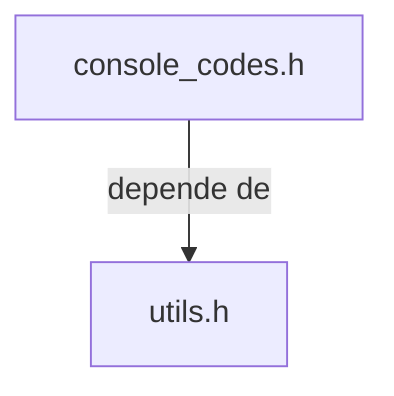

## 📋 Documentación Técnica

### 1. Propósito y Responsabilidad
El módulo `console_codes.h` se encarga de proporcionar funciones para manipular la consola a través de ANSI/VT100 escapes. Esto incluye movimiento de cursor, manipulación de texto, etc. 

### 2. Código Comentado (con explicación de funciones y parámetros)
#### `void move_cursor(int x, int y)`
Mueve el cursor a la posición x, y en la consola. 
**Parámetros:**
- `x`: Coordenada x del cursor.
- `y`: Coordenada y del cursor.

#### `void move(int x, int y)`
Mueve el cursor hacia la esquina superior izquierda de la pantalla.
**Parámetros:**
- `x`: Número de columnas a mover.
- `y`: Número de filas a mover.

#### `void erase_display(void)`
Borra todo el contenido de la pantalla.
**Parámetros:**
- Ninguno.

#### `void erase_line(void)`
Borra la línea en la que se encuentra el cursor.
**Parámetros:**
- Ninguno.

#### `void textcolor_normal(void)`
Restaura el color de texto a normal.
**Parámetros:**
- Ninguno.

#### `void hide_cursor(void)`
Oculta el cursor de la consola.
**Parámetros:**
- Ninguno.

#### `void show_cursor(void)`
Muestra el cursor de la consola.
**Parámetros:**
- Ninguno.

#### `int mygetch(void)`
Lee un carácter de la consola, incluso si el carácter es un controlador (tecla especial).
**Parámetros:**
- Ninguno.
**Retorno:**
- El carácter leído de la consola.

#### `void console_utf8_enable(void)`
Habilita la codificación UTF-8 en la consola.
**Parámetros:**
- Ninguno.

### 3. Interfaz Pública
La interfaz pública de este módulo incluye las siguientes funciones y clases:

- `move_cursor(int x, int y)`
- `move(int x, int y)`
- `erase_display(void)`
- `erase_line(void)`
- `textcolor_normal(void)`
- `hide_cursor(void)`
- `show_cursor(void)`
- `mygetch(void)`
- `console_utf8_enable(void)`

### 4. Dependencias Internas
Este módulo no tiene dependencias directas del resto del código, pero depende del módulo `utils.h` para manejar la manipulación de cadenas.

### 5. Diagrama de Interdependencias

Este diagrama muestra que el módulo `console_codes.h` depende del módulo `utils.h` para manejar la manipulación de cadenas.