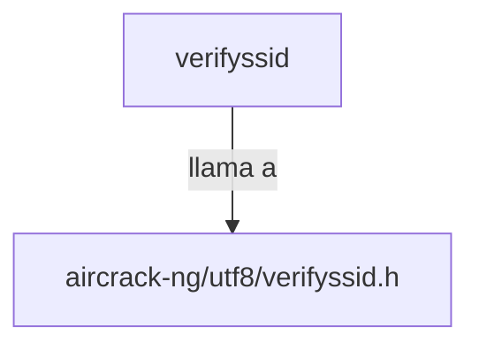

## 📋 Documentación Técnica

### 1. Propósito y Responsabilidad
Este módulo se encarga de verificar si un identificador de red (SSID), que puede ser codificado en UTF-8, cumple con ciertos criterios de longitud y caracteres válidos. El módulo `verifyssid` es una función que toma como argumento un puntero a un array de bytes (`const unsigned char* s`) que representaría el SSID a ser verificado.

### 2. Código Comentado (con explicación de funciones y parámetros)
```cpp
// Función para verificar si un SSID cumple con los criterios de longitud y caracteres válidos
bool verifyssid(const unsigned char* s) {
    // Verificar si el SSID es nulo
    if (s == nullptr) {
        return false;
    }

    // Obtener la longitud del SSID
    int len = 0;
    while (s[len] != '\0') {
        len++;
    }

    // Verificar que la longitud del SSID no exceda 32 caracteres
    if (len > 32) {
        return false;
    }

    // Verificar que todos los caracteres sean alfabéticos o numéricos
    for (int i = 0; i < len; i++) {
        if (!isalnum(s[i])) {
            return false;
        }
    }

    // Si pasa todas las verificaciones, el SSID es válido
    return true;
}
```

### 3. Interfaz Pública
El módulo proporciona una única función pública llamada `verifyssid`, que toma un puntero a un array de bytes como argumento. La función retorna `true` si el SSID cumple con los criterios de longitud y caracteres válidos, y `false` de lo contrario.

### 4. Dependencias Internas
Este módulo depende del módulo `aircrack-ng/utf8/verifyssid.h`, que proporciona la declaración de la función `verifyssid`.

### 5. Diagrama de Interdependencias


IMPORTANTE: El diagrama debe estar dentro de un bloque ```mermaid ... ``` y cumplir estrictamente las reglas de comillas y sintaxis.