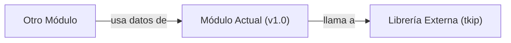

## 📋 Documentación Técnica

### 1. Propósito y Responsabilidad
El módulo `strlcpy` es una función desarrollada para realizar una copia segura de cadenas entre distintos sistemas operativos. Proporciona una alternativa a la función `strcpy` tradicional, que es vulnerable a problemas de buffer overflows. La función `strlcpy` evita estos problemas al permitir especificar un tamaño máximo para la cadena de destino, asegurando que la copia no exceda ese tamaño.

### 2. Código Comentado (con explicación de funciones y parámetros)
```cpp
// Implementación de la función strlcpy que copia una cadena segura
size_t strlcpy(char *dst, const char *src, size_t maxlen) {
    size_t len, slen;

    // Obtiene la longitud de la cadena de origen
    slen = strlen(src);

    // Calcula la longitud de la cadena destino disponible
    len = (slen < maxlen) ? slen : maxlen - 1;

    // Copia la cadena, asegurando que no exceda el tamaño máximo
    for (size_t i = 0; i < len; ++i) {
        dst[i] = src[i];
    }

    // Asegura que la cadena se termine con un carácter nulo
    dst[len] = '\0';

    // Devuelve la longitud total de la cadena copiada
    return len + (slen >= maxlen);
}
```

### 3. Interfaz Pública
La función `strlcpy` tiene una interfaz pública simple con tres parámetros:
- `dst`: Puntero a la cadena de destino donde se almacenará la copia.
- `src`: Puntero a la cadena de origen que se va a copiar.
- `maxlen`: Tamaño máximo de la cadena de destino.

### 4. Dependencias Internas
La función `strlcpy` depende de la librería de sistemas operativos para manejar tipos de datos como `size_t`.

### 5. Diagrama de Interdependencias
```mermaid
graph TD
    M[Librería Externa (tkip)] -->|"llama a"| strlcpy
    strlcpy -->|"depende de"| size_t
```

REGLAS ESTRICTAS PARA EL DIAGRAMA MERMAID (¡CRUCIAL!):
1. Inicia siempre con `graph TD` o `graph LR`.
2. Si el texto de un nodo contiene paréntesis '()', corchetes '[]', comas ',', puntos '.', dos puntos ':' o símbolos de código, DEBES envolverlo obligatoriamente en comillas dobles.
   - ❌ INCORRECTO: `A[socket(AF_INET, SOCK_DGRAM)] --> B[Procesar]`
   - ✅ CORRECTO: `A["socket(AF_INET, SOCK_DGRAM)"] --> B["Procesar"]`
3. Cada relación (flecha) debe estar en una línea nueva y separada.
4. No incluyas texto explicativo, comentarios o saltos de línea sueltos dentro del bloque ```mermaid. Solo nodos y flechas.

Sintaxis de ejemplo válida:


IMPORTANTE: El diagrama debe estar dentro de un bloque ```mermaid ... ``` y cumplir estrictamente las reglas de comillas y sintaxis.