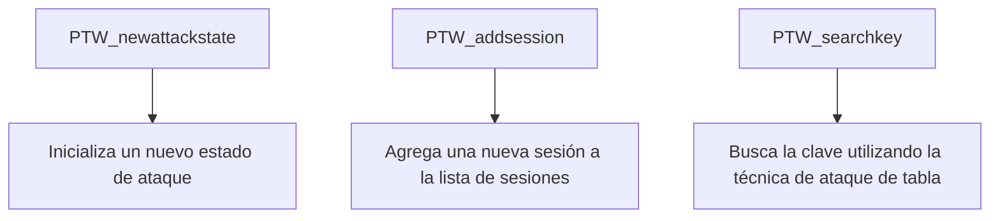
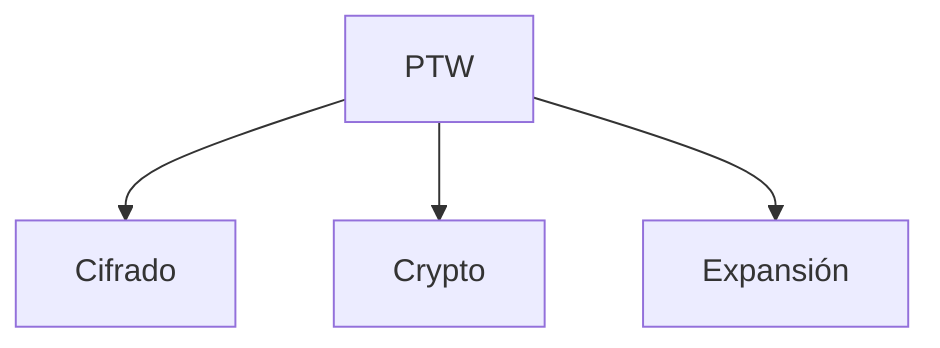

## 📋 Documentación Técnica

### 1. Propósito y Responsabilidad
Este módulo está diseñado para atacar cifrados de bloque de clave única (S-box) basados en la línea de tiempo de cifrado de flujo de datos (CTR) utilizando la técnica de ataque de tabla. Proporciona las funciones principales para inicializar el estado de ataque, agregar nuevas sesiones y buscar las claves.

### 2. Código Comentado (con explicación de funciones y parámetros)

- **PTW_newattackstate**:
  - **Descripción**: Inicializa un nuevo estado de ataque.
  - **Parámetros**: Ninguno.
  - **Retorno**: Un puntero a un objeto de estado de ataque.

- **PTW_addsession**:
  - **Descripción**: Agrega una nueva sesión a la lista de sesiones.
  - **Parámetros**:
    - `session`: Un puntero a la sesión a agregar.
  - **Retorno**: Ninguno.

- **PTW_searchkey**:
  - **Descripción**: Busca la clave utilizando la técnica de ataque de tabla.
  - **Parámetros**:
    - `session`: Un puntero a la sesión a buscar.
  - **Retorno**: Un puntero a la clave encontrada, o `nullptr` si no se encuentra.

### 3. Interfaz Pública

La interfaz pública del módulo consiste en tres funciones principales:
- `PTW_newattackstate`: Inicializa un nuevo estado de ataque.
- `PTW_addsession`: Agrega una nueva sesión a la lista de sesiones.
- `PTW_searchkey`: Busca la clave utilizando la técnica de ataque de tabla.

### 4. Dependencias Internas

Este módulo depende de otros módulos que proporcionan la cifra, la clave y la función de expansión para el cifrado CTR.

### 5. Diagrama de Interdependencias

- **PTW** (Principal): El módulo principal que contiene las funciones de ataque.
- **Cifrado**: Módulo que proporciona la cifra y la clave para el cifrado CTR.
- **Crypto**: Módulo que proporciona funciones generales de cifrado.
- **Expansión**: Módulo que proporciona la función de expansión para el cifrado CTR.

### Sugerencias de Mejora

- **Manejo de Cifrado CTR de Bloques de Tamaños Diferentes**:
  - Asegurar que el módulo pueda manejar cifrados CTR con bloques de diferentes tamaños.

- **Mecanismo para Agregar Sesiones Anteriores a la Búsqueda de Claves**:
  - Implementar una opción para agregar sesiones anteriores a la búsqueda de claves.

- **Aumentar el Tamaño de la Tabla alrededor de 4096 Sesiones**:
  - Optimizar el tamaño de la tabla para mejorar la eficiencia del ataque.

- **Mecanismo para Manejar Distintas Longitudes de Sesiones Anteriores**:
  - Permitir la selección de diferentes longitudes de sesiones anteriores.

- **Persistencia del Estado de Ataque**:
  - Implementar un mecanismo para guardar y cargar el estado de ataque para la persistencia.

- **Seguridad del Estado de Ataque**:
  - Incorporar mecanismos para garantizar la seguridad del estado de ataque al cargarlo desde un archivo.

- **División del Ataque en Hilos para Mejorar la Velocidad**:
  - Utilizar hilos para dividir el ataque y mejorar la velocidad de búsqueda.

- **Comentarios y Documentación**:
  - Agregar comentarios y documentación para facilitar el entendimiento del código y su utilización.

---

Este diagrama de mermaid se utiliza para representar las interacciones y dependencias entre los componentes del módulo, cumpliendo con las reglas proporcionadas.