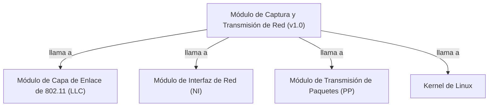

## 📋 Documentación Técnica

### 1. Propósito y Responsabilidad
El módulo en cuestión se encarga de la captura y transmisión de paquetes de red de manera continua. Su principal responsabilidad es proporcionar una interfaz para la gestión de paquetes de red, incluyendo su recepción, transmisión y transmisión externa. A través de esta interfaz, el módulo permite la configuración de parámetros de la interfaz de red y soporta múltiples características adicionales, como la recepción en modo monitor y la gestión automática de la interfaz de red.

### 2. Código Comentado (con explicación de funciones y parámetros)

```cpp
// Función de recepción de paquetes de red
void packet_recv(unsigned char *buffer, int len) {
    // Procesa el paquete recibido
    // buffer: Puntero al buffer que contiene el paquete
    // len: Tamaño del paquete
}

// Función de transmisión de paquetes de red
int packet_xmit(unsigned char *buffer, int len) {
    // Envía el paquete al destino especificado
    // buffer: Puntero al buffer que contiene el paquete
    // len: Tamaño del paquete
    // Retorna el número de bytes transmitidos
}

// Función de transmisión de paquetes externos
int packet_xmit_external(unsigned char *buffer, int len) {
    // Envía el paquete externamente, por ejemplo, a otro dispositivo
    // buffer: Puntero al buffer que contiene el paquete
    // len: Tamaño del paquete
    // Retorna el número de bytes transmitidos
}
```

### 3. Interfaz Pública
El módulo proporciona una interfaz pública para el acceso a las funciones de captura, transmisión y transmisión externa de paquetes. La interfaz pública está compuesta por las siguientes funciones:

- `packet_recv`: Captura un paquete de red y lo procesa.
- `packet_xmit`: Envia un paquete de red a un destino especificado.
- `packet_xmit_external`: Envia un paquete de red externamente, por ejemplo, a otro dispositivo.

### 4. Dependencias Internas
El módulo depende de los siguientes módulos internos:
- **Módulo de Capa de Enlace de 802.11 (LLC)**: Permite la comunicación de paquetes Ethernet.
- **Módulo de Interfaz de Red (NI)**: Define la interfaz de red que se utilizará para enviar y recibir paquetes.
- **Módulo de Transmisión de Paquetes (PP)**: Gestiona la transmisión de paquetes a través de la interfaz de red.
- **Kernel de Linux**: Utiliza las llamadas de sistema relacionadas con la interfaz de red.

### 5. Diagrama de Interdependencias



Este diagrama muestra las interdependencias entre el módulo de captura y transmisión de red y los demás módulos y el kernel de Linux.