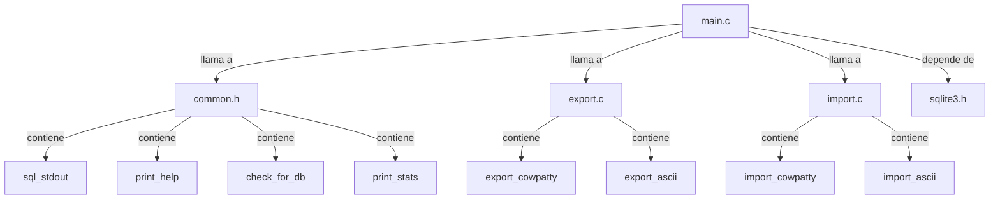

## 📋 Documentación Técnica

### 1. Propósito y Responsabilidad
El módulo principal, `main.c`, es el punto de entrada del programa. Se encarga de parsear los argumentos de la línea de comandos y dirigir el flujo de ejecución al usuario. Además, gestiona la base de datos SQLite y proporciona la interfaz de usuario para el usuario interactivo.

### 2. Código Comentado (con explicación de funciones y parámetros)

#### Función Principal (`main()`)
- **Entrada**: La función principal `main()` recibe un puntero a `argc` y un puntero a `argv` como argumentos.
- **Proceso**:
  1. Parsea los argumentos de la línea de comandos para determinar la acción a realizar (crear, exportar, importar, buscar, ordenar, etc.).
  2. Verifica la existencia de la base de datos SQLite y, si no existe, la crea.
  3. Llama a las funciones correspondientes según la acción especificada.
- **Salida**: No retorna un valor específico.

#### Funciones Comunes (`common.h`)
- **`sql_stdout`**: Imprime los resultados de las consultas a la base de datos.
- **`print_help`**: Imprime la ayuda del programa.
- **`check_for_db`**: Verifica la existencia de la base de datos SQLite y la crea si no existe.
- **`print_stats`**: Imprime estadísticas de la base de datos.

#### Funciones de Exportación (`export.c`)
- **`export_cowpatty`**: Exporta la base de datos a formato Cowpatty.
- **`export_ascii`**: Exporta la base de datos a formato ASCII.

#### Funciones de Importación (`import.c`)
- **`import_cowpatty`**: Importa datos desde un archivo en formato Cowpatty.
- **`import_ascii`**: Importa datos desde un archivo en formato ASCII.

### 3. Interfaz Pública
- **Comando de Línea de Comandos**: El programa acepta los siguientes comandos:
  - `-c`: Crea una nueva base de datos.
  - `-e`: Exporta la base de datos.
  - `-i`: Importa datos.
  - `-s`: Busca en la base de datos.
  - `-o`: Ordena la salida de la base de datos.
- **Opciones adicionales**: `--help` muestra la ayuda del programa.

### 4. Dependencias Internas
El archivo principal `main.c` depende de los siguientes archivos para funcionar correctamente:
- `common.h`: Contiene las declaraciones de las funciones comunes.
- `export.c`: Contiene las funciones para exportar la base de datos.
- `import.c`: Contiene las funciones para importar datos.
- `sqlite3.h`: Biblioteca de SQLite para la gestión de la base de datos.

### 5. Diagrama de Interdependencias

## Sugerencias de Mejora
1. **Opción para Crear Base de Datos Nueva**: Añadir una opción para crear una nueva base de datos.
2. **Opción para Buscar en Base de Datos**: Añadir una opción para buscar en la base de datos.
3. **Opción para Ordenar Salida**: Añadir una opción para ordenar la salida de la base de datos.