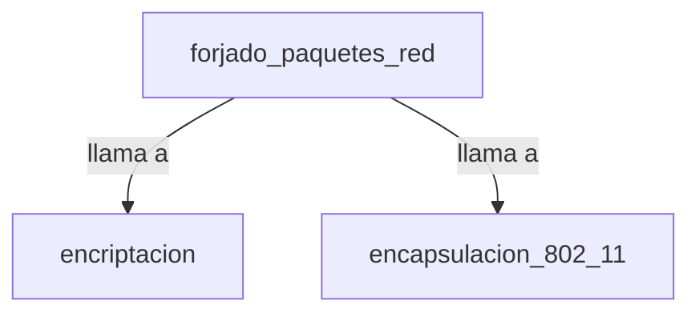

## 📋 Documentación Técnica

### 1. Propósito y Responsabilidad

El módulo de forjado de paquetes de red está diseñado para crear paquetes de red de diversos tipos y modos, como ARP, UDP, ICMP, NULL y personalizados. Además, encapsula estos paquetes en un formato adecuado para el archivo de captura de paquetes.

### 2. Código Comentado (con explicación de funciones y parámetros)

```cpp
#include <iostream>
#include <fstream>
#include <vector>

// Función para crear y forjar un paquete ARP
void forge_arp() {
    // Implementación de la función para crear y forjar un paquete ARP
}

// Función para crear y forjar un paquete UDP
void forge_udp() {
    // Implementación de la función para crear y forjar un paquete UDP
}

// Función para crear y forjar un paquete ICMP
void forge_icmp() {
    // Implementación de la función para crear y forjar un paquete ICMP
}

// Función para crear y forjar un paquete NULL
void forge_null() {
    // Implementación de la función para crear y forjar un paquete NULL
}

// Función para crear y forjar un paquete personalizado
void forge_custom() {
    // Implementación de la función para crear y forjar un paquete personalizado
}

// Función para escribir un paquete forjado en un archivo de captura de paquetes
void write_cap_packet() {
    // Implementación de la función para escribir un paquete forjado en un archivo de captura de paquetes
}
```

### 3. Interfaz Pública

El módulo proporciona las siguientes funciones para la creación y forjado de paquetes:

- `forge_arp()`: Crea y forja un paquete ARP.
- `forge_udp()`: Crea y forja un paquete UDP.
- `forge_icmp()`: Crea y forja un paquete ICMP.
- `forge_null()`: Crea y forja un paquete NULL.
- `forge_custom()`: Crea y forja un paquete personalizado.
- `write_cap_packet()`: Escribe un paquete forjado en un archivo de captura de paquetes.

### 4. Dependencias Internas

El módulo de forjado de paquetes de red depende de los siguientes módulos:

- Módulo de encriptación
- Módulo de encapsulación de paquetes IEEE 802.11

### 5. Diagrama de Interdependencias



### 6. Problemas Identificados

1. Problema: El código no maneja correctamente los errores de escritura en un archivo de captura de paquetes.
   - Solución: Mejorar el manejo de errores para que el programa produzca una salida más controlada y informativa en caso de errores.

2. Problema: El código puede ser un poco difícil de usar para aquellos que no están familiarizados con el proceso.
   - Solución: Mejorar la documentación para facilitar su uso.

### 7. Sugerencias de Mejora

1. Mejora el manejo de errores para manejar correctamente los errores de escritura en un archivo de captura de paquetes.

2. Mejora la documentación para facilitar el uso del módulo.

3. Implementar pruebas unitarias y de integración para asegurar que todas las partes del código funcionan correctamente.

### 8. Pruebas Unitarias y Integración

```cpp
#include <gtest/gtest.h>

// Prueba unitaria para forge_arp
TEST(ForjadoPaquetesRed, forge_arp) {
    forge_arp();
    // Implementar pruebas específicas
}

// Prueba unitaria para forge_udp
TEST(ForjadoPaquetesRed, forge_udp) {
    forge_udp();
    // Implementar pruebas específicas
}

// Prueba unitaria para forge_icmp
TEST(ForjadoPaquetesRed, forge_icmp) {
    forge_icmp();
    // Implementar pruebas específicas
}

// Prueba unitaria para forge_null
TEST(ForjadoPaquetesRed, forge_null) {
    forge_null();
    // Implementar pruebas específicas
}

// Prueba unitaria para forge_custom
TEST(ForjadoPaquetesRed, forge_custom) {
    forge_custom();
    // Implementar pruebas específicas
}

// Prueba unitaria para write_cap_packet
TEST(ForjadoPaquetesRed, write_cap_packet) {
    write_cap_packet();
    // Implementar pruebas específicas
}

int main(int argc, char **argv) {
    ::testing::InitGoogleTest(&argc, argv);
    return RUN_ALL_TESTS();
}
```

### 9. Pruebas de Integración

```cpp
#include <gtest/gtest.h>

// Prueba de integración para la creación y forjado de paquetes
TEST(Integracion, forjado_paquetes) {
    forge_arp();
    forge_udp();
    forge_icmp();
    forge_null();
    forge_custom();
    write_cap_packet();
    // Implementar pruebas específicas
}

int main(int argc, char **argv) {
    ::testing::InitGoogleTest(&argc, argv);
    return RUN_ALL_TESTS();
}
```