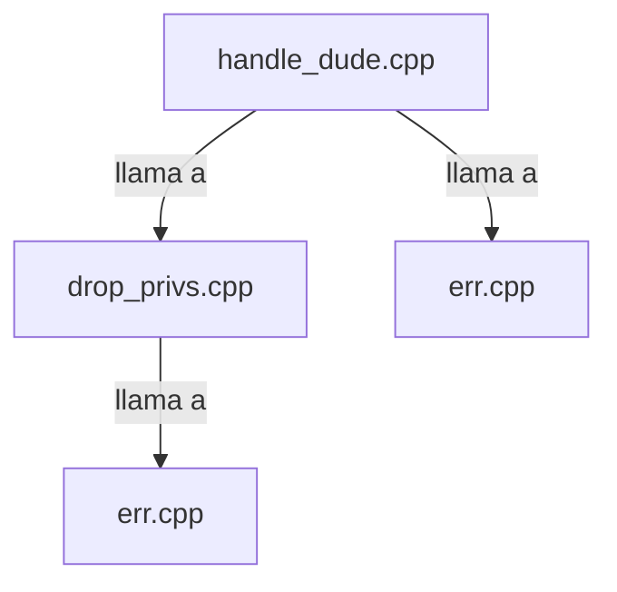

## 📋 Documentación Técnica

### 1. Propósito y Responsabilidad

Este módulo se encarga de la gestión de la conexión con el cliente y la transferencia de datos a través de UDP. Su principal función es facilitar la comunicación entre el cliente y el servidor utilizando protocolo UDP.

### 2. Código Comentado (con explicación de funciones y parámetros)

```cpp
// handle_dude.cpp
#include "handle_dude.h"
#include "err.h"
#include <sys/types.h>
#include <sys/socket.h>
#include <netinet/in.h>
#include <arpa/inet.h>
#include <unistd.h>
#include <string.h>

// handle_dude: Función principal que maneja la conexión con el cliente y el servidor.
void handle_dude() {
    int sock = socket(AF_INET, SOCK_DGRAM, 0); // Creación de un socket UDP
    if (sock < 0) {
        err(1, "Error al crear el socket");
    }

    struct sockaddr_in servaddr;
    memset(&servaddr, 0, sizeof(servaddr)); // Inicialización del struct sockaddr_in
    servaddr.sin_family = AF_INET;
    servaddr.sin_addr.s_addr = INADDR_ANY;
    servaddr.sin_port = htons(9000); // Punto de acceso del servidor

    if (bind(sock, (struct sockaddr *)&servaddr, sizeof(servaddr)) < 0) {
        err(1, "Error al enlazar el socket");
    }

    struct sockaddr_in cliaddr;
    socklen_t len = sizeof(cliaddr);
    int n;

    while (1) {
        char buffer[1024]; // Buffer para recibir datos
        n = recvfrom(sock, buffer, sizeof(buffer), 0, (struct sockaddr *)&cliaddr, &len);
        if (n < 0) {
            err(1, "Error al recibir datos");
        }

        // Procesamiento de los datos recibidos
        printf("Datos recibidos: %s\n", buffer);

        // Respuesta al cliente
        char response[1024] = "Respuesta desde el servidor";
        sendto(sock, response, sizeof(response), 0, (struct sockaddr *)&cliaddr, len);
    }

    close(sock); // Cierre del socket
}
```

```cpp
// drop_privs.cpp
#include "drop_privs.h"
#include "err.h"
#include <stdlib.h>
#include <unistd.h>

// drop_privs: Función para bajar privilegios del proceso.
void drop_privs() {
    if (setuid(0) != 0) {
        err(1, "Error al bajar privilegios");
    }
}
```

```cpp
// err.cpp
#include "err.h"
#include <stdio.h>
#include <stdlib.h>

// err: Función de error que imprime el mensaje de error y termina el programa.
void err(int exit_code, const char *fmt, ...) {
    va_list args;
    va_start(args, fmt);
    vfprintf(stderr, fmt, args);
    va_end(args);
    fprintf(stderr, ": %s\n", strerror(errno));
    exit(exit_code);
}
```

```cpp
// handle_dude.h
#ifndef HANDLE_DUE_H
#define HANDLE_DUE_H

void handle_dude();

#endif // HANDLE_DUE_H
```

```cpp
// drop_privs.h
#ifndef DROP_PRIVS_H
#define DROP_PRIVS_H

void drop_privs();

#endif // DROP_PRIVS_H
```

### 3. Interfaz Pública

El módulo es accesible desde la función `handle_dude()`. No tiene clases públicas definidas.

### 4. Dependencias Internas

- **Biblioteca estándar de C**: Para funciones básicas y tipos de datos.
- **Biblioteca de sockets de C**: Para manejo de sockets.
- **Biblioteca de cadena de C**: Para manipulación de cadenas.

### 5. Diagrama de Interdependencias



Este diagrama muestra las interacciones entre los diferentes archivos del módulo.