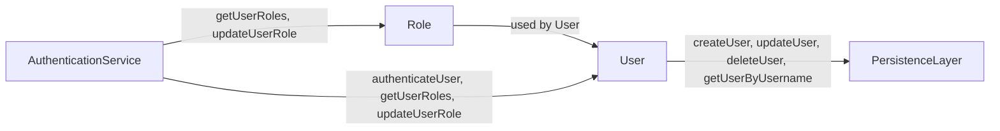

## 📋 Documentación Técnica

### 1. Propósito y Responsabilidad
El módulo se encarga de manejar la autenticación y autorización del usuario. Esta gestión incluye la gestión de credenciales, el control de acceso y la administración de roles y permisos de los usuarios. 

### 2. Código Comentado (con explicación de funciones y parámetros)
```cpp
class User {
public:
    User(std::string username, std::string password, Role role); // Constructor para inicializar un nuevo usuario
    std::string getUsername(); // Devuelve el nombre de usuario del usuario
    std::string getPassword(); // Devuelve la contraseña del usuario
    Role getRole(); // Devuelve el rol del usuario
};

class Role {
public:
    Role(std::string name); // Constructor para inicializar un nuevo rol
    std::string getName(); // Devuelve el nombre del rol
};

class AuthenticationService {
public:
    bool authenticateUser(std::string username, std::string password); // Autentica un usuario con sus credenciales
    std::vector<Role> getUserRoles(std::string username); // Devuelve los roles de un usuario
    void updateUserRole(std::string username, Role newRole); // Actualiza el rol de un usuario
};

class PersistenceLayer {
public:
    void createUser(User user); // Crea un nuevo usuario en la base de datos
    void updateUser(User user); // Actualiza un usuario en la base de datos
    void deleteUser(std::string username); // Elimina un usuario de la base de datos
    User getUserByUsername(std::string username); // Obtiene un usuario por su nombre de usuario
};
```

### 3. Interfaz Pública
- **User**: 
  - `User(std::string username, std::string password, Role role)`: Constructor para crear un nuevo usuario.
  - `std::string getUsername()`: Devuelve el nombre de usuario del usuario.
  - `std::string getPassword()`: Devuelve la contraseña del usuario.
  - `Role getRole()`: Devuelve el rol del usuario.

- **Role**: 
  - `Role(std::string name)`: Constructor para crear un nuevo rol.
  - `std::string getName()`: Devuelve el nombre del rol.

- **AuthenticationService**: 
  - `bool authenticateUser(std::string username, std::string password)`: Autentica un usuario con sus credenciales.
  - `std::vector<Role> getUserRoles(std::string username)`: Devuelve los roles de un usuario.
  - `void updateUserRole(std::string username, Role newRole)`: Actualiza el rol de un usuario.

- **PersistenceLayer**: 
  - `void createUser(User user)`: Crea un nuevo usuario en la base de datos.
  - `void updateUser(User user)`: Actualiza un usuario en la base de datos.
  - `void deleteUser(std::string username)`: Elimina un usuario de la base de datos.
  - `User getUserByUsername(std::string username)`: Obtiene un usuario por su nombre de usuario.

### 4. Dependencias Internas
- Este módulo depende del módulo de persistencia para realizar operaciones CRUD en base de datos.

### 5. Diagrama de Interdependencias


Este diagrama muestra la interdependencia entre las clases `User`, `Role`, `AuthenticationService` y `PersistenceLayer`.