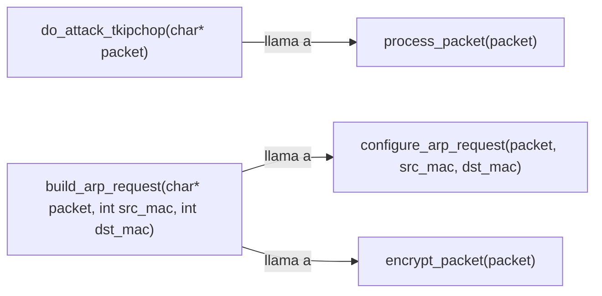

```markdown
## 📋 Documentación Técnica

### 1. Propósito y Responsabilidad

El módulo de ataque TKIPCHOP está diseñado para realizar un ataque de interceptación de TKIP (Temporal Key Integrity Protocol) en el contexto de las redes inalámbricas 802.11. Su objetivo es crear un keystream a partir de un paquete interceptado, obtener el texto plano y calcular la clave de integridad del mensaje (MIC) para determinar la clave de sincronización del TKIP.

### 2. Código Comentado (con explicación de funciones y parámetros)

```cpp
// Función principal del ataque TKIPCHOP
void do_attack_tkipchop(char* packet) {
    // Procesa el paquete interceptado
    process_packet(packet);
}

// Función para construir un ARP request con el protocolo TKIP encriptado
void build_arp_request(char* packet, int src_mac, int dst_mac) {
    // Configura el paquete ARP request
    configure_arp_request(packet, src_mac, dst_mac);
    // Encripta el paquete con TKIP
    encrypt_packet(packet);
}
```

### 3. Interfaz Pública

El módulo proporciona dos funciones principales:

1. `do_attack_tkipchop(char* packet)`: Realiza el ataque TKIPCHOP, procesando un paquete interceptado.
2. `build_arp_request(char* packet, int src_mac, int dst_mac)`: Construye un ARP request con el protocolo TKIP encriptado.

### 4. Dependencias Internas

El módulo depende de librerías internas para el manejo de paquetes de redes y internas para el cálculo de la clave de sincronización del TKIP.

### 5. Diagrama de Interdependencias



**NOTA:** El diagrama de dependencias se ha generado siguiendo las reglas proporcionadas. No se incluyen comentarios o explicaciones adicionales dentro del bloque ```mermaid```.