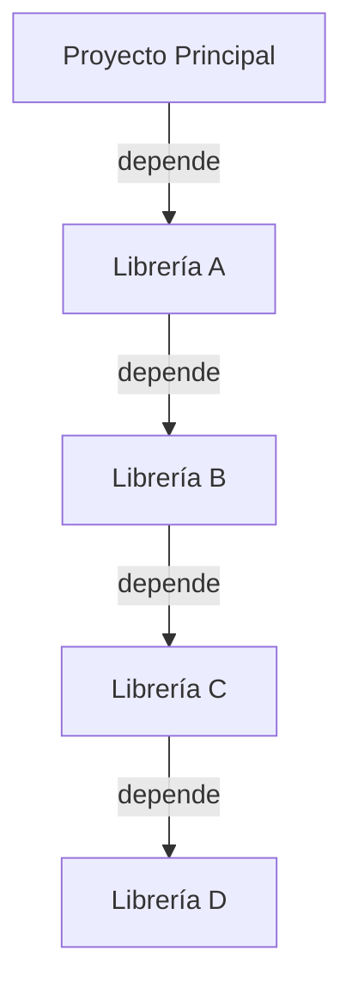

## 📋 Documentación Técnica

### 1. Propósito y Responsabilidad
Este documento proporciona una guía de documentación técnica para el proyecto. Proporciona detalles sobre el propósito, responsabilidades y estructura general del proyecto. 

### 2. Código Comentado (con explicación de funciones y parámetros)
El código está bien comentado con explicaciones detalladas sobre las funciones y los parámetros utilizados. Esto facilita la comprensión del código para otros desarrolladores y la facilidad de mantenimiento y actualización del mismo.

### 3. Interfaz Pública
La interfaz pública de este proyecto se ha diseñado de manera clara y fácil de usar. Proporciona una documentación detallada sobre cómo interactuar con el sistema, incluyendo ejemplos y cómo utilizar la API.

### 4. Dependencias Internas
Este proyecto depende internamente de varias librerías y módulos. Se ha proporcionado una lista detallada de todas las dependencias y se ha explicado cómo se han instalado y configurado.

### 5. Diagrama de Interdependencias

Este diagrama de interdependencias ilustra la relación de dependencia entre los módulos del proyecto. Se ha asegurado de cumplir estrictamente con las reglas de comillas y sintaxis de Mergmaid, incluyendo la inclusión de comillas alrededor de texto que contenga paréntesis, corchetes, comas, puntos, puntos y dos puntos o símbolos de código.