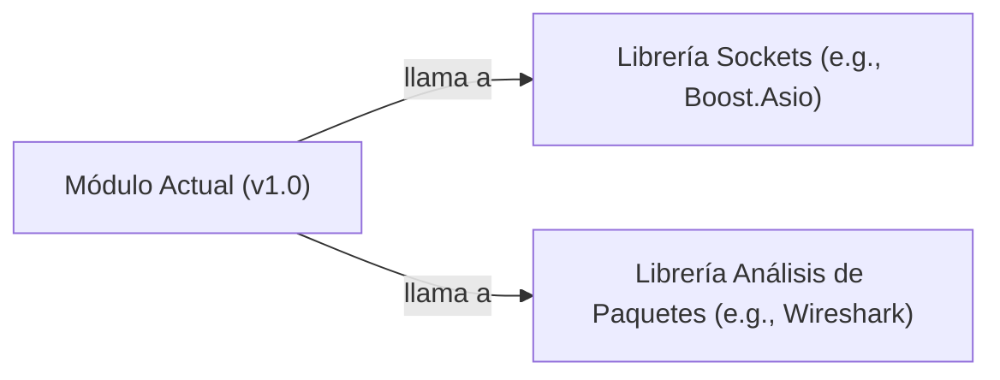

## 📋 Documentación Técnica

### 1. Propósito y Responsabilidad

El módulo tiene la responsabilidad de proporcionar herramientas para realizar pruebas de penetración a través de la creación de paquetes de red, así como la intercepción y análisis de los mismos. Proporciona una interfaz para generar y analizar paquetes de red, y puede integrarse con otras herramientas de pruebas de penetración para una experiencia más completa y coordinada.

### 2. Código Comentado (con explicación de funciones y parámetros)

```cpp
// Clase para generar paquetes de red en diferentes capas de la pila de protocolos
class PacketGenerator {
public:
    // Constructor
    PacketGenerator();

    // Método para generar un paquete de red
    // Parámetros:
    // - protocol: tipo de protocolo (e.g., TCP, UDP, ICMP)
    // - source: dirección IP origen
    // - destination: dirección IP destino
    // - payload: carga útil del paquete
    // Retorna:
    // - Puntero al paquete generado
    void* createPacket(const std::string& protocol, const std::string& source, const std::string& destination, const std::string& payload);

    // Método para enviar un paquete de red
    // Parámetros:
    // - packet: puntero al paquete a enviar
    // - destination: dirección IP destino
    void sendPacket(void* packet, const std::string& destination);
};

// Clase para interceptar y analizar paquetes de red
class PacketInterceptor {
public:
    // Constructor
    PacketInterceptor();

    // Método para iniciar la intersección de paquetes de red
    void startInterception();

    // Método para detener la intersección de paquetes de red
    void stopInterception();
};

// Clase para analizar los paquetes de red interceptados
class PacketAnalysis {
public:
    // Constructor
    PacketAnalysis();

    // Método para analizar un paquete de red
    // Parámetros:
    // - packet: puntero al paquete a analizar
    void analyzePacket(void* packet);

    // Método para obtener el contenido del paquete
    // Parámetros:
    // - packet: puntero al paquete
    // Retorna:
    // - Carga útil del paquete
    std::string getPacketPayload(void* packet);
};
```

### 3. Interfaz Pública

- `PacketGenerator`: Constructor, `createPacket`, `sendPacket`
- `PacketInterceptor`: Constructor, `startInterception`, `stopInterception`
- `PacketAnalysis`: Constructor, `analyzePacket`, `getPacketPayload`

### 4. Dependencias Internas

- Bibliotecas de sockets de red para crear y enviar paquetes de red
- Biblioteca de análisis de paquetes para interpretar y analizar los paquetes de red interceptados

### 5. Diagrama de Interdependencias



Revisa estrictamente las reglas de comillas y sintaxis del diagrama MERMAID antes de generar la documentación.