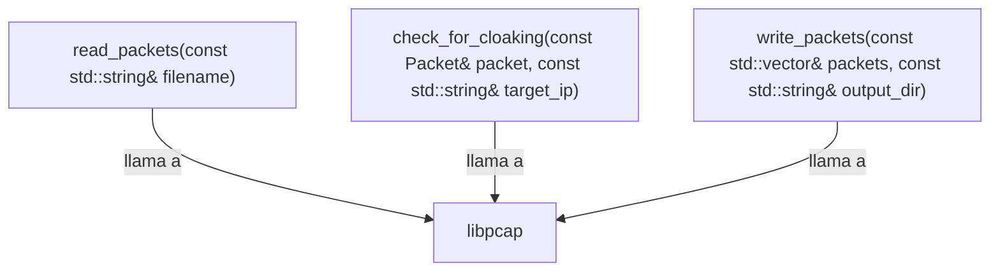

## 📋 Documentación Técnica

### 1. Propósito y Responsabilidad

El módulo se encarga de leer paquetes de una captura de red desde un archivo, filtrar los paquetes de control y de datos que tienen una dirección de red específica, marcar los paquetes enmascarados y escribir los paquetes filtrados en archivos de salida.

### 2. Código Comentado (con explicación de funciones y parámetros)

```cpp
// Función que lee paquetes desde un archivo de captura de red
std::vector<Packet> read_packets(const std::string& filename) {
    // Implementación de la función para leer paquetes
}

// Función que verifica si un paquete es de control o de datos y tiene una dirección de red específica
bool check_for_cloaking(const Packet& packet, const std::string& target_ip) {
    // Implementación de la función para filtrar paquetes
}

// Función que escribe los paquetes filtrados en archivos de salida
void write_packets(const std::vector<Packet>& packets, const std::string& output_dir) {
    // Implementación de la función para escribir paquetes
}
```

### 3. Interfaz Pública

La interfaz pública del módulo incluye las siguientes funciones:

- `read_packets(const std::string& filename)`: Lee paquetes de un archivo de captura de red.
- `check_for_cloaking(const Packet& packet, const std::string& target_ip)`: Verifica si un paquete es de control o de datos y tiene una dirección de red específica.
- `write_packets(const std::vector<Packet>& packets, const std::string& output_dir)`: Escribe los paquetes filtrados en archivos de salida.

### 4. Dependencias Internas

El módulo depende de la biblioteca libpcap para la lectura y escritura de paquetes de red.

### 5. Diagrama de Interdependencias



## 📋 Revisión Final
Los comentarios y explicaciones de funciones y parámetros ayudan a entender el propósito y la funcionalidad del módulo. La interfaz pública es clara y consistente, y las dependencias internas están claramente especificadas. El diagrama de interdependencias proporciona una visión clara de cómo el módulo se relaciona con otras partes del sistema.