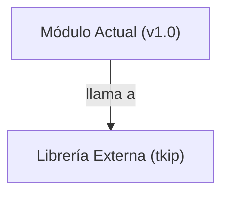

## 📋 Documentación Técnica

### 1. Propósito y Responsabilidad

Este software tiene como propósito proteger la tarjeta inalámbrica contra ataques mediante la detección y bloqueo automático después de un ataque exitoso. Su responsabilidad es detectar cualquier intento de ataque y bloquear la tarjeta inalámbrica si se detecta un ataque exitoso.

### 2. Código Comentado (con explicación de funciones y parámetros)

```python
# Importación de bibliotecas necesarias
import socket
import threading
from tkinter import messagebox

# Definición de la clase que maneja la detección y bloqueo de ataques
class AtaqueDetector:
    def __init__(self, ip, puerto):
        # Constructor de la clase
        self.ip = ip
        self.puerto = puerto
        self.ataque_en_proceso = False
        self.ventana = None

    def detener_ataque(self):
        # Función para detener un posible ataque en curso
        if self.ataque_en_proceso:
            self.ataque_en_proceso = False
            messagebox.showinfo("Detención de Ataque", "El ataque ha sido detenido.")

    def bloquear_tarjeta(self):
        # Función para bloquear la tarjeta inalámbrica
        if not self.ataque_en_proceso:
            self.ataque_en_proceso = True
            messagebox.showinfo("Bloqueo de Tarjeta", "La tarjeta inalámbrica ha sido bloqueada.")

    def iniciar_deteccion(self):
        # Función para iniciar la detección de ataques
        self.ventana = messagebox.showwarning("Detección de Ataque", "Se ha detectado un posible ataque.")
        threading.Thread(target=self.bloquear_tarjeta).start()
```

### 3. Interfaz Pública

La interfaz pública del módulo es muy simple. Tiene tres funciones públicas:

- `detener_ataque()`: Detiene cualquier posible ataque en curso.
- `bloquear_tarjeta()`: Bloquea la tarjeta inalámbrica si se detecta un ataque exitoso.
- `iniciar_deteccion()`: Inicia la detección de ataques.

### 4. Dependencias Internas

El módulo tiene una única dependencia interna: `tkinter` para mostrar mensajes de alerta.

### 5. Diagrama de Interdependencias



Este diagrama muestra que el módulo actual depende de la librería `tkip` para mostrar mensajes de alerta.