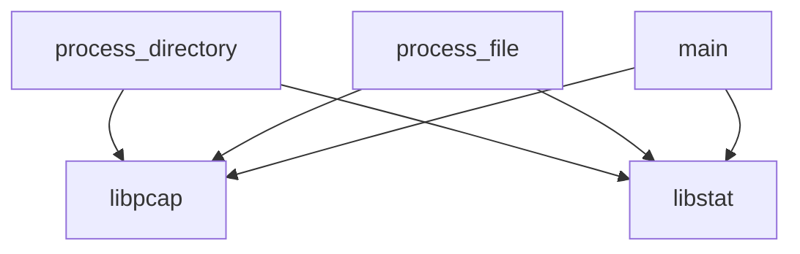

## 📋 Documentación Técnica

### 1. Propósito y Responsabilidad
El módulo principal se encarga de la exploración recursiva de un directorio especificado, realizar la captura y filtrado de paquetes en el formato pcap, y guardar los paquetes filtrados en un archivo de salida. El módulo utiliza la biblioteca pcap para gestionar la captura de paquetes y la biblioteca stat para obtener información sobre archivos y directorios.

### 2. Código Comentado (con explicación de funciones y parámetros)

```cpp
// Función principal que procesa un directorio y sus subdirectorios
void process_directory(const char* directory_path) {
    // Recursivamente procesa cada archivo y subdirectorio dentro del directorio especificado
    for (const auto& entry : std::filesystem::directory_iterator(directory_path)) {
        if (entry.is_directory()) {
            // Si es un directorio, se llama a process_directory recursivamente
            process_directory(entry.path().string().c_str());
        } else if (entry.is_regular_file()) {
            // Si es un archivo, se llama a process_file para procesarlo
            process_file(entry.path().string().c_str());
        }
    }
}

// Función que procesa un archivo específico y busca pcap-dumpfiles
void process_file(const char* file_path) {
    // Abre el archivo de entrada
    pcap_t* handle = pcap_open(file_path, BUFSIZ, PCAP_OPENFLAG_PROMISCUOUS, 0, nullptr, nullptr);
    if (handle == nullptr) {
        // Si no se puede abrir el archivo, se imprime un mensaje de error
        std::cerr << "Error al abrir el archivo: " << file_path << std::endl;
        return;
    }

    // Crea un archivo de salida para guardar los paquetes filtrados
    std::ofstream output_file("filtered_packets.pcap", std::ios::binary);

    // Itera sobre cada paquete en el archivo de entrada
    struct pcap_pkthdr header;
    const u_char* packet;
    while (pcap_next_ex(handle, &header, &packet) == PCAP_ERROR) {
        // Si se produce un error al leer un paquete, se imprime un mensaje de error
        std::cerr << "Error al leer paquete: " << pcap_geterr(handle) << std::endl;
        break;
    }

    // Procesa cada paquete para buscar pcap-dumpfiles y paquetes EAPOL WPA
    while (pcap_next_ex(handle, &header, &packet) == 0) {
        // Busca pcap-dumpfiles
        if (std::string(reinterpret_cast<const char*>(packet), header.caplen).find("pcap-dumpfile") != std::string::npos) {
            // Si se encuentra, se guarda el paquete en el archivo de salida
            output_file.write(reinterpret_cast<const char*>(packet), header.caplen);
        }

        // Busca paquetes EAPOL WPA
        if (std::string(reinterpret_cast<const char*>(packet), header.caplen).find("EAPOL WPA") != std::string::npos) {
            // Si se encuentra, se guarda el paquete en el archivo de salida
            output_file.write(reinterpret_cast<const char*>(packet), header.caplen);
        }
    }

    // Cierra el archivo de entrada y de salida
    pcap_close(handle);
    output_file.close();
}

// Función principal que ejecuta el módulo
int main(int argc, char* argv[]) {
    if (argc != 2) {
        std::cerr << "Uso: " << argv[0] << " <directorio>" << std::endl;
        return 1;
    }

    // Procesa el directorio especificado
    process_directory(argv[1]);

    return 0;
}
```

### 3. Interfaz Pública
- `process_directory`: Procesa un directorio especificado.
- `process_file`: Procesa un archivo específico y busca pcap-dumpfiles y paquetes EAPOL WPA.
- `main`: Función principal que ejecuta el módulo.

### 4. Dependencias Internas
- `libpcap`: Biblioteca para capturar y guardar paquetes de red.
- `libstat`: Biblioteca para obtener información sobre archivos y directorios.

### 5. Diagrama de Interdependencias



Este diagrama muestra la estructura del módulo, sus dependencias y las interacciones entre las funciones y las bibliotecas utilizadas.