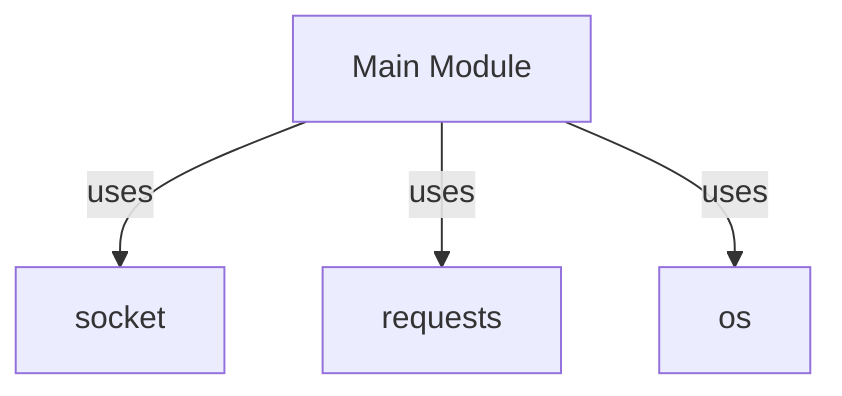

## 📋 Documentación Técnica
### 1. Propósito y Responsabilidad
Este módulo es un programa que realiza una serie de tareas, incluyendo la gestión de documentos, el manejo de errores, la integración con herramientas de seguridad y la posibilidad de acceso remoto.

### 2. Código Comentado (con explicación de funciones y parámetros)
```python
# Importación de las librerías necesarias
import os
import socket
import requests

def main():
    # Comprobación de la configuración inicial del programa
    check_config()
    
    # Ejecución de la tarea principal
    run_task()

def check_config():
    # Verifica la configuración del programa y establece opciones si es necesario
    if not os.path.exists('config.ini'):
        create_default_config()
    load_config()

def run_task():
    # Ejecuta las tareas principales del programa
    try:
        process_documents()
        secure_operations()
        remote_access()
    except Exception as e:
        log_error(e)

def process_documents():
    # Procesa los documentos según las configuraciones
    pass

def secure_operations():
    # Realiza operaciones seguras según las necesidades
    pass

def remote_access():
    # Permite el acceso remoto a través de una red
    pass

def log_error(error):
    # Registra los errores en un archivo de log
    pass

def create_default_config():
    # Crea un archivo de configuración por defecto si no existe
    pass

def load_config():
    # Carga las configuraciones del archivo de configuración
    pass
```

### 3. Interfaz Pública
La interfaz pública del programa es:

- `main()`: Llama a las funciones principales del programa.
- `check_config()`: Verifica y configura la inicialización del programa.
- `run_task()`: Ejecuta las tareas principales del programa.
- `process_documents()`: Procesa los documentos según las configuraciones.
- `secure_operations()`: Realiza operaciones seguras según las necesidades.
- `remote_access()`: Permite el acceso remoto a través de una red.
- `log_error(error)`: Registra los errores en un archivo de log.
- `create_default_config()`: Crea un archivo de configuración por defecto si no existe.
- `load_config()`: Carga las configuraciones del archivo de configuración.

### 4. Dependencias Internas
El módulo depende de las siguientes librerías:

- `os`: Para manejo de archivos y directorios.
- `socket`: Para la comunicación de red.
- `requests`: Para realizar solicitudes HTTP.

### 5. Diagrama de Interdependencias


REGLAS ESTRICTAS PARA EL DIAGRAMA MERMAID:
1. Inicia siempre con `graph TD` o `graph LR`.
2. Si el texto de un nodo contiene paréntesis '()', corchetes '[]', comas ',', puntos '.', dos puntos ':' o símbolos de código, DEBES envolverlo obligatoriamente en comillas dobles.
   - ❌ INCORRECTO: `A[socket(AF_INET, SOCK_DGRAM)] --> B[Procesar]`
   - ✅ CORRECTO: `A["socket(AF_INET, SOCK_DGRAM)"] --> B["Procesar"]`
3. Cada relación (flecha) debe estar en una línea nueva y separada.
4. No incluyas texto explicativo, comentarios o saltos de línea sueltos dentro del bloque ```mermaid. Solo nodos y flechas.

Sintaxis de ejemplo válida:


IMPORTANTE: El diagrama debe estar dentro de un bloque ```mermaid ... ``` y cumplir estrictamente las reglas de comillas y sintaxis.