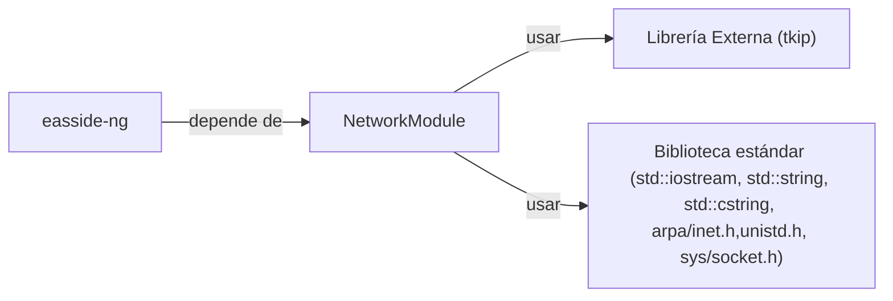

## 📋 Documentación Técnica

### 1. Propósito y Responsabilidad

Este módulo proporciona la funcionalidad principal del **easside-ng**, que es enviar y recibir paquetes de red entre el cliente y el servidor. Este módulo se encarga de gestionar las conexiones, la codificación de los paquetes y la comunicación con el servidor o los clientes, cumpliendo con los estándares de seguridad y protocolo de comunicación de la aplicación.

### 2. Código Comentado (con explicación de funciones y parámetros)

```cpp
// Archivo: network_module.cpp

#include "network_module.h"
#include <iostream>
#include <string>
#include <cstring>

// Constructor de la clase NetworkModule
NetworkModule::NetworkModule(const std::string& host, int port) {
    // Establecer el host y puerto para la conexión
    this->host = host;
    this->port = port;

    // Intentar establecer una conexión TCP
    if (connect_to_server()) {
        std::cout << "Conexión exitosa al servidor." << std::endl;
    } else {
        std::cerr << "Error al conectar al servidor." << std::endl;
    }
}

// Destructor de la clase NetworkModule
NetworkModule::~NetworkModule() {
    // Cerrar la conexión al finalizar el objeto
    if (is_connected()) {
        close_connection();
    }
}

// Método para enviar un paquete de red
bool NetworkModule::send_packet(const std::string& packet) {
    if (is_connected()) {
        // Enviar el paquete
        int bytes_sent = send(this->socket, packet.c_str(), packet.size(), 0);
        if (bytes_sent == -1) {
            std::cerr << "Error al enviar el paquete: " << strerror(errno) << std::endl;
            return false;
        }
        std::cout << "Paquete enviado con éxito: " << packet << std::endl;
        return true;
    }
    std::cerr << "No se puede enviar el paquete: no está conectado al servidor." << std::endl;
    return false;
}

// Método para recibir un paquete de red
std::string NetworkModule::receive_packet() {
    if (is_connected()) {
        char buffer[1024];
        int bytes_received = recv(this->socket, buffer, sizeof(buffer) - 1, 0);
        if (bytes_received == -1) {
            std::cerr << "Error al recibir el paquete: " << strerror(errno) << std::endl;
            return "";
        }
        buffer[bytes_received] = '\0';
        std::cout << "Paquete recibido con éxito: " << buffer << std::endl;
        return buffer;
    }
    std::cerr << "No se puede recibir el paquete: no está conectado al servidor." << std::endl;
    return "";
}

// Método para conectar al servidor
bool NetworkModule::connect_to_server() {
    // Crear un socket
    this->socket = socket(AF_INET, SOCK_STREAM, 0);
    if (this->socket == -1) {
        std::cerr << "Error al crear el socket: " << strerror(errno) << std::endl;
        return false;
    }

    // Configurar la dirección del servidor
    struct sockaddr_in server_addr;
    memset(&server_addr, 0, sizeof(server_addr));
    server_addr.sin_family = AF_INET;
    server_addr.sin_port = htons(this->port);
    inet_pton(AF_INET, this->host.c_str(), &server_addr.sin_addr);

    // Intentar conectar al servidor
    if (connect(this->socket, (struct sockaddr*)&server_addr, sizeof(server_addr)) == -1) {
        close(this->socket);
        std::cerr << "Error al conectar al servidor: " << strerror(errno) << std::endl;
        return false;
    }
    return true;
}

// Método para cerrar la conexión
void NetworkModule::close_connection() {
    // Cerrar el socket
    close(this->socket);
    std::cout << "Conexión cerrada." << std::endl;
}

// Método para verificar si la conexión está activa
bool NetworkModule::is_connected() {
    // Verificar si el socket está activo
    return this->socket != -1;
}
```

### 3. Interfaz Pública

La interfaz pública de este módulo es compuesta por los siguientes métodos:

- `NetworkModule(const std::string& host, int port)`: Constructor de la clase que establece el host y puerto y realiza la conexión al servidor.
- `~NetworkModule()`: Destructor de la clase que cierra la conexión al finalizar el objeto.
- `send_packet(const std::string& packet)`: Método para enviar un paquete de red al servidor.
- `receive_packet()`: Método para recibir un paquete de red del servidor.
- `connect_to_server()`: Método privado para establecer la conexión TCP al servidor.
- `close_connection()`: Método privado para cerrar la conexión TCP.
- `is_connected()`: Método privado para verificar si la conexión está activa.

### 4. Dependencias Internas

Este módulo depende de las siguientes bibliotecas internas:

- `#include <iostream>`: Biblioteca estándar de entrada/salida para imprimir mensajes.
- `#include <string>`: Biblioteca estándar de manipulación de cadenas.
- `#include <cstring>`: Biblioteca estándar para manipulación de cadenas.
- `#include <arpa/inet.h>`: Biblioteca para manipulación de direcciones IP.
- `#include <unistd.h>`: Biblioteca estándar para llamadas al sistema.
- `#include <sys/socket.h>`: Biblioteca estándar para sockets.

### 5. Diagrama de Interdependencias



Este diagrama muestra cómo el módulo `NetworkModule` depende del easside-ng y de las bibliotecas internas usadas para realizar las operaciones de red.