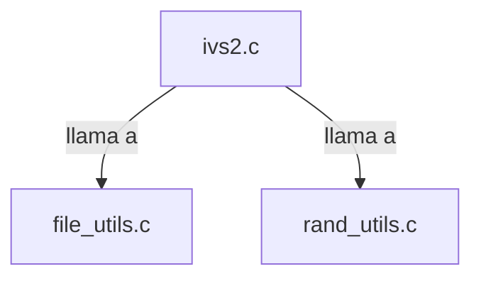

## 📋 Documentación Técnica

### 1. Propósito y Responsabilidad
Este módulo se encarga de generar archivos de IVS (Vector de Inicialización de Secuencia) a partir de un archivo de entrada. El módulo realiza una serie de operaciones encriptográficas para generar el IVS a partir del archivo de entrada.

### 2. Código Comentado (con explicación de funciones y parámetros)
#### ivs2.c
- **generate_ivs**: Función principal que encapsula la generación del IVS.
  - Parámetros:
    - `file_path`: Ruta al archivo de entrada.
    - `ivs_path`: Ruta donde se guardará el IVS generado.
  - Funciónamiento:
    - Lee el contenido del archivo de entrada.
    - Aplica una serie de operaciones de encriptación para generar el IVS.
    - Guarda el IVS generado en el archivo de salida.

- **init_key_stream**: Inicializa el flujo de claves para la encriptación.
  - Parámetros:
    - `key`: Clave para la encriptación.
  - Funciónamiento:
    - Configura el flujo de claves para la encriptación usando la clave proporcionada.

- **encrypt_data**: Función que encripta el contenido de un archivo utilizando el flujo de claves inicializado.
  - Parámetros:
    - `input_file`: Ruta al archivo de entrada que se desea encriptar.
    - `output_file`: Ruta donde se guardará el archivo encriptado.
  - Funciónamiento:
    - Lee el contenido del archivo de entrada.
    - Aplica la encriptación utilizando el flujo de claves.
    - Guarda el archivo encriptado en el archivo de salida.

### 3. Interfaz Pública
La interfaz pública del módulo se define en el archivo `ivs2.c`. Las funciones principales que deben ser utilizadas por otros componentes del proyecto son `generate_ivs`, `init_key_stream` y `encrypt_data`.

### 4. Dependencias Internas
Este módulo depende de los módulos `file_utils.c` y `rand_utils.c` para las funciones relacionadas con el manejo de archivos y la generación de números aleatorios, respectivamente.

### 5. Diagrama de Interdependencias

### 6. Sugerencias de Mejora

1. **Documentación y Comentarios**:
   - Añadir comentarios y documentación exhaustiva a las funciones para facilitar su comprensión para futuros desarrolladores.
   - Documentar claramente los parámetros de entrada y salida de cada función.

2. **Control de Versiones**:
   - Implementar un sistema de control de versiones para ayudar a controlar los cambios y actualizaciones que puedan surgir en el futuro.

3. **Pruebas Unitarias**:
   - Añadir pruebas unitarias para comprobar el correcto funcionamiento del módulo.

4. **Eficiencia del Código**:
   - Mejorar la eficiencia del código, especialmente en las funciones relacionadas con la generación de la secuencia de IVS.
   - Optar por algoritmos más eficientes para la encriptación y generación de IVS.