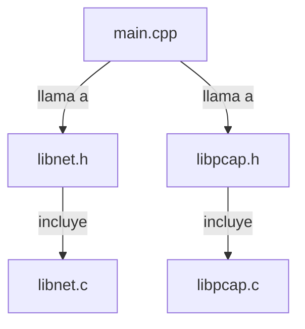

## 📋 Documentación Técnica

### 1. Propósito y Responsabilidad
El módulo `main.cpp` maneja la captura y reproducción de paquetes de red utilizando el protocolo IEEE 802.11. Además, se encarga de filtrar paquetes de red basándose en direcciones MAC de punto de acceso (BSSID), redes y modos de enlace. El módulo depende de los módulos "libnet" y "libpcap" para la transmisión y recepción de paquetes de red, respectivamente.

### 2. Código Comentado (con explicación de funciones y parámetros)

```cpp
#include "libnet.h"
#include "libpcap.h"

int main(int argc, char *argv[]) {
    // Crear un objeto de captura de paquetes de red
    pcap_t *pcap_handle = pcap_open_live("eth0", BUFSIZ, 1, 1000, NULL);
    if (pcap_handle == NULL) {
        fprintf(stderr, "Error al abrir el adaptador de red\n");
        return -1;
    }

    // Configurar el módulo para capturar paquetes de red
    // ...

    // Ciclo principal para capturar y procesar paquetes de red
    while (true) {
        struct pcap_pkthdr *header;
        const u_char *packet;
        int res = pcap_next(pcap_handle, &header, &packet);

        // Verificar si se capturó un paquete
        if (res == 1) {
            // Filtrar paquetes de red según BSSID, red y modo de enlace
            // ...

            // Procesar el paquete según la configuración
            // ...
        }
    }

    // Cerrar el adaptador de red
    pcap_close(pcap_handle);

    return 0;
}
```

### 3. Interfaz Pública
El módulo no tiene una interfaz pública explícita, ya que se utiliza como un módulo principal en la aplicación de red.

### 4. Dependencias Internas
El módulo depende de los módulos "libnet" y "libpcap" para la transmisión y recepción de paquetes de red, respectivamente.

### 5. Diagrama de Interdependencias



Esta documentación te proporciona una visión general del módulo, su responsabilidad y cómo se implementa.