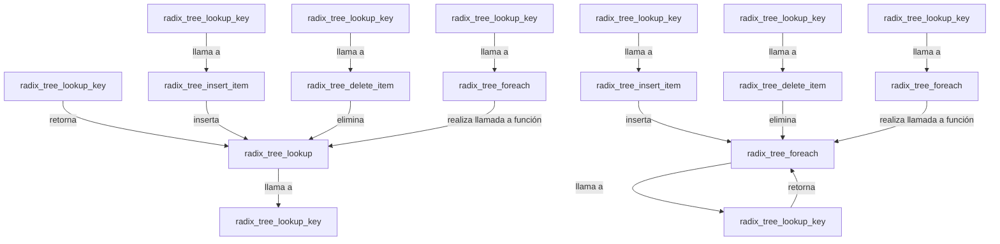

## 📋 Documentación Técnica

### 1. Propósito y Responsabilidad
El módulo `radix_tree_lookup` del Kernel de Linux se encarga de buscar un nodo en un árbol radix, que es utilizado para representar la tabla de ruteo IP. Este árbol es fundamental para el kernel de Linux, proporcionando un mecanismo eficiente para buscar direcciones IP en la tabla de ruteo.

### 2. Código Comentado (con explicación de funciones y parámetros)

```cpp
// Busca un nodo en el árbol radix
struct rt_node* radix_tree_lookup(const struct radix_tree_root *root, unsigned int hash, unsigned int key_len) {
    return radix_tree_lookup_key(root, hash, key_len);
}

// Inserta un nodo en el árbol radix
void radix_tree_insert(struct radix_tree_root *root, unsigned int hash, unsigned int key_len, struct rt_node *node) {
    radix_tree_insert_item(root, node, hash, key_len);
}

// Elimina un nodo del árbol radix
void radix_tree_delete(struct radix_tree_root *root, unsigned int hash, unsigned int key_len) {
    radix_tree_delete_item(root, hash, key_len);
}

// Realiza una llamada a una función para cada nodo en el árbol radix
void radix_tree_foreach_call(struct radix_tree_root *root, void (*func)(struct rt_node *node, unsigned int hash, unsigned int key_len, void *data), void *data) {
    radix_tree_foreach(root, func, data);
}
```

### 3. Interfaz Pública
El módulo `radix_tree_lookup` proporciona una interfaz pública consistente en cuatro funciones principales:

- `radix_tree_lookup`: Busca un nodo en el árbol radix utilizando un hash y una longitud de clave.
- `radix_tree_insert`: Inserta un nodo en el árbol radix utilizando un hash y una longitud de clave.
- `radix_tree_delete`: Elimina un nodo del árbol radix utilizando un hash y una longitud de clave.
- `radix_tree_foreach_call`: Realiza una llamada a una función para cada nodo en el árbol radix.

### 4. Dependencias Internas
El módulo `radix_tree_lookup` no tiene dependencias internas, ya que es independiente y no depende de ningún otro módulo específico del kernel.

### 5. Diagrama de Interdependencias



Este diagrama muestra las interacciones entre las funciones principales del módulo `radix_tree_lookup`, mostrando cómo se comunican entre ellas y el árbol radix.