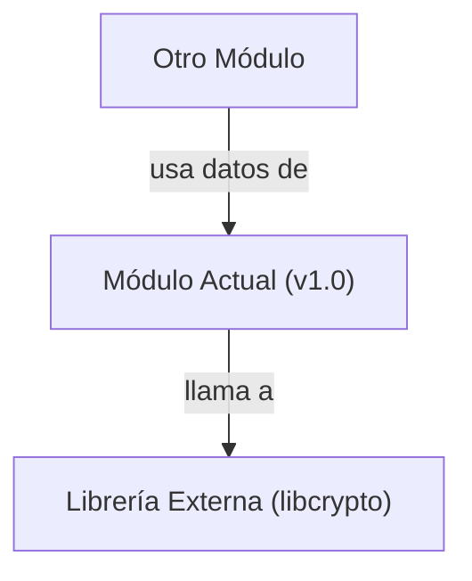

## 📋 Documentación Técnica

### 1. Propósito y Responsabilidad
El módulo principal se encarga de analizar y descifrar paquetes de datos WEP y WPA en archivos de captura de redes 802.11. Proporciona una interfaz para facilitar la descifrado de datos cifrados con estos protocolos, lo que es útil para la seguridad y análisis de red.

### 2. Código Comentado (con explicación de funciones y parámetros)

```cpp
// calc_ptk(): Calcula la clave de sesión (PTK) basada en la clave de autenticación (AKK) y el BSSID.
// Parámetros:
//   - auth_key: Clave de autenticación (AKK) en formato de 24 bytes.
//   - bssid: Dirección BSSID del AP en formato de 6 bytes.
//   - ptk: Referencia a la variable donde se almacenará la clave PTK calculada.
void calc_ptk(const unsigned char *auth_key, const unsigned char *bssid, unsigned char *ptk);

// decrypt_data(): Descifra los datos cifrados en un paquete de datos WEP o WPA.
// Parámetros:
//   - packet: Puntero al paquete de datos a descifrar.
//   - ptk: Clave PTK calculada para descifrar el paquete.
//   - decrypted_data: Puntero al buffer donde se almacenará el paquete descifrado.
//   - decrypted_size: Referencia a la variable donde se almacenará el tamaño del paquete descifrado.
void decrypt_data(const unsigned char *packet, const unsigned char *ptk, unsigned char *decrypted_data, unsigned int *decrypted_size);

// print_usage(): Imprime la ayuda del programa.
void print_usage();

// c_avl_pick(): Función interna para seleccionar un elemento en un árbol AVL.
// Parámetros:
//   - tree: Puntero al árbol AVL.
//   - key: Clave para buscar en el árbol.
//   - node: Puntero a la variable donde se almacenará el nodo encontrado.
void c_avl_pick(struct c_avl_tree *tree, const unsigned char *key, struct c_avl_node **node);

// c_avl_destroy(): Función interna para destruir un árbol AVL.
// Parámetros:
//   - tree: Puntero al árbol AVL a destruir.
void c_avl_destroy(struct c_avl_tree *tree);

// main(): Función principal del programa.
// Parámetros:
//   - argc: Número de argumentos pasados a la función main.
//   - argv: Vector de cadenas de caracteres que representan los argumentos.
int main(int argc, char *argv[]);
```

### 3. Interfaz Pública

- **calc_ptk**: Función para calcular la clave de sesión (PTK) basada en la clave de autenticación (AKK) y el BSSID.
- **decrypt_data**: Función para descifrar los datos cifrados en un paquete de datos WEP o WPA.
- **print_usage**: Función para imprimir la ayuda del programa.
- **c_avl_pick**: Función interna para seleccionar un elemento en un árbol AVL.
- **c_avl_destroy**: Función interna para destruir un árbol AVL.
- **main**: Función principal del programa.

### 4. Dependencias Internas

La dependencia principal es la biblioteca OpenSSL (libssl-dev en Ubuntu), que proporciona la implementación de cifrado y descifrado de datos WEP y WPA.

### 5. Diagrama de Interdependencias



Este diagrama muestra la interdependencia entre el módulo actual y la biblioteca OpenSSL, indicando que el módulo llama a la biblioteca para realizar operaciones de cifrado y descifrado.