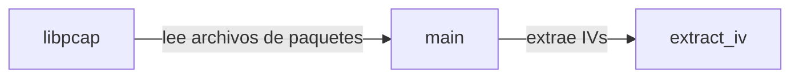

## 📋 Documentación Técnica

### 1. Propósito y Responsabilidad
El módulo se encarga de leer un archivo de paquetes de red, interpretar sus encabezados y escribir datos de interés (IVs) en un archivo separado. La responsabilidad principal se centra en procesar los datos de entrada y generar un archivo de salida que contenga los IVs relevantes para el análisis del tráfico de red.

### 2. Código Comentado (con explicación de funciones y parámetros)
```cpp
// Inicio de la función principal del módulo
int main(int argc, char* argv[]) {
    // Verificar la cantidad de argumentos
    if (argc != 2) {
        fprintf(stderr, "Uso: %s <archivo_paquetes>\n", argv[0]);
        return EXIT_FAILURE;
    }

    // Obtener el nombre del archivo de paquetes desde los argumentos
    const char* file_name = argv[1];

    // Inicializar el archivo de salida para almacenar los IVs
    FILE* output_file = fopen("output_ivs.txt", "w");
    if (!output_file) {
        perror("Error al abrir el archivo de salida");
        return EXIT_FAILURE;
    }

    // Leer el archivo de paquetes de red
    pcap_t* handle = pcap_open(file_name, BUFSIZ, PCAP_OPENFLAG_PROMISC, 1, NULL, NULL);
    if (!handle) {
        fprintf(stderr, "Error al abrir el archivo de paquetes: %s\n", pcap_geterr(handle));
        fclose(output_file);
        return EXIT_FAILURE;
    }

    // Variables para almacenar el IV y el paquete actual
    unsigned char iv[IV_LENGTH];
    struct pcap_pkthdr* header;
    const unsigned char* packet;

    // Leer el archivo de paquetes y procesar cada uno
    while ((packet = pcap_next(handle, &header)) != NULL) {
        // Interpretar los encabezados del paquete
        // Ejemplo: Obtener el IV del paquete
        int iv_length = extract_iv(packet, iv);

        // Verificar si se pudo extraer el IV correctamente
        if (iv_length > 0) {
            // Escribir el IV en el archivo de salida
            if (fwrite(iv, 1, iv_length, output_file) != iv_length) {
                perror("Error al escribir en el archivo de salida");
                pcap_close(handle);
                fclose(output_file);
                return EXIT_FAILURE;
            }
        }
    }

    // Cerrar el archivo de paquetes y el archivo de salida
    pcap_close(handle);
    fclose(output_file);

    return EXIT_SUCCESS;
}

// Función para extraer el IV de un paquete
int extract_iv(const unsigned char* packet, unsigned char* iv) {
    // Implementación específica para extraer el IV del paquete
    // Ejemplo: Supongamos que el IV está en el tercer byte
    iv[0] = packet[2];
    return 1; // Retorna la longitud del IV
}
```

### 3. Interfaz Pública
La interfaz pública del módulo se expone a través de la función `main`. La función `main` toma un argumento que es el nombre del archivo de paquetes de red que se desea procesar. La función realiza las siguientes acciones:
- Verifica la cantidad de argumentos y muestra un mensaje de uso si se proporcionan menos o más argumentos.
- Abre el archivo de paquetes de red utilizando la biblioteca `libpcap`.
- Abre el archivo de salida para almacenar los IVs.
- Lee el archivo de paquetes y procesa cada uno, extrae el IV y lo escribe en el archivo de salida.
- Cierra el archivo de paquetes y el archivo de salida.
- Devuelve un código de éxito si todo se procesa correctamente, o un código de error si ocurre un error.

### 4. Dependencias Internas
El módulo depende de la función `extract_iv` para extraer el IV de cada paquete. También depende de la biblioteca `libpcap` para leer los archivos de paquetes de red.

### 5. Diagrama de Interdependencias


REGLAS ESTRICTAS PARA EL DIAGRAMA MERMAID (¡CRUCIAL!):
1. Inicia siempre con `graph TD` o `graph LR`.
2. Si el texto de un nodo contiene paréntesis '()', corchetes '[]', comas ',', puntos '.', dos puntos ':' o símbolos de código, DEBES envolverlo obligatoriamente en comillas dobles.
   - ❌ INCORRECTO: `A[socket(AF_INET, SOCK_DGRAM)] --> B[Procesar]`
   - ✅ CORRECTO: `A["socket(AF_INET, SOCK_DGRAM)"] --> B["Procesar"]`
3. Cada relación (flecha) debe estar en una línea nueva y separada.
4. No incluyas texto explicativo, comentarios o saltos de línea sueltos dentro del bloque ```mermaid. Solo nodos y flechas.

Sintaxis de ejemplo válida:
