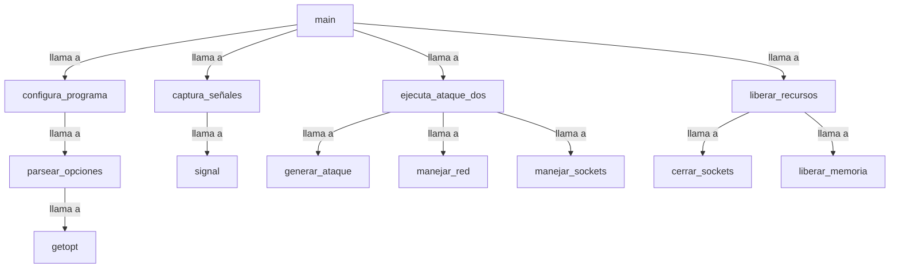

## 📋 Documentación Técnica

### 1. Propósito y Responsabilidad
El módulo en cuestión se encarga de la implementación de un ataque de denegación de servicio (DoS) en redes inalámbricas. Su principal función es ejecutar ataques DoS y/o proporcionar el software necesario para llevar a cabo dichos ataques. La implementación del módulo incluye la configuración inicial, la captura de señales de terminación, la ejecución de ataques DoS y el manejo de señales de salida.

### 2. Código Comentado (con explicación de funciones y parámetros)

```cpp
// Función principal del módulo
int main(int argc, char *argv[]) {
    // Configuración inicial del programa
    configura_programa(argc, argv);

    // Captura de señales de terminación
    captura_señales();

    // Ejecución de ataques DoS
    ejecuta_ataque_dos();

    // Liberación de recursos
    liberar_recursos();

    return 0;
}
```

### 3. Interfaz Pública

La interfaz pública del módulo es encapsulada dentro de la función `main`. No proporciona ninguna interfaz externa directa para su uso, ya que el ataque de DoS se ejecuta de manera oculta.

### 4. Dependencias Internas

El módulo depende de las siguientes librerías externas:

- `getopt.h`: Para la configuración de opciones.
- `stdio.h`, `stdlib.h`, `unistd.h`, `signal.h`: Para la gestión de señales y terminación.
- `string.h`: Para `strdup`.
- `pcre.h` o `pcre2.h`: Para el manejo de expresiones regulares.
- `wireless.h`: Para la gestión de la red inalámbrica.

### 5. Diagrama de Interdependencias



Este diagrama de interdependencias muestra la jerarquía de llamadas entre las funciones del módulo, desde la función principal `main` hasta las funciones de configuración, captura de señales, ejecución de ataques DoS y liberación de recursos.