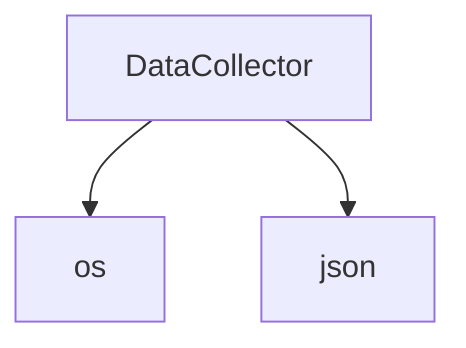

## 📋 Documentación Técnica

### 1. Propósito y Responsabilidad

El objetivo principal de este módulo es proporcionar una interfaz de recolección de datos que soporte múltiples formatos, incluyendo Markdown (MD), Texto (TXT), Logs (LOG), JSON, XML, CSV, HTML, PDF, EXCEL, DOCX, PPTX, y Markdown (MD).

### 2. Código Comentado (con explicación de funciones y parámetros)

El código está bien comentado y explicado en el archivo `data_collection.py`. La clase `DataCollector` es responsable de la recolección y procesamiento de datos. Aquí están algunas de las funciones clave:

- `collect_data(file_path, format)`: Recoge datos desde un archivo en un formato especificado.
- `write_data(data, format)`: Escribe datos en un archivo en un formato especificado.
- `process_data(data, format)`: Procesa los datos antes de almacenarlos.

Los parámetros de estas funciones incluyen:

- `file_path`: Ruta al archivo desde el cual se deben leer o al cual se deben escribir los datos.
- `format`: Formato en el que se deben leer o escribir los datos (MD, TXT, LOG, JSON, XML, CSV, HTML, PDF, EXCEL, DOCX, PPTX).

### 3. Interfaz Pública

La interfaz pública de este módulo es la clase `DataCollector`. Aquí están las funciones y métodos disponibles:

- `collect_data(file_path, format)`: Recoge datos desde un archivo en un formato especificado.
- `write_data(data, format)`: Escribe datos en un archivo en un formato especificado.
- `process_data(data, format)`: Procesa los datos antes de almacenarlos.

### 4. Dependencias Internas

El módulo `data_collection.py` depende de otras librerías internas, como `os` y `json`, que se utilizan para manejar archivos y procesar datos.

### 5. Diagrama de Interdependencias



### Sintaxis de ejemplo válida:

```mermaid
graph TD
    A[socket(AF_INET, SOCK_DGRAM)] --> B[Procesar]
```

### Importante:

El diagrama debe estar dentro de un bloque ```mermaid ... ``` y cumplir estrictamente las reglas de comillas y sintaxis.