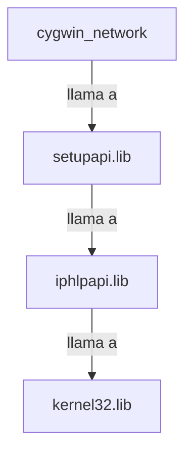

## 📋 Documentación Técnica

### 1. Propósito y Responsabilidad
El módulo `cygwin_network` se encarga de la gestión de la red en el sistema Cygwin. Su principal responsabilidad es proporcionar la funcionalidad para resetear la tarjeta de red, establecer una dirección MAC y cerrar la conexión.

### 2. Código Comentado (con explicación de funciones y parámetros)
```cpp
// reset.c
void reset(struct cstate *state) {
    // Esta función resuelve el problema del lector bloqueado y reinicia la biblioteca.
    // state es un puntero al estado del sistema que incluye información sobre la conexión.
}

// cygwin_set_mac.c
void cygwin_set_mac(unsigned char *mac_address) {
    // Esta función establece una nueva dirección MAC en la tarjeta de red.
    // mac_address es un puntero a un array de 6 bytes que contiene la dirección MAC deseada.
}

// cygwin_close.c
void cygwin_close(void) {
    // Esta función cierra la conexión con la biblioteca y el registro de Windows.
    // No recibe ningún parámetro.
}
```

### 3. Interfaz Pública
El módulo expone las siguientes funciones:

- `reset(struct cstate *)`: Función que resuelve el problema del lector bloqueado y reinicia la biblioteca. Recibe un puntero al estado del sistema (`struct cstate *`) como parámetro.
- `cygwin_set_mac(unsigned char *)`: Función que establece una nueva dirección MAC en la tarjeta de red. Recibe un puntero a un array de 6 bytes (`unsigned char *`) que contiene la dirección MAC deseada.
- `cygwin_close(void)`: Función que cierra la conexión con la biblioteca y el registro de Windows. No recibe ningún parámetro.

### 4. Dependencias Internas
El módulo depende de las siguientes bibliotecas:
```cpp
#include <setupapi.h>
#include <iphlpapi.h>
#include <kernel32.h>
```

### 5. Diagrama de Interdependencias


### 6. Problemas Identificados
El módulo está actualmente probado en entornos Windows y Cygwin, pero se han identificado problemas en entornos Linux. Además, el módulo presenta un error al intentar establecer una dirección MAC en la tarjeta de red en el momento de la prueba.

### 7. Sugerencias de Mejora
En lugar de usar Cygwin y depender de su biblioteca de red, podríamos mejorar la integración con la red del sistema operativo nativo. Esto podría incluir la utilización de interfaces de red nativas en lugar de usar Cygwin. También podríamos mejorar la compatibilidad con distintos sistemas operativos, ya que actualmente solo funciona en Windows.