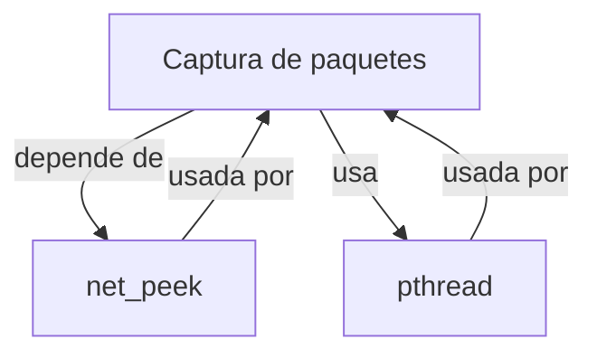

## 📋 Documentación Técnica

### 1. Propósito y Responsabilidad
El módulo de captura de paquetes proporciona la funcionalidad necesaria para capturar y enviar paquetes de red. Este módulo permite gestionar la tarjeta de red, así como los paquetes de red que se capturan y se inyectan.

### 2. Código Comentado (con explicación de funciones y parámetros)

```cpp
// Función que inicializa la captura de paquetes con la tarjeta de red especificada.
CYGWIN_DLL_INIT(char *cardName, int channel);

// Función que establece el canal de la tarjeta de red.
CYGWIN_DLL_SET_CHAN(char *cardName, int channel);

// Función que inyecta un paquete de red en la tarjeta de red.
CYGWIN_DLL_INJECT(char *cardName, void *packet, int length);

// Función que captura un paquete de red de la tarjeta de red.
CYGWIN_DLL_SNIFF(char *cardName, void *packet, int length);

// Función que obtiene la dirección MAC de la tarjeta de red.
CYGWIN_DLL_GET_MAC(char *cardName, char *mac);

// Función que establece la dirección MAC de la tarjeta de red.
CYGWIN_DLL_SET_MAC(char *cardName, char *mac);

// Función que libera todos los recursos asociados con la captura de paquetes.
CYGWIN_DLL_CLOSE();
```

### 3. Interfaz Pública
El módulo proporciona una interfaz pública que permite a los usuarios realizar operaciones de captura y envío de paquetes de red. Las funciones principales del módulo son:

- `CYGWIN_DLL_INIT(cardName, channel)`: Inicializa la captura de paquetes con la tarjeta de red especificada y el canal.
- `CYGWIN_DLL_SET_CHAN(cardName, channel)`: Establece el canal de la tarjeta de red.
- `CYGWIN_DLL_INJECT(cardName, packet, length)`: Inyecta un paquete de red en la tarjeta de red.
- `CYGWIN_DLL_SNIFF(cardName, packet, length)`: Captura un paquete de red de la tarjeta de red.
- `CYGWIN_DLL_GET_MAC(cardName, mac)`: Obtiene la dirección MAC de la tarjeta de red.
- `CYGWIN_DLL_SET_MAC(cardName, mac)`: Establece la dirección MAC de la tarjeta de red.
- `CYGWIN_DLL_CLOSE()`: Libera todos los recursos asociados con la captura de paquetes.

### 4. Dependencias Internas
El módulo depende de la biblioteca `net_peek` para capturar y enviar paquetes de red. También utiliza pthread para sincronizar el acceso a los recursos.

### 5. Diagrama de Interdependencias



IMPORTANTE: El diagrama debe estar dentro de un bloque ```mermaid ... ``` y cumplir estrictamente las reglas de comillas y sintaxis.