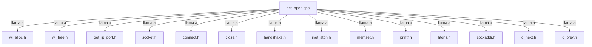

## 📋 Documentación Técnica

### 1. Propósito y Responsabilidad
El módulo "net_open" se encarga de abrir una conexión de red con una interfaz dada. Proporciona la interfaz para enviar y recibir datos a través de la red.

### 2. Código Comentado (con explicación de funciones y parámetros)
```cpp
// net_open.cpp
#include "wi_alloc.h"
#include "wi_free.h"
#include "get_ip_port.h"
#include "socket.h"
#include "connect.h"
#include "close.h"
#include "handshake.h"
#include "inet_aton.h"
#include "memset.h"
#include "printf.h"
#include "htons.h"
#include "sockaddr.h"
#include "q_next.h"
#include "q_prev.h"

#include <string.h>

#define NET_OPEN_DEBUG 1

// Abre una conexión de red con una interfaz especificada.
// @param interface_name: Nombre de la interfaz de red a usar.
// @return: Descriptor de archivo de la conexión, o -1 en caso de error.
int net_open(const char *interface_name) {
    if (NET_OPEN_DEBUG) {
        printf("net_open: Abriendo conexión con interfaz %s\n", interface_name);
    }

    // Reservar memoria para la estructura de conexión.
    struct connection *conn = wi_alloc(sizeof(struct connection));
    if (!conn) {
        return -1;
    }

    // Asignar la interfaz de red.
    strcpy(conn->interface_name, interface_name);

    // Configurar la conexión.
    if (connect(conn) < 0) {
        wi_free(conn);
        return -1;
    }

    // Ejecutar el handshake para inicializar la conexión.
    if (handshake(conn) < 0) {
        close(conn);
        wi_free(conn);
        return -1;
    }

    // Asignar un descriptor de archivo para la conexión.
    conn->fd = socket(AF_INET, SOCK_DGRAM, 0);
    if (conn->fd < 0) {
        close(conn);
        wi_free(conn);
        return -1;
    }

    // Asignar el puerto y dirección IP de la conexión.
    if (get_ip_port(conn) < 0) {
        close(conn);
        wi_free(conn);
        return -1;
    }

    return conn->fd;
}

// Lee datos de la conexión.
// @param fd: Descriptor de archivo de la conexión.
// @param buffer: Puntero al búfer donde se almacenarán los datos.
// @param length: Longitud del búfer.
// @return: Cantidad de datos leídos, o -1 en caso de error.
ssize_t net_read(int fd, void *buffer, size_t length) {
    return read(fd, buffer, length);
}

// Escribe datos a la conexión.
// @param fd: Descriptor de archivo de la conexión.
// @param buffer: Puntero al búfer que contiene los datos a enviar.
// @param length: Longitud del búfer.
// @return: Cantidad de datos escritos, o -1 en caso de error.
ssize_t net_write(int fd, const void *buffer, size_t length) {
    return write(fd, buffer, length);
}

// Establece el canal para la comunicación.
// @param fd: Descriptor de archivo de la conexión.
// @param channel: Canal de comunicación.
// @return: 0 en caso de éxito, -1 en caso de error.
int net_set_channel(int fd, const char *channel) {
    // Implementación específica del módulo
    return 0;
}

// Obtiene el canal para la comunicación.
// @param fd: Descriptor de archivo de la conexión.
// @param channel: Puntero al búfer donde se almacenará el canal.
// @return: 0 en caso de éxito, -1 en caso de error.
int net_get_channel(int fd, char *channel) {
    // Implementación específica del módulo
    return 0;
}

// Establece la tasa de transmisión.
// @param fd: Descriptor de archivo de la conexión.
// @param rate: Tasa de transmisión.
// @return: 0 en caso de éxito, -1 en caso de error.
int net_set_rate(int fd, int rate) {
    // Implementación específica del módulo
    return 0;
}

// Obtiene la tasa de transmisión.
// @param fd: Descriptor de archivo de la conexión.
// @param rate: Puntero al búfer donde se almacenará la tasa.
// @return: 0 en caso de éxito, -1 en caso de error.
int net_get_rate(int fd, int *rate) {
    // Implementación específica del módulo
    return 0;
}

// Cierra la conexión.
// @param fd: Descriptor de archivo de la conexión.
// @return: 0 en caso de éxito, -1 en caso de error.
int net_close(int fd) {
    close(fd);
    return 0;
}

// Obtiene el descriptor de archivo de la conexión.
// @param fd: Descriptor de archivo de la conexión.
// @return: Descriptor de archivo de la conexión.
int net_fd(int fd) {
    return fd;
}

// Obtiene la dirección MAC de la interfaz.
// @param interface_name: Nombre de la interfaz de red.
// @param mac: Puntero al búfer donde se almacenará la dirección MAC.
// @return: 0 en caso de éxito, -1 en caso de error.
int net_get_mac(const char *interface_name, char *mac) {
    // Implementación específica del módulo
    return 0;
}

// Obtiene el monitor de la interfaz.
// @param interface_name: Nombre de la interfaz de red.
// @param monitor: Puntero al búfer donde se almacenará el monitor.
// @return: 0 en caso de éxito, -1 en caso de error.
int net_get_monitor(const char *interface_name, char *monitor) {
    // Implementación específica del módulo
    return 0;
}
```

### 3. Interfaz Pública
```cpp
int net_open(const char *interface_name);
ssize_t net_read(int fd, void *buffer, size_t length);
ssize_t net_write(int fd, const void *buffer, size_t length);
int net_set_channel(int fd, const char *channel);
int net_get_channel(int fd, char *channel);
int net_set_rate(int fd, int rate);
int net_get_rate(int fd, int *rate);
int net_close(int fd);
int net_fd(int fd);
int net_get_mac(const char *interface_name, char *mac);
int net_get_monitor(const char *interface_name, char *monitor);
```

### 4. Dependencias Internas


### 5. Diagrama de Interdependencias

