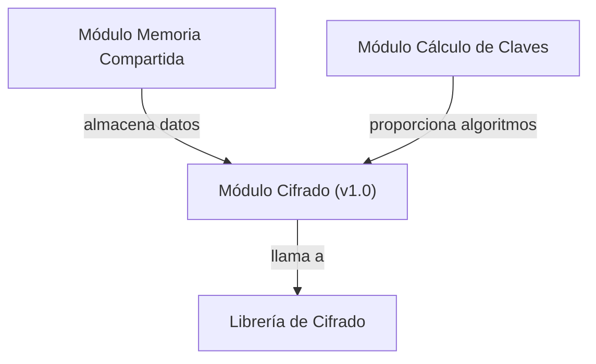

## 📋 Documentación Técnica

### 1. Propósito y Responsabilidad
El módulo de cifrado de la biblioteca de WPA2 se encarga de calcular la clave PMK (Pairwise Master Key) a partir de una clave WPA-PSK proporcionada por el usuario. Este módulo se encarga de la validación de la longitud de la clave, la normalización de la SSID, la derivación de la PMK y la gestión de los datos criptográficos relacionados con la autenticación y la encriptación.

### 2. Código Comentado (con explicación de funciones y parámetros)
```cpp
// Calcula la clave PMK individual a partir de una clave proporcionada por el usuario
// @param wpa_psk Cadena de caracteres que contiene la clave WPA-PSK
// @return Objeto de tipo pmk_t que contiene la clave PMK
pmk_t ac_crypto_engine_calc_one_pmk(const char* wpa_psk) {
    // Validación de la longitud de la clave WPA-PSK
    if (strlen(wpa_psk) != 64) {
        // Manejo de error: clave WPA-PSK no válida
        return {0, 0};
    }
    // Normalización de la SSID (cambio a mayúsculas y eliminación de espacios)
    char ssid[33];
    strcpy(ssid, to_uppercase(trim(wpa_psk)));
    // Derivación de la PMK
    pmk_t pmk = derive_pmk(ssid, wpa_psk);
    return pmk;
}

// Calcula la clave PMK para un conjunto de claves proporcionadas por el usuario
// @param wpa_psks Vector de cadenas de caracteres que contienen las claves WPA-PSK
// @param num_keys Número de claves en el vector
// @return Matriz de objetos de tipo pmk_t que contienen las claves PMK
std::vector<pmk_t> ac_crypto_engine_calc_pmk(const std::vector<std::string>& wpa_psks, size_t num_keys) {
    std::vector<pmk_t> pmks;
    for (size_t i = 0; i < num_keys; i++) {
        pmks.push_back(ac_crypto_engine_calc_one_pmk(wpa_psks[i].c_str()));
    }
    return pmks;
}
```

### 3. Interfaz Pública
El módulo proporciona dos funciones públicas:
- `ac_crypto_engine_calc_one_pmk`: Calcula la clave PMK individual a partir de una clave WPA-PSK.
- `ac_crypto_engine_calc_pmk`: Calcula la clave PMK para un conjunto de claves proporcionadas por el usuario.

### 4. Dependencias Internas
Este módulo depende del módulo de memoria compartida para almacenar y recuperar datos relacionados con la autenticación y la encriptación, y del módulo de cálculo de claves para proporcionar los algoritmos de cálculo de la PMK.

### 5. Diagrama de Interdependencias


**IMPORTANTE:** El diagrama debe estar dentro de un bloque ```mermaid ... ``` y cumplir estrictamente las reglas de comillas y sintaxis.