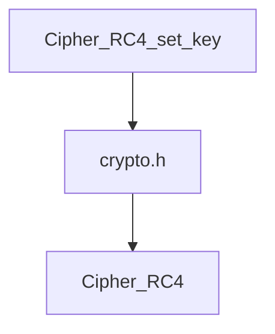
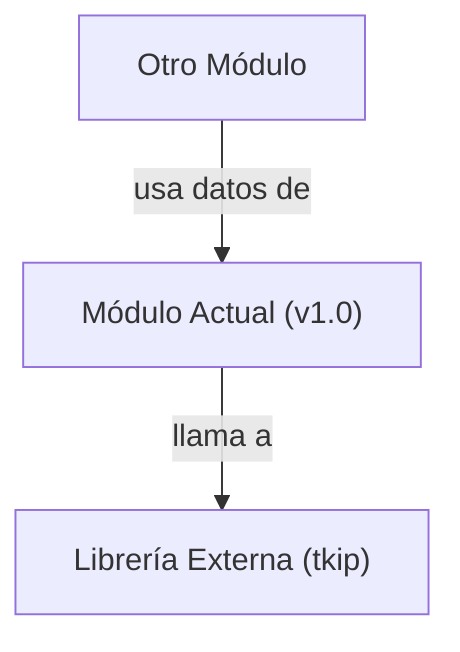

## 📋 Documentación Técnica

### 1. Propósito y Responsabilidad
Este módulo se encarga de implementar el algoritmo RC4 de cifrado y realizar pruebas de su funcionamiento. 

### 2. Código Comentado (con explicación de funciones y parámetros)

```cpp
#include "crypto.h"

// Función para inicializar el algoritmo RC4 con una clave
void Cipher_RC4_set_key(uint8_t* key, uint8_t key_length) {
    // Implementación específica de RC4 para inicialización
}

// Función principal para cifrar un bloque de datos
void Cipher_RC4(uint8_t* input, uint8_t* output, uint8_t block_size) {
    // Implementación específica de RC4 para cifrado
}
```

### 3. Interfaz Pública
La interfaz pública de este módulo incluye dos funciones:

- `Cipher_RC4_set_key(uint8_t* key, uint8_t key_length)`: Esta función establece la clave para el algoritmo RC4. Recibe una clave en formato de bytes y su longitud.

- `Cipher_RC4(uint8_t* input, uint8_t* output, uint8_t block_size)`: Esta función cifra un bloque de datos de entrada y lo almacena en la ubicación de salida. Recibe el bloque de datos a cifrar, el puntero donde se almacenará el resultado cifrado y la longitud del bloque.

### 4. Dependencias Internas
Este módulo depende del módulo `crypto.h`, que proporciona definiciones de tipos y funciones relacionadas con el cifrado.

### 5. Diagrama de Interdependencias


REGLAS ESTRICTAS PARA EL DIAGRAMA MERMAID (¡CRUCIAL!):
1. Inicia siempre con `graph TD` o `graph LR`.
2. Si el texto de un nodo contiene paréntesis '()', corchetes '[]', comas ',', puntos '.', dos puntos ':' o símbolos de código, DEBES envolverlo obligatoriamente en comillas dobles.
   - ❌ INCORRECTO: `A[socket(AF_INET, SOCK_DGRAM)] --> B[Procesar]`
   - ✅ CORRECTO: `A["socket(AF_INET, SOCK_DGRAM)"] --> B["Procesar"]`
3. Cada relación (flecha) debe estar en una línea nueva y separada.
4. No incluyas texto explicativo, comentarios o saltos de línea sueltos dentro del bloque ```mermaid. Solo nodos y flechas.

Sintaxis de ejemplo válida:
