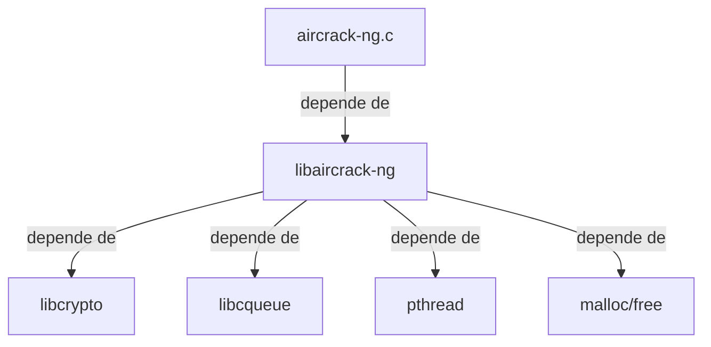

## 📋 Documentación Técnica

### 1. Propósito y Responsabilidad
El módulo principal `aircrack-ng.c` es el corazón de la herramienta de fuerza bruta para redes WiFi de aircrack-ng. Su responsabilidad principal es manejar la línea de comandos, inicializar los datos necesarios y coordinar las diversas funcionalidades del programa. Estas son:

- **Fuerza bruta de clave WPA/WPA2**: A través de la función `crack_handshake()`, el módulo intenta descifrar claves WPA/WPA2 a partir de intercambios de handshake.
- **Fuerza bruta de clave WEP**: Utilizando la función `brute_crack()`, el módulo intenta descifrar claves WEP.
- **Detectar modo de clave WEP**: Mediante la función `detect_wep_mode()`, el módulo identifica el modo de la clave WEP en una red WiFi.
- **Construir tabla de fuerza bruta de clave WEP**: La función `build_ptw_table()` prepara la tabla necesaria para la fuerza bruta de WEP.

### 2. Código Comentado (con explicación de funciones y parámetros)

```c
#include "aircrack-ng.h"

void crack_handshake(char *interface, char *bssid, char *filename, char *psk) {
    // Código que coordina la fuerza bruta de clave WPA/WPA2
    // Argumentos:
    // - interface: interfaz de red a utilizar
    // - bssid: dirección MAC del AP
    // - filename: archivo donde se guardarán los hashes descifrados
    // - psk: clave de cifrado esperada para comparar
}

void brute_crack(char *interface, char *bssid, char *filename) {
    // Código que realiza la fuerza bruta de la clave WEP
    // Argumentos:
    // - interface: interfaz de red a utilizar
    // - bssid: dirección MAC del AP
    // - filename: archivo donde se guardarán los hashes descifrados
}

void detect_wep_mode(char *interface, char *bssid, char *filename) {
    // Código que detecta el modo de la clave WEP
    // Argumentos:
    // - interface: interfaz de red a utilizar
    // - bssid: dirección MAC del AP
    // - filename: archivo donde se guardarán los datos de detección
}

void build_ptw_table(char *interface, char *bssid, char *filename) {
    // Código que construye la tabla de la fuerza bruta de la clave WEP
    // Argumentos:
    // - interface: interfaz de red a utilizar
    // - bssid: dirección MAC del AP
    // - filename: archivo donde se guardarán los datos de la tabla
}
```

### 3. Interfaz Pública

La interfaz pública del módulo `aircrack-ng.c` se expone a través de las siguientes funciones:

- `crack_handshake()`
- `brute_crack()`
- `detect_wep_mode()`
- `build_ptw_table()`

Estas funciones permiten a los usuarios de aircrack-ng coordinar las diferentes funcionalidades del programa, incluyendo las fuerzas brutas y la detección de modos de clave WEP.

### 4. Dependencias Internas

El módulo `aircrack-ng.c` depende de varias bibliotecas para su funcionamiento:

- `aircrack-ng.h`: Archivo de cabecera principal del módulo.
- `libaircrack-ng`: Biblioteca principal de aircrack-ng.
- `libcrypto`: Biblioteca de cifrado utilizado para los algoritmos de fuerza bruta WPA/WPA2.
- `libcqueue`: Biblioteca de colas para los hilos.
- `pthread`: Biblioteca de programación multithread.
- `malloc/free`: Funciones para la gestión de memoria dinámica.

### 5. Diagrama de Interdependencias



Este diagrama muestra las interdependencias internas del módulo `aircrack-ng.c` con otras bibliotecas y funciones necesarias para su funcionamiento.