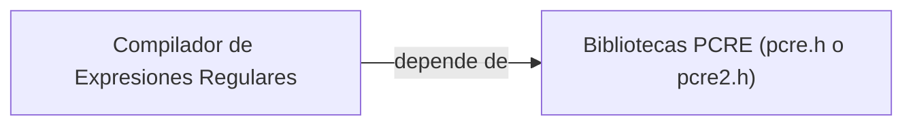

## 📋 Documentación Técnica

### 1. Propósito y Responsabilidad
Este módulo proporciona compatibilidad entre el código fuente de `aircrack-ng` y las bibliotecas PCRE (Perl-Compatible Regular Expressions). PCRE es una biblioteca de expresiones regulares flexible que permite al desarrollador usar patrones de expresiones regulares para buscar, reemplazar y manipular textos de una manera similar a cómo lo hace Perl.

### 2. Código Comentado (con explicación de funciones y parámetros)
```cpp
// Macro para compilar expresiones regulares
#define COMPAT_PCRE_COMPILE(regexp, errptr) \
    pcre_compile(regexp, PCRE_ANCHORED, NULL, errptr, NULL)

// Macro para ejecutar expresiones regulares
#define COMPAT_PCRE_MATCH(re, subject, errptr) \
    pcre_exec(re, NULL, subject, (int)strlen(subject), 0, 0, NULL, 0, errptr)

// Macro para imprimir errores de PCRE
#define COMPAT_PCRE_PRINT_ERROR(errptr) \
    pcre_error_number_to_string(errptr, NULL, NULL)
```

### 3. Interfaz Pública
El módulo proporciona las siguientes funciones/macros:
- `COMPAT_PCRE_COMPILE`: Compila una expresión regular.
- `COMPAT_PCRE_MATCH`: Ejecuta una expresión regular en un texto.
- `COMPAT_PCRE_PRINT_ERROR`: Imprime el error correspondiente a una expresión regular.

### 4. Dependencias Internas
Este módulo depende de las bibliotecas de expresiones regulares `pcre.h` o `pcre2.h`, que deben estar instaladas en el sistema. La dependencia se establece a través de las macros `HAVE_PCRE` o `HAVE_PCRE2`, que deben estar definidas en el sistema de compilación del proyecto y su configuración.

### 5. Diagrama de Interdependencias


REGLAS ESTRICTAS PARA EL DIAGRAMA MERMAID (¡CRUCIAL!):
1. Inicia siempre con `graph TD` o `graph LR`.
2. Si el texto de un nodo contiene paréntesis '()', corchetes '[]', comas ',', puntos '.', dos puntos ':' o símbolos de código, DEBES envolverlo obligatoriamente en comillas dobles.
3. Cada relación (flecha) debe estar en una línea nueva y separada.
4. No incluyas texto explicativo, comentarios o saltos de línea sueltos dentro del bloque ```mermaid. Solo nodos y flechas.