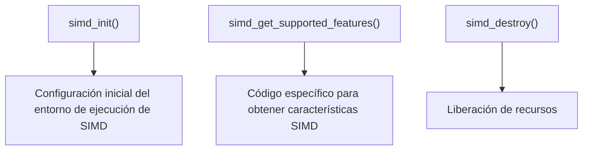

## 📋 Documentación Técnica

### 1. Propósito y Responsabilidad
El módulo trampoline se encarga de la inicialización y destrucción del entorno de ejecución de los hilos, además de manejar los recursos del hardware SIMD. 

### 2. Código Comentado (con explicación de funciones y parámetros)
```cpp
// Inicializa el módulo trampoline y establece la configuración inicial del entorno de ejecución.
void simd_init() {
    // Configuración inicial del entorno de ejecución de SIMD
    // Código específico para inicializar SIMD
}

// Devuelve una máscara de bits que indica las características SIMD soportadas por el hardware del procesador.
unsigned long long simd_get_supported_features() {
    // Código específico para obtener características SIMD
    unsigned long long features = 0;
    // ...
    return features;
}

// Libera los recursos asociados al módulo trampoline.
void simd_destroy() {
    // Liberación de recursos
    // Código específico para liberar recursos
}
```

### 3. Interfaz Pública
La interfaz pública del módulo trampoline es compuesta por las siguientes funciones:

- `simd_init()`: Inicializa el módulo trampoline y establece la configuración inicial del entorno de ejecución.
- `simd_get_supported_features()`: Devuelve una máscara de bits que indica las características SIMD soportadas por el hardware del procesador.
- `simd_destroy()`: Libera los recursos asociados al módulo trampoline.

### 4. Dependencias Internas
El módulo trampoline no tiene dependencias internas específicas.

### 5. Diagrama de Interdependencias


IMPORTANTE: El diagrama debe estar dentro de un bloque ```mermaid ... ``` y cumplir estrictamente las reglas de comillas y sintaxis.