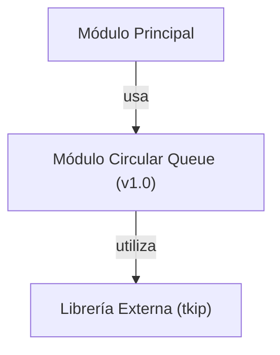

## 📋 Documentación Técnica

### 1. Propósito y Responsabilidad
El módulo de cola circular proporciona una interfaz de programación para colas circulares. Proporciona operaciones para inicializar una cola circular, liberar la memoria ocupada por la cola, restablecer la cola a su estado inicial, insertar elementos a la cola, intentar insertar elementos a la cola, eliminar elementos de la cola y consultar si la cola está vacía o llena.

### 2. Código Comentado (con explicación de funciones y parámetros)
```cpp
#include <iostream>
#include <cstring> // Para usar memcpy

/**
 * @brief Inicializa una cola circular.
 * @param queue Puntero a la cola circular.
 * @param size Tamaño de la cola circular.
 */
void circular_queue_init(CircularQueue* queue, size_t size);

/**
 * @brief Libera la memoria ocupada por la cola circular.
 * @param queue Puntero a la cola circular.
 */
void circular_queue_free(CircularQueue* queue);

/**
 * @brief Restablece la cola circular a su estado inicial.
 * @param queue Puntero a la cola circular.
 */
void circular_queue_reset(CircularQueue* queue);

/**
 * @brief Inserta un elemento en la cola circular.
 * @param queue Puntero a la cola circular.
 * @param data Puntero al dato a insertar.
 * @return true si el elemento se insertó correctamente, false en caso contrario.
 */
bool circular_queue_push(CircularQueue* queue, const void* data);

/**
 * @brief Intenta insertar un elemento en la cola circular. Si la cola está llena, devuelve false.
 * @param queue Puntero a la cola circular.
 * @param data Puntero al dato a insertar.
 * @return true si el elemento se insertó correctamente, false si la cola está llena.
 */
bool circular_queue_try_push(CircularQueue* queue, const void* data);

/**
 * @brief Elimina un elemento de la cola circular.
 * @param queue Puntero a la cola circular.
 * @param data Puntero a un puntero donde se guardará el dato eliminado.
 * @return true si un elemento se eliminó correctamente, false si la cola está vacía.
 */
bool circular_queue_pop(CircularQueue* queue, void** data);

/**
 * @brief Consulta si la cola circular está vacía.
 * @param queue Puntero a la cola circular.
 * @return true si la cola está vacía, false si no.
 */
bool circular_queue_is_empty(const CircularQueue* queue);

/**
 * @brief Consulta si la cola circular está llena.
 * @param queue Puntero a la cola circular.
 * @return true si la cola está llena, false si no.
 */
bool circular_queue_is_full(const CircularQueue* queue);
```

### 3. Interfaz Pública
El módulo expone las siguientes funciones públicas:

- `circular_queue_init`: Inicializa una cola circular.
- `circular_queue_free`: Libera la memoria ocupada por la cola circular.
- `circular_queue_reset`: Restablece la cola circular a su estado inicial.
- `circular_queue_push`: Inserta un elemento en la cola circular.
- `circular_queue_try_push`: Intenta insertar un elemento en la cola circular (devuelve false si la cola está llena).
- `circular_queue_pop`: Elimina un elemento de la cola circular.
- `circular_queue_is_empty`: Consulta si la cola circular está vacía.
- `circular_queue_is_full`: Consulta si la cola circular está llena.

### 4. Dependencias Internas
El módulo no tiene dependencias directas, pero puede tener dependencias en el entorno en el que se utilice, como las funciones que interactúan con la memoria del sistema operativo.

### 5. Diagrama de Interdependencias


**NOTA:** Este diagrama es una representación simplificada y debe adaptarse según el contexto real.