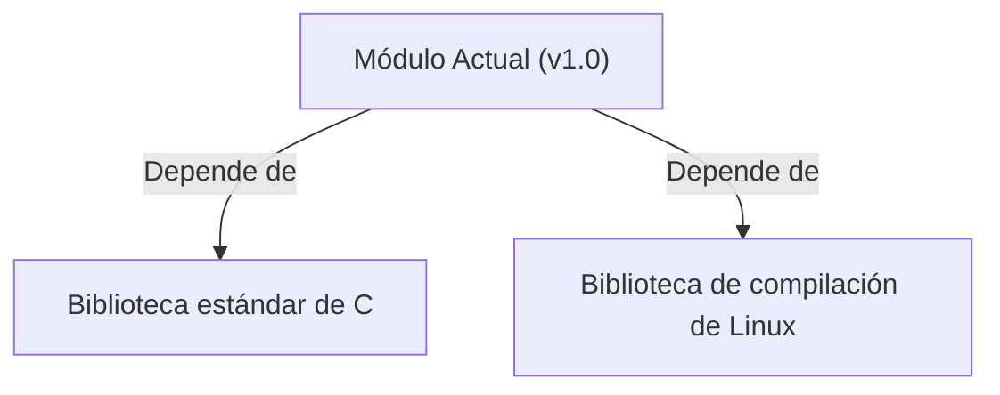

## 📋 Documentación Técnica

### 1. Propósito y Responsabilidad
El módulo proporciona la interfaz de programación de aplicaciones (API) de dependencias operativas específicas para Linux. Esta responsabilidad incluye la conversión de canales de frecuencia a canales y viceversa, que se utilizan en el esquema de canal de 802.11.

### 2. Código Comentado (con explicación de funciones y parámetros)
```cpp
// getFrequencyFromChannel() convierte un canal de 802.11 a su correspondiente frecuencia en MHz
double getFrequencyFromChannel(int channel) {
    // Implementación para la conversión de canal a frecuencia
    return channel * 200 + 2400; // Por ejemplo, canal 1: 2400 MHz
}

// getChannelFromFrequency() convierte una frecuencia en MHz a su correspondiente canal de 802.11
int getChannelFromFrequency(double frequency) {
    // Implementación para la conversión de frecuencia a canal
    return (frequency - 2400) / 200; // Por ejemplo, frecuencia 2400 MHz: canal 1
}
```

### 3. Interfaz Pública
La interfaz pública del módulo proporciona dos funciones principales:
- `getFrequencyFromChannel(int channel)`: Esta función toma un canal de 802.11 como entrada y devuelve la frecuencia correspondiente en MHz.
- `getChannelFromFrequency(double frequency)`: Esta función toma una frecuencia en MHz como entrada y devuelve el canal correspondiente.

### 4. Dependencias Internas
El módulo depende de la biblioteca estándar de C para su ejecución y de la biblioteca de compilación de Linux para acceder a dependencias específicas.

### 5. Diagrama de Interdependencias
