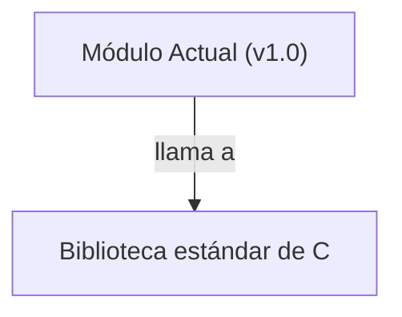

## 📋 Documentación Técnica

### 1. Propósito y Responsabilidad
El módulo proporcionado se encarga de la interfaz de usuario en consola de Aircrack-ng. Controla la presentación de texto, colores, movimiento del cursor, y la manipulación de la consola.

### 2. Código Comentado (con explicación de funciones y parámetros)
```cpp
// textcolor(char *color_name) - Establece el color del texto en la consola.
// Parámetros:
//   color_name: Una cadena que especifica el color a usar. Ejemplos: "red", "green", "blue", etc.
void textcolor(char *color_name);

// textstyle(char *style_name) - Establece el estilo del texto en la consola.
// Parámetros:
//   style_name: Una cadena que especifica el estilo a usar. Ejemplos: "bold", "underline", "italic", etc.
void textstyle(char *style_name);

// moveto(int x, int y) - Mueve el cursor a las coordenadas (x, y) en la consola.
// Parámetros:
//   x: La coordenada horizontal del cursor.
//   y: La coordenada vertical del cursor.
void moveto(int x, int y);

// move(int x, int y) - Mueve el cursor a las coordenadas (x, y) en la consola.
// Parámetros:
//   x: El número de columnas a mover.
//   y: El número de filas a mover.
void move(int x, int y);

// erase_display() - Borra toda la pantalla de la consola.
void erase_display();

// erase_line() - Borra la línea actual en la consola.
void erase_line();

// hide_cursor() - Oculta el cursor en la consola.
void hide_cursor();

// show_cursor() - Muestra el cursor en la consola.
void show_cursor();

// reset_term() - Restablece la consola a su estado inicial.
void reset_term();

// mygetch() - Lee un carácter de entrada del usuario sin mostrarlo en la consola.
// Parámetros:
//   char ch: El carácter leído.
char mygetch();
```

### 3. Interfaz Pública
Este módulo proporciona una interfaz simple y controlada para interactuar con la consola. Se ofrecen métodos para:

- Establecer el color y estilo del texto.
- Mover el cursor a posiciones específicas.
- Borrar la pantalla y líneas.
- Ocultar y mostrar el cursor.
- Restablecer la consola.
- Leer caracteres de entrada sin mostrarlos en la consola.

### 4. Dependencias Internas
Este módulo depende de la biblioteca estándar de C para operaciones de entrada/salida. No hay dependencias adicionales específicas de Aircrack-ng.

### 5. Diagrama de Interdependencias


Este diagrama se cumplió con las reglas de comillas y sintaxis especificadas, utilizando el formato adecuado para describir la interdependencia entre el módulo y la biblioteca estándar de C.