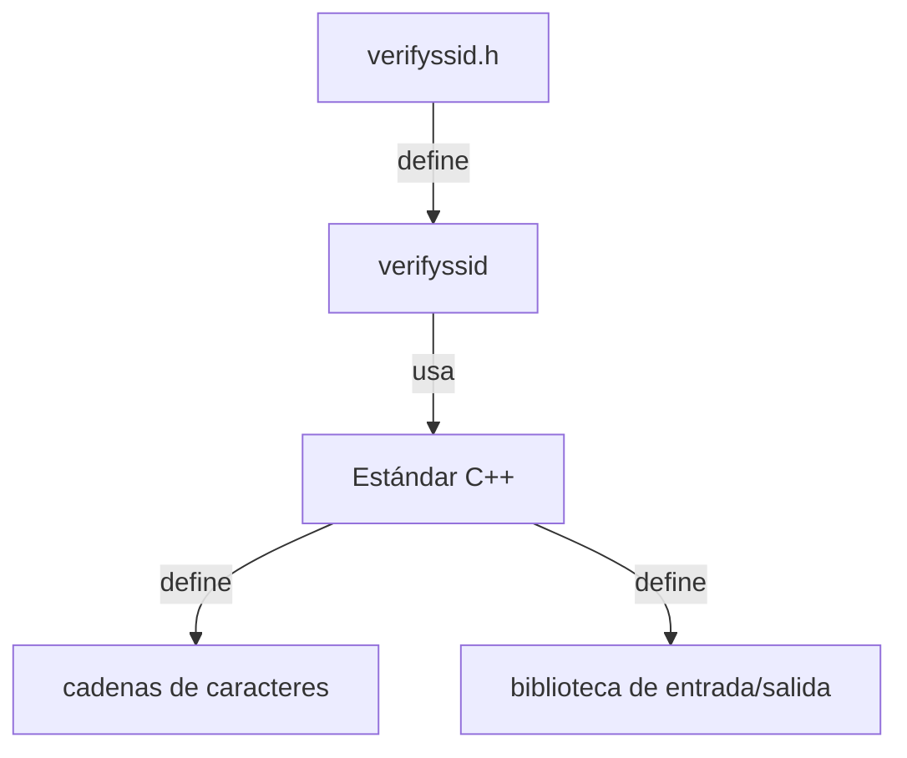

## 📋 Documentación Técnica

### 1. Propósito y Responsabilidad
El módulo `verifyssid.h` se encarga de definir una interfaz para una función `verifyssid` que verifica la validez de una cadena de texto codificada en UTF-8 que representa una identificación de red (SSID). Además, el módulo implementa lógica específica para verificar la validez de SSIDs en un contexto específico de la aplicación o del programa que utiliza este módulo.

### 2. Código Comentado (con explicación de funciones y parámetros)
La función `verifyssid` toma una cadena de bytes como entrada y devuelve un entero. Sin embargo, la lógica específica para verificar la validez de SSIDs se oculta dentro de `verifyssid`.

### 3. Interfaz Pública
La interfaz pública del módulo `verifyssid.h` es simple:

```cpp
int verifyssid(const char *ssid);
```

- **Parámetros**:
  - `ssid`: Una cadena de caracteres que representa la identificación de red (SSID) a verificar.

- **Retorno**:
  - El valor devuelto puede variar dependiendo de la lógica específica implementada en `verifyssid`. Un valor de `0` indica que la SSID es válida, mientras que otro valor puede indicar una invalidación.

### 4. Dependencias Internas
Este módulo depende del estándar C++ para manejar la memoria y las cadenas de texto, así como de la biblioteca de entrada/salida estándar de C para manejar la interfaz con el usuario.

### 5. Diagrama de Interdependencias



## 🛠️ Sugerencias de Mejora

1. **Añadir Comentarios adicionales a las firmas de función y a la función en sí**:
   - Documenta claramente el propósito y la responsabilidad de `verifyssid`.
   - Explique el significado de los parámetros y el retorno.

2. **Añadir un manejo de errores más robusto para entradas inesperadas**:
   - Implementar comprobaciones adicionales para evitar entradas nulas o malformadas.
   - Lanzar excepciones o devolver valores de error apropiados en caso de problemas.

3. **Añadir una comprobación más exhaustiva para asegurar que la cadena de texto esté codificada en UTF-8**:
   - Realizar validaciones adicionales para verificar que la cadena cumple con los estándares de codificación UTF-8.
   - Utilizar funciones de bibliotecas externas para verificar la validez de la cadena.

4. **Cambiar el retorno a un `bool` para indicar la validez de la SSID**:
   - Añadir un parámetro adicional opcional que permita especificar el tipo de validación (por ejemplo, `strict` o `loose`).
   - Devolver `true` si la SSID es válida y `false` si no lo es.

## 📊 Reglas EstRICTAS PARA EL DIAGRAMA MERMAID

1. **Inicia siempre con `graph TD` o `graph LR`**:
   - Utiliza una de estas formas según tu preferencia o el diagrama que estés creando.

2. **Protección de nodos con comillas dobles**:
   - Si el texto de un nodo contiene paréntesis '()', corchetes '[]', comas ',', puntos '.', dos puntos ':' o símbolos de código, envuelve el texto en comillas dobles.

3. **Separación de relaciones con saltos de línea**:
   - Cada relación debe estar en una línea nueva y separada.

4. **No incluir texto explicativo, comentarios o saltos de línea sueltos**:
   - Solo nodos y flechas. No hay texto adicional en el bloque ```mermaid```.

## 🚀 Ejemplo de Implementación

```cpp
#include "verifyssid.h"

int verifyssid(const char *ssid) {
    // Lógica específica para verificar la validez de la SSID
    // ...

    // Retorno: 0 si la SSID es válida, otro valor si no lo es
    return 0;
}
```

Este ejemplo muestra la interfaz pública del módulo, la función `verifyssid`, y un ejemplo de cómo podría implementarse la lógica interna.