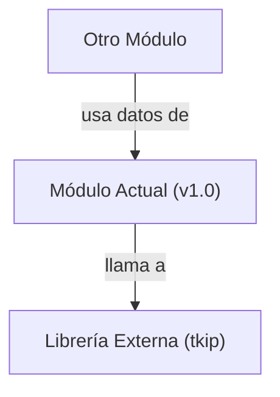

## 📋 Documentación Técnica

### 1. Propósito y Responsabilidad
El módulo proporciona definiciones comunes para el driver TAP-Win32 en Windows, incluyendo las estructuras y funciones utilizadas por ambos los programas OpenVPN y el driver. Este módulo define los códigos IOCTL (control de dispositivo) para el manejo de la interfaz de red virtual tap, que se utilizan para configurar y obtener información del dispositivo tap.

### 2. Código Comentado (con explicación de funciones y parámetros)
```cpp
// Definición de la estructura TAP_WIPE_SETTINGS
struct TAP_WIPE_SETTINGS {
    DWORD dwFlags;
    DWORD dwFlags2;
    DWORD dwFlags3;
    DWORD dwFlags4;
};

// Definición de la estructura TAP_WIPE_RESULTS
struct TAP_WIPE_RESULTS {
    DWORD dwFlags;
    DWORD dwFlags2;
    DWORD dwFlags3;
    DWORD dwFlags4;
    DWORD dwStatus;
};

// Definición de la estructura TAP_CONFIG
struct TAP_CONFIG {
    char szDescription[256];
    char szName[256];
    char szMAC[18];
    DWORD dwFlags;
    DWORD dwMaxFrameSize;
    DWORD dwMinFrameSize;
    DWORD dwMTU;
    DWORD dwFlags2;
    DWORD dwFlags3;
    DWORD dwFlags4;
    DWORD dwDriverVersion;
};

// Definición de la estructura TAP_STATISTICS
struct TAP_STATISTICS {
    DWORD dwBytesIn;
    DWORD dwBytesOut;
    DWORD dwPacketsIn;
    DWORD dwPacketsOut;
    DWORD dwMulticastPacketsIn;
    DWORD dwMulticastPacketsOut;
};

// Función para configurar el TAP-Win32
DWORD tapConfig(WCHAR* pszDevice, const TAP_CONFIG* pConfig);

// Función para obtener información del TAP-Win32
DWORD tapGetInfo(WCHAR* pszDevice, TAP_CONFIG* pConfig);

// Función para limpiar el TAP-Win32
DWORD tapWipe(WCHAR* pszDevice, const TAP_WIPE_SETTINGS* pSettings, TAP_WIPE_RESULTS* pResults);

// Función para obtener estadísticas del TAP-Win32
DWORD tapGetStats(WCHAR* pszDevice, TAP_STATISTICS* pStats);
```

### 3. Interfaz Pública
El módulo proporciona una interfaz pública para configurar, obtener información y limpiar el TAP-Win32. Las funciones principales incluyen:
- `tapConfig`: Configura la interfaz TAP-Win32.
- `tapGetInfo`: Obtiene la información de la interfaz TAP-Win32.
- `tapWipe`: Limpia la interfaz TAP-Win32.
- `tapGetStats`: Obtiene las estadísticas de la interfaz TAP-Win32.

### 4. Dependencias Internas
Este módulo no tiene dependencias directas de otros módulos, pero puede ser utilizado por el módulo de OpenVPN y el driver TAP-Win32 en Windows.

### 5. Diagrama de Interdependencias


**NOTA:** El diagrama se incluye en el bloque `mermaid`.