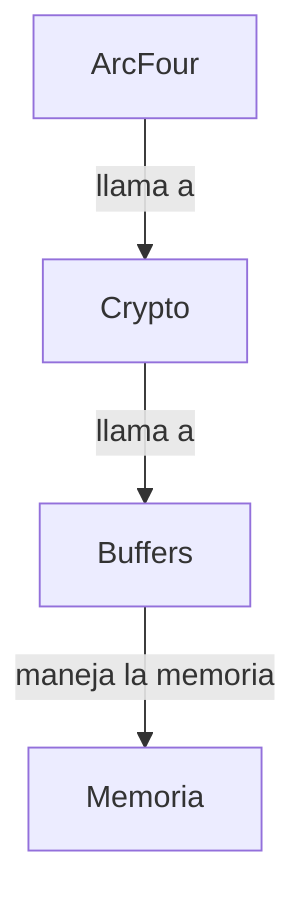

## 📋 Documentación Técnica

### 1. Propósito y Responsabilidad
El módulo ArcFour está diseñado para proporcionar cifrado de flujo RC4. Este cifrado es considerado débil y, por lo tanto, se recomienda utilizar cifrados más robustos para la seguridad de los datos.

### 2. Código Comentado (con explicación de funciones y parámetros)

```c
/**
 * @file arcfour.h
 * @brief Archivo de cabecera para el módulo de cifrado RC4.
 */

/**
 * @file arcfour.c
 * @brief Archivo de implementación para el módulo de cifrado RC4.
 *
 * Esta biblioteca proporciona funciones para el cifrado y descifrado RC4.
 */

/**
 * @struct Cipher_RC4_KEY
 * @brief Estructura para almacenar la clave de cifrado RC4.
 */
typedef struct {
    uint8_t m[256];  // Array para el estado interno del algoritmo.
    uint8_t x;        // Variable para el índice actual.
    uint8_t y;        // Variable para el índice actual.
} Cipher_RC4_KEY;

/**
 * @brief Función para inicializar la clave de RC4.
 *
 * @param ctx Puntero a la estructura Cipher_RC4_KEY.
 * @param key Puntero a la clave de cifrado.
 * @param key_length Tamaño de la clave.
 *
 * @return 0 en caso de éxito, -1 en caso de error.
 */
int Cipher_RC4_Init(Cipher_RC4_KEY *ctx, const uint8_t *key, size_t key_length);

/**
 * @brief Función para cifrar datos usando RC4.
 *
 * @param ctx Puntero a la estructura Cipher_RC4_KEY.
 * @param length Longitud de los datos a cifrar.
 * @param input Puntero a los datos a cifrar.
 * @param output Puntero al espacio donde se almacenarán los datos cifrados.
 *
 * @return 0 en caso de éxito, -1 en caso de error.
 */
int Cipher_RC4(Cipher_RC4_KEY *ctx, size_t length,
                const uint8_t input[static length],
                uint8_t output[static length] );
```

### 3. Interfaz Pública
El módulo ArcFour proporciona las siguientes funciones y estructuras:

- **Struct**: `Cipher_RC4_KEY`: Estructura que contiene los estados necesarios para el algoritmo RC4.
- **Función**: `Cipher_RC4_Init`: Función para inicializar la clave de RC4.
- **Función**: `Cipher_RC4`: Función para cifrar datos usando RC4.

### 4. Dependencias Internas
El módulo ArcFour depende de los módulos Crypto y Buffers para el manejo de la memoria y la implementación de las funciones de cifrado.

### 5. Diagrama de Interdependencias



Este diagrama muestra la dependencia del módulo ArcFour con los módulos Crypto y Buffers, y cómo estos últimos dependen de la memoria.