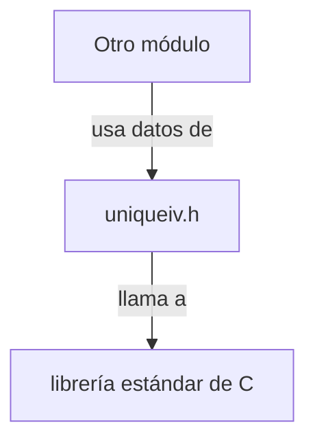

## 📋 Documentación Técnica

### 1. Propósito y Responsabilidad
El módulo `uniqueiv.h` se encarga de la administración de los vectores de inicialización (IV) únicos en un sistema WEP. Estos son códigos de inicialización únicos usados en los sistemas WEP para asegurar la integridad de los datos encapsulados en las tramas 802.11. El módulo proporciona interfaces para inicializar la estructura de datos, marcar un IV como presente y comprobar su presencia.

### 2. Código Comentado (con explicación de funciones y parámetros)
```cpp
#include <stddef.h> // Incluye la librería estándar de C
#include <stdlib.h> // Incluye la librería estándar de C

// Estructura que contiene los vectores de inicialización únicos
struct uniqueiv {
    // Atributo que almacena los vectores de inicialización
    // Este atributo es un puntero a un arreglo de longitudes de 64 bits
    unsigned long long *ivs;
    // Atributo que almacena el número de vectores de inicialización
    size_t iv_count;
};

// Función que inicializa la estructura de datos
// Recibe un puntero a un puntero a una estructura uniqueiv
void uniqueiv_init(struct uniqueiv **ivs);

// Función que marca un IV como presente
// Recibe un puntero a una estructura uniqueiv y el IV a marcar
void uniqueiv_mark(struct uniqueiv *ivs, unsigned long long iv);

// Función que comprueba si un IV está presente
// Recibe un puntero a una estructura uniqueiv y el IV a comprobar
bool uniqueiv_check(struct uniqueiv *ivs, unsigned long long iv);

// Función que elimina la estructura de datos
// Recibe un puntero a una estructura uniqueiv
void uniqueiv_wipe(struct uniqueiv *ivs);

// Funciones auxiliares para la gestión de datos de claves WEP
void data_init(void **data);
bool data_check(void *data, void *value);
void data_wipe(void **data);
```

### 3. Interfaz Pública
La interfaz pública del módulo `uniqueiv.h` se compone de las siguientes funciones y clases:

- `uniqueiv_init`: Inicializa la estructura de datos.
- `uniqueiv_mark`: Marca un IV como presente.
- `uniqueiv_check`: Comprueba si un IV está presente.
- `uniqueiv_wipe`: Elimina la estructura de datos.
- `data_init`, `data_check` y `data_wipe`: Funciones auxiliares para la gestión de datos de claves WEP.

### 4. Dependencias Internas
El módulo `uniqueiv.h` no parece depender de ningún otro módulo específico de la aplicación. Sin embargo, parece depender de la biblioteca estándar de C.

### 5. Diagrama de Interdependencias



Este diagrama representa el interconexión entre el módulo `uniqueiv.h` y la biblioteca estándar de C, así como la dependencia de este módulo con otros módulos que pueden utilizar sus funciones.