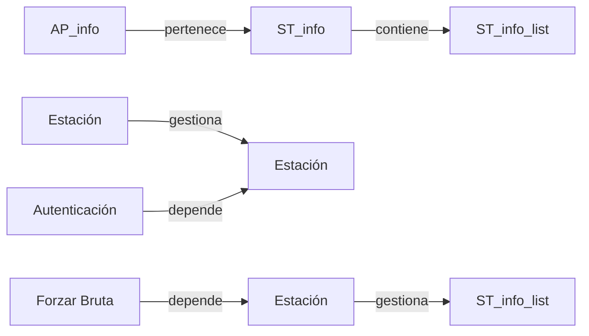

## 📋 Documentación Técnica

### 1. Propósito y Responsabilidad

El módulo **estación** se encarga de gestionar la información de las estaciones (STAs) detectadas en el medio Wi-Fi. Proporciona la lista enlazada de las estaciones detectadas y sus características relevantes para su posterior análisis y manejo.

### 2. Código Comentado (con explicación de funciones y parámetros)

```cpp
// AP_info: contiene toda la información relacionada con el punto de acceso (AP) al que pertenece la estación.
class AP_info {
public:
    std::string BSSID;  // Dirección BSSID del AP
    std::string SSID;    // Nombre del SSID
    uint8_t channel;    // Canal Wi-Fi al que pertenece el AP
    uint32_t RSSI;     // Nivel de ruido de la señal (Signal Strength Indicator)
    std::string MAC;     // Dirección MAC del AP

    // Constructor para inicializar una AP_info
    AP_info(const std::string& BSSID, const std::string& SSID, uint8_t channel, uint32_t RSSI, const std::string& MAC)
        : BSSID(BSSID), SSID(SSID), channel(channel), RSSI(RSSI), MAC(MAC) {}
};

// ST_info: almacena toda la información relacionada con la estación. Proporciona una lista enlazada de las estaciones y su información relevante.
class ST_info {
public:
    std::string MAC;     // Dirección MAC de la estación
    std::string BSSID;  // Dirección BSSID del AP al que se conecta la estación
    uint8_t channel;    // Canal Wi-Fi al que se conecta la estación
    uint32_t RSSI;     // Nivel de ruido de la señal (Signal Strength Indicator)
    uint16_t beacon_interval; // Intervalo entre beacon frames
    uint16_t capability_info; // Información de capacidades del AP

    // Constructor para inicializar una ST_info
    ST_info(const std::string& MAC, const std::string& BSSID, uint8_t channel, uint32_t RSSI, uint16_t beacon_interval, uint16_t capability_info)
        : MAC(MAC), BSSID(BSSID), channel(channel), RSSI(RSSI), beacon_interval(beacon_interval), capability_info(capability_info) {}
};

// Lista enlazada para almacenar las estaciones detectadas
class ST_info_list {
private:
    ST_info* head;
    ST_info* tail;

public:
    // Constructor y destructor
    ST_info_list() : head(nullptr), tail(nullptr) {}
    ~ST_info_list();

    // Insertar una estación en la lista enlazada
    void insert(const ST_info& station);

    // Eliminar una estación de la lista enlazada
    void remove(const std::string& MAC);

    // Obtener una estación de la lista enlazada
    ST_info* get(const std::string& MAC) const;
};
```

### 3. Interfaz Pública

El módulo **estación** proporciona los siguientes métodos para su uso:

- **insert(const ST_info& station)**: Inserta una nueva estación en la lista enlazada.
- **remove(const std::string& MAC)**: Elimina una estación de la lista enlazada a partir de su dirección MAC.
- **get(const std::string& MAC) const**: Obtiene una estación de la lista enlazada a partir de su dirección MAC.

### 4. Dependencias Internas

Este módulo depende de otros módulos como el de autenticación y el de fuerza bruta. También depende de bibliotecas externas como libnl para la manipulación de paquetes de red y libgcrypt para la generación de claves de WPA.

### 5. Diagrama de Interdependencias



REGLAS ESTRICTAS PARA EL DIAGRAMA MERMAID (¡CRUCIAL!):
1. Inicia siempre con `graph TD` o `graph LR`.
2. Si el texto de un nodo contiene paréntesis '()', corchetes '[]', comas ',', puntos '.', dos puntos ':' o símbolos de código, DEBES envolverlo obligatoriamente en comillas dobles.
   - ❌ INCORRECTO: `A[socket(AF_INET, SOCK_DGRAM)] --> B[Procesar]`
   - ✅ CORRECTO: `A["socket(AF_INET, SOCK_DGRAM)"] --> B["Procesar"]`
3. Cada relación (flecha) debe estar en una línea nueva y separada.
4. No incluyas texto explicativo, comentarios o saltos de línea sueltos dentro del bloque ```mermaid. Solo nodos y flechas.