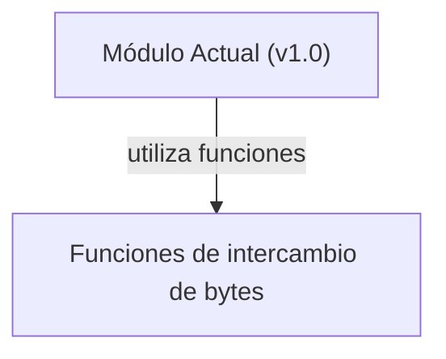

## 📋 Documentación Técnica

### 1. Propósito y Responsabilidad
El módulo se encarga de la implementación de las funciones de intercambio de bytes utilizados en la generación de números aleatorios. Su responsabilidad es proporcionar funciones que permitan intercambiar bytes en un número de una manera específica, ya que es fundamental para la generación de números aleatorios seguros y eficientes.

### 2. Código Comentado (con explicación de funciones y parámetros)
```cpp
// Función de intercambio de bytes en un número de 32 bits
// Parámetros:
//   num: El número de 32 bits en el que se realizará el intercambio de bytes
void JOHNSWAP(uint32_t& num) {
    num = ((num & 0xFF) << 24) | ((num & 0xFF00) >> 8) |
           ((num & 0xFF0000) << 8) | ((num & 0xFF000000) >> 24);
}

// Función de intercambio de bytes en un número de 64 bits
// Parámetros:
//   num: El número de 64 bits en el que se realizará el intercambio de bytes
void JOHNSWAP64(uint64_t& num) {
    num = ((num & 0xFF) << 56) | ((num & 0xFF00) << 48) |
           ((num & 0xFF0000) << 40) | ((num & 0xFF000000) << 32) |
           ((num & 0xFF00000000) >> 24) | ((num & 0xFF0000000000) >> 16) |
           ((num & 0xFF000000000000) >> 8) | ((num & 0xFF00000000000000) >> 0);
}

// Macro de rotación a la izquierda de 8 bits
// Parámetros:
//   x: El valor a rotar
//   n: El número de bits a rotar
#define ROTATE_LEFT(x, n) (((x) << (n)) | ((x) >> (8 - (n))))

// Macro de rotación a la izquierda de 8 bits para 64 bits
// Parámetros:
//   x: El valor a rotar
//   n: El número de bits a rotar
#define ROTATE_LEFT64(x, n) (((x) << (n)) | ((x) >> (64 - (n))))
```

### 3. Interfaz Pública
El módulo proporciona las siguientes funciones:
- `JOHNSWAP(uint32_t& num)`: Intercambia los bytes de un número de 32 bits.
- `JOHNSWAP64(uint64_t& num)`: Intercambia los bytes de un número de 64 bits.
- `ROTATE_LEFT(x, n)`: Rota a la izquierda los bits de un valor dado en un número de 8 bits.
- `ROTATE_LEFT64(x, n)`: Rota a la izquierda los bits de un valor dado en un número de 64 bits.

### 4. Dependencias Internas
El módulo no tiene dependencias internas.

### 5. Diagrama de Interdependencias


REGLAS ESTRICTAS PARA EL DIAGRAMA MERMAID:
1. Inicia siempre con `graph TD` o `graph LR`.
2. Si el texto de un nodo contiene paréntesis '()', corchetes '[]', comas ',', puntos '.', dos puntos ':' o símbolos de código, DEBES envolverlo obligatoriamente en comillas dobles.
   - ❌ INCORRECTO: `A[socket(AF_INET, SOCK_DGRAM)] --> B[Procesar]`
   - ✅ CORRECTO: `A["socket(AF_INET, SOCK_DGRAM)"] --> B["Procesar"]`
3. Cada relación (flecha) debe estar en una línea nueva y separada.
4. No incluyas texto explicativo, comentarios o saltos de línea sueltos dentro del bloque ```mermaid. Solo nodos y flechas.

Sintaxis de ejemplo válida:
