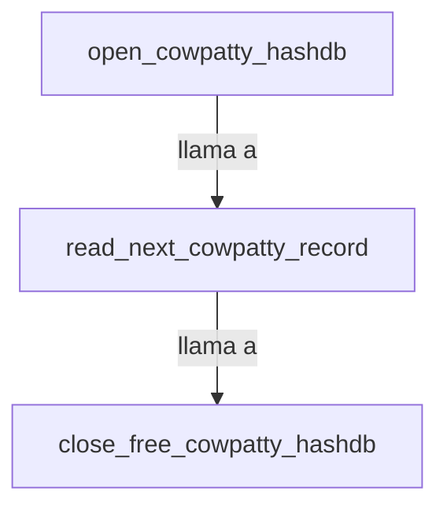

```markdown
## 📋 Documentación Técnica

### 1. Propósito y Responsabilidad

El módulo `cowpatty_hashdb.c` se encarga de la gestión y manipulación de archivos de base de datos de hash utilizados por coWPAtty, un programa de aircrack-ng diseñado para descifrar contraseñas WEP. Los principales aspectos del módulo incluyen abrir, leer y cerrar archivos de hash, así como la creación y destrucción de registros de hash.

### 2. Código Comentado (con explicación de funciones y parámetros)

```c
// Abre un archivo de hash.
// Parámetros:
//   - filename: Nombre del archivo de hash a abrir.
//   - hashdb: Puntero a la estructura hashdb_head que contendrá los datos del archivo abierto.
// Retorno:
//   - 0 si se abre correctamente, -1 en caso de error.
int open_cowpatty_hashdb(const char *filename, hashdb_head **hashdb) {
    // Lógica para abrir el archivo y cargar la estructura hashdb.
}

// Lee el siguiente registro del archivo de hash.
// Parámetros:
//   - hashdb: Puntero a la estructura hashdb_head que contiene los datos del archivo abierto.
// Retorno:
//   - Un puntero al siguiente registro en el archivo, NULL si se llega al final o en caso de error.
hash_record *read_next_cowpatty_record(hashdb_head *hashdb) {
    // Lógica para leer el siguiente registro del archivo.
}

// Cierra un archivo de hash liberando la memoria.
// Parámetros:
//   - hashdb: Puntero a la estructura hashdb_head que contiene los datos del archivo abierto.
// Retorno:
//   - 0 si se cierra correctamente, -1 en caso de error.
int close_free_cowpatty_hashdb(hashdb_head *hashdb) {
    // Lógica para cerrar el archivo y liberar la memoria asociada a hashdb.
}
```

### 3. Interfaz Pública

El módulo proporciona una interfaz pública mediante tres funciones principales:
- `open_cowpatty_hashdb`: Abre un archivo de hash y devuelve un puntero a la estructura `hashdb_head`.
- `read_next_cowpatty_record`: Lee el siguiente registro de un archivo de hash abierto y devuelve un puntero al registro.
- `close_free_cowpatty_hashdb`: Cierra un archivo de hash y libera la memoria asociada a la estructura `hashdb_head`.

### 4. Dependencias Internas

El módulo depende de:
- La biblioteca estándar de C para manejo de archivos.
- La biblioteca estándar de C para manejo de enteros de 32 bits.
- La biblioteca estándar de C para manejo de cadenas.
- La biblioteca estándar de C para manejo de memoria.

### 5. Diagrama de Interdependencias



Este diagrama muestra la interacción entre las funciones principales del módulo `cowpatty_hashdb.c`.
```