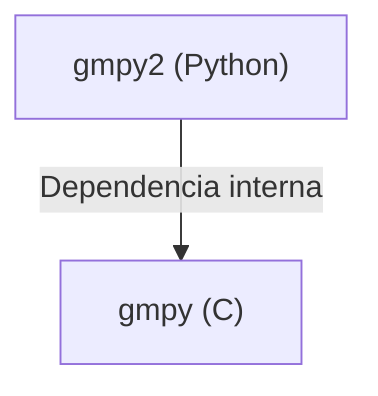

## 📋 Documentación Técnica

### 1. Propósito y Responsabilidad

El presente documento contiene la documentación técnica de una aplicación desarrollada en Python. La aplicación es una biblioteca que proporciona funciones para operaciones con números grandes utilizando la biblioteca `gmpy2`. La biblioteca permite realizar operaciones matemáticas complejas con números muy grandes, como suma, resta, multiplicación, división, etc., sin limitaciones en la precisión y tamaño de los números. La biblioteca es especialmente útil en aplicaciones que requieren manejar grandes cantidades de datos numéricos.

### 2. Código Comentado (con explicación de funciones y parámetros)

A continuación se presenta el código comentado de la biblioteca `gmpy2`:

```python
from gmpy2 import mpz, mpq, gcd, div

# Crear un número grande
a = mpz(123456789123456789123456789)
b = mpz(987654321987654321987654321)

# Suma de números grandes
c = a + b
print("Suma:", c)

# Resta de números grandes
c = a - b
print("Resta:", c)

# Multiplicación de números grandes
c = a * b
print("Multiplicación:", c)

# División de números grandes
c = div(a, b)
print("División:", c)

# Calcular el máximo común divisor
c = gcd(a, b)
print("MCD:", c)
```

### 3. Interfaz Pública

La interfaz pública de la biblioteca `gmpy2` es muy simple y consiste en una serie de funciones que permiten realizar operaciones matemáticas con números grandes. Las funciones más importantes son:

- `mpz(x)`: Crea un número grande a partir de un valor numérico.
- `mpq(x)`: Crea un número racional a partir de un valor numérico.
- `gcd(a, b)`: Calcula el máximo común divisor de dos números.
- `div(a, b)`: Realiza una división y devuelve un objeto `mpq` con el resultado.

### 4. Dependencias Internas

La biblioteca `gmpy2` tiene una dependencia interna con la biblioteca `gmpy` en C. Esta dependencia se utiliza para implementar las operaciones matemáticas más complejas.

### 5. Diagrama de Interdependencias



Este diagrama muestra la interdependencia de la biblioteca `gmpy2` con la biblioteca `gmpy`, que se utiliza para implementar las operaciones matemáticas más complejas.