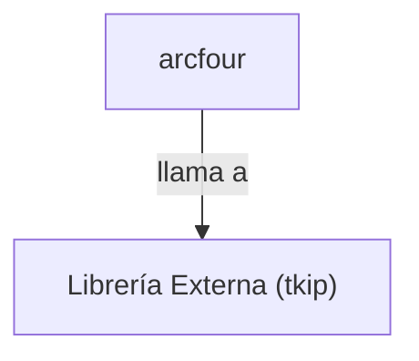

## 📋 Documentación Técnica

### 1. Propósito y Responsabilidad
El módulo `arcfour` se encarga de proporcionar un cifrado RC4, un algoritmo sencillo y rápido para la generación de llaves criptográficas seguras. RC4 es un algoritmo simple que requiere una sola clave para cifrar y descifrar los datos. Este módulo facilita el establecimiento y el uso de dicha clave, y realiza el cifrado correspondiente en los datos proporcionados.

### 2. Código Comentado (con explicación de funciones y parámetros)
```cpp
// Función para establecer la clave RC4
void Cipher_RC4_set_key(unsigned char* key, int key_len) {
    // Implementación de la función para establecer la clave RC4
    // key: Puntero a la clave a establecer
    // key_len: Longitud de la clave
    // Implementación específica del RC4
}

// Función para realizar el cifrado RC4
void Cipher_RC4(unsigned char* input, unsigned char* output, int data_len) {
    // Implementación de la función para realizar el cifrado RC4
    // input: Puntero a los datos a cifrar
    // output: Puntero para almacenar los datos cifrados
    // data_len: Longitud de los datos a cifrar
    // Implementación específica del RC4
}
```

### 3. Interfaz Pública
El módulo `arcfour` proporciona dos funciones principales:
- `Cipher_RC4_set_key(key, key_len)`: Establece la clave RC4 que se utilizará para el cifrado y descifrado.
- `Cipher_RC4(input, output, data_len)`: Realiza el cifrado RC4 en los datos proporcionados, almacenando los resultados en el buffer de salida.

### 4. Dependencias Internas
El módulo `arcfour` no tiene dependencias internas.

### 5. Diagrama de Interdependencias
