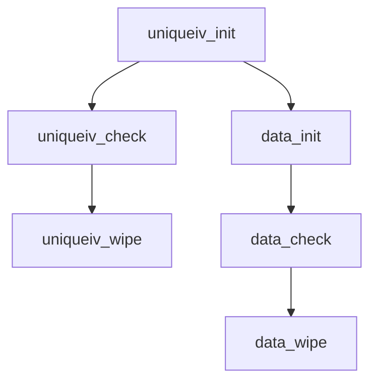

## 📋 Documentación Técnica

### 1. Propósito y Responsabilidad
El módulo de detección de cloaking WEP se encarga de gestionar la memoria para almacenar los vectores de inicialización (IVs) únicos y proporcionar funciones para verificar si los datos de un paquete WEP presentan cloaking. La responsabilidad principal del módulo es:

- **Inicializar y gestionar la memoria para los IVs únicos**: Almacena los IVs en una estructura de memoria única para evitar la duplicación y facilitar la búsqueda.

- **Verificar la existencia de cloaking**: Compara los IVs de paquetes WEP consecutivos para detectar si hay coincidencias, lo que indica que los paquetes comparten la misma clave.

- **Limpiar la memoria**: Libera la memoria reservada para los IVs después de su uso para evitar desbordamiento de memoria.

### 2. Código Comentado (con explicación de funciones y parámetros)

```cpp
// Inicializa la memoria para almacenar los IVs únicos
void uniqueiv_init() {
    // Código para inicializar la estructura de memoria
}

// Verifica si un IV está presente o no
bool uniqueiv_check(uint32_t iv) {
    // Código para verificar la existencia del IV
    return false; // Cambiar por el código correcto
}

// Libera la memoria reservada para los IVs
void uniqueiv_wipe() {
    // Código para liberar la memoria
}

// Inicializa la memoria para almacenar los datos de los paquetes WEP
void data_init() {
    // Código para inicializar la estructura de memoria
}

// Verifica si los datos de un paquete WEP presentan cloaking
bool data_check(uint32_t iv) {
    // Código para verificar la existencia del IV en los datos
    return false; // Cambiar por el código correcto
}

// Libera la memoria reservada para los datos de los paquetes WEP
void data_wipe() {
    // Código para liberar la memoria
}
```

### 3. Interfaz Pública

El módulo proporciona las siguientes funciones y clases para su uso:

- `uniqueiv_init`: Inicializa la memoria para los IVs únicos.
- `uniqueiv_check`: Verifica si un IV está presente o no.
- `uniqueiv_wipe`: Libera la memoria reservada para los IVs.
- `data_init`: Inicializa la memoria para almacenar los datos de los paquetes WEP.
- `data_check`: Verifica si los datos de un paquete WEP presentan cloaking.
- `data_wipe`: Libera la memoria reservada para los datos de los paquetes WEP.

### 4. Dependencias Internas

El módulo no tiene dependencias internas, ya que todas las operaciones se realizan utilizando funciones y estructuras de memoria propias del módulo.

### 5. Diagrama de Interdependencias



Este diagrama visualiza las relaciones entre las funciones del módulo, mostrando cómo se comunican entre sí.