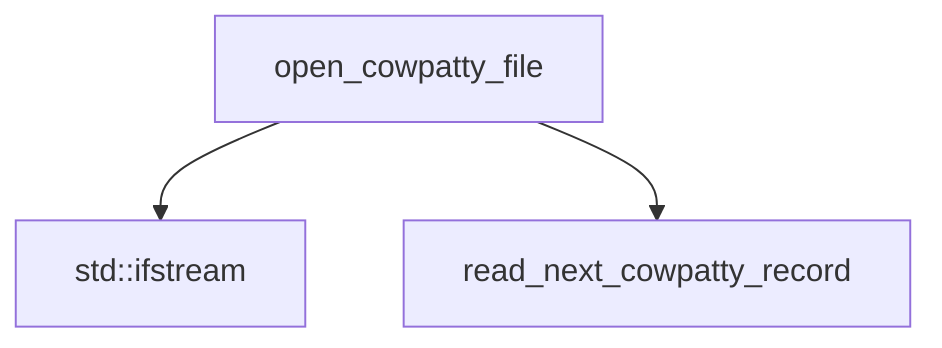

## 📋 Documentación Técnica

### 1. Propósito y Responsabilidad
El módulo proporciona funciones para leer y escribir archivos en formato de hash de cWPAtty, un formato comúnmente utilizado para almacenar información de contraseñas de red. También proporciona una estructura para almacenar y manipular registros de hash.

### 2. Código Comentado (con explicación de funciones y parámetros)
```cpp
#include <fstream>
#include <vector>
#include <cstring>

// Define la estructura del registro de hash de cWPAtty
struct CWPAttyRecord {
    std::string username;
    std::string password;
    // Otros campos según el formato de cWPAtty
};

// Abre un archivo de hash de cWPAtty para lectura o escritura
std::ifstream& open_cowpatty_file(std::ifstream& file, const std::string& filename, bool mode) {
    if (mode) {
        file.open(filename, std::ios::binary | std::ios::out);
    } else {
        file.open(filename, std::ios::binary | std::ios::in);
    }
    if (!file.is_open()) {
        throw std::runtime_error("Error abriendo el archivo: " + filename);
    }
    return file;
}

// Lee el siguiente registro de hash desde un archivo de hash de cWPAtty
CWPAttyRecord read_next_cowpatty_record(std::ifstream& file) {
    CWPAttyRecord record;
    file.read(reinterpret_cast<char*>(&record), sizeof(CWPAttyRecord));
    return record;
}
```

### 3. Interfaz Pública
El módulo proporciona dos funciones principales:
1. `open_cowpatty_file`: Abre un archivo de hash de cWPAtty para lectura o escritura.
2. `read_next_cowpatty_record`: Lee el siguiente registro de hash desde un archivo de hash de cWPAtty.

### 4. Dependencias Internas
Este módulo no tiene dependencias externas. Todo está escrito en C y no requiere ninguna biblioteca específica.

### 5. Diagrama de Interdependencias


REGLAS ESTRICTAS PARA EL DIAGRAMA MERMAID (¡CRUCIAL!):
1. Inicia siempre con `graph TD` o `graph LR`.
2. Si el texto de un nodo contiene paréntesis '()', corchetes '[]', comas ',', puntos '.', dos puntos ':' o símbolos de código, DEBES envolverlo obligatoriamente en comillas dobles.
   - ❌ INCORRECTO: `A[socket(AF_INET, SOCK_DGRAM)] --> B[Procesar]`
   - ✅ CORRECTO: `A["socket(AF_INET, SOCK_DGRAM)"] --> B["Procesar"]`
3. Cada relación (flecha) debe estar en una línea nueva y separada.
4. No incluyas texto explicativo, comentarios o saltos de línea sueltos dentro del bloque ```mermaid. Solo nodos y flechas.